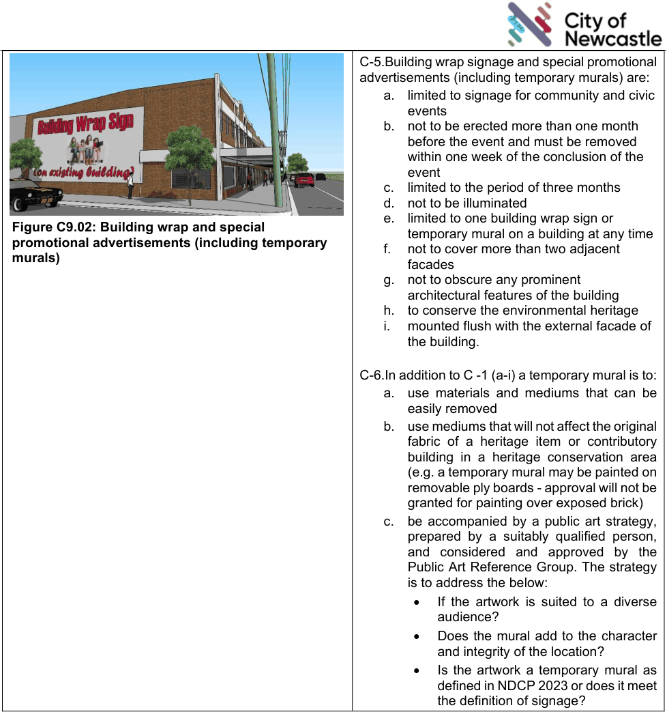
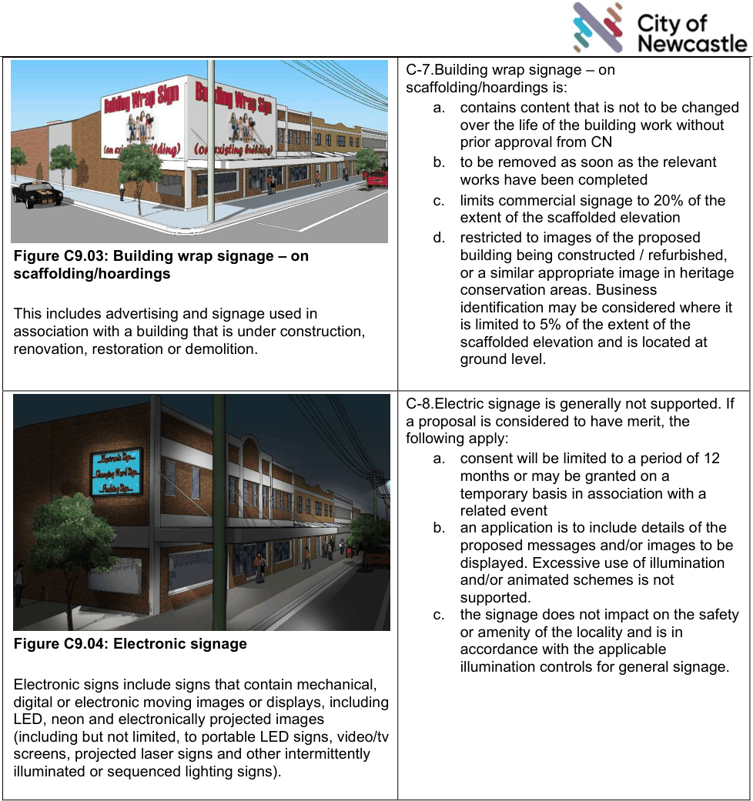
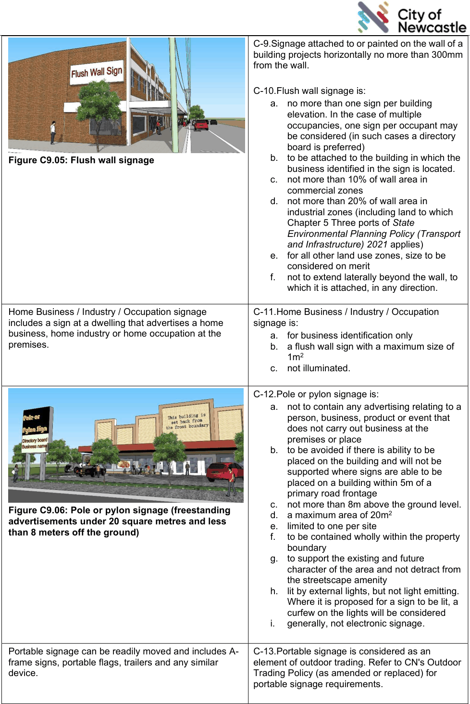
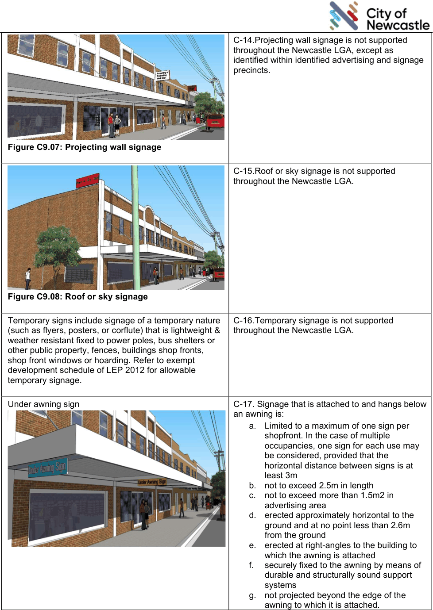

### 8.0 Signage types

| Signage type / definition | Control |
|---|---|
| Figure C9.01: Above awning signage Signage which is displayed above an awning. | C-1.Above awning signage is not supported throughout the Newcastle local government area (LGA). |
| Billboards (advertisements with display area greater than 45 square metres) | C-2. Billboards with an advertising display area greater than 45m2 are not permitted unless they are on transport corridor land as reflected in State Environmental Planning Policy (Industry and Employment) 2021. |
| Billboards (advertisements with display area greater than 20 square metres or higher than 8 metres above ground) | C-3.Billboards are discouraged and: a. must not contain any advertising relating to a person, business, product or event that does not carry out business at the premises or place. b. should be avoided if there is ability to be placed on the building and will not be supported where signs are able to be placed on a building within 5m of a primary road frontage. c. are kept to a maximum of one per site d. are to be contained wholly within the property boundary. e. should support the existing and future character of the area and not detract from the streetscape amenity. f. may be lit by external lights, but not light emitting. Where it is proposed for a sign to be lit, a curfew on the lights will be considered. g. will generally not host electronic signage. |
| Building identification signage | C-4.A building identification sign is limited to naming or identifying the building owner or tenant occupying the largest amount of floorspace relative to other occupants within the building. Note: Refer to State Environmental Planning Policy (Exempt and Complying Development Codes) 2008 for minimum requirements. |

> [Picture on page 6: a picture, saved as a picture (images/section-c9-advertising-and-signage-page-6-1.gif, 150 dpi).]
> [Picture text on page 6 is stored in the PDF without readable letters (no character map), so it could not be copied; see the original PDF.]
> Words printed on the picture (title and legend, copied from the PDF):
> events
> facades
> the building.
> easily removed

C-5.Building wrap signage and special promotional advertisements (including temporary murals) are:

a. limited to signage for community and civic

b. not to be erected more than one month before the event and must be removed within one week of the conclusion of the event

c. limited to the period of three months

d. not to be illuminated

e. limited to one building wrap sign or

Figure C9.02: Building wrap and special promotional advertisements (including temporary murals)

temporary mural on a building at any time

f. not to cover more than two adjacent

g. not to obscure any prominent architectural features of the building

h. to conserve the environmental heritage

i. mounted flush with the external facade of

C-6.In addition to C -1 (a-i) a temporary mural is to:

a. use materials and mediums that can be

b. use mediums that will not affect the original fabric of a heritage item or contributory building in a heritage conservation area (e.g. a temporary mural may be painted on removable ply boards - approval will not be granted for painting over exposed brick)

c. be accompanied by a public art strategy, prepared by a suitably qualified person, and considered and approved by the Public Art Reference Group. The strategy is to address the below: If the artwork is suited to a diverse audience? Does the mural add to the character and integrity of the location? Is the artwork a temporary mural as defined in NDCP 2023 or does it meet the definition of signage?

> [Picture on page 7: a picture, saved as a picture (images/section-c9-advertising-and-signage-page-7-1.gif, 150 dpi).]
> Words printed on the picture (title and legend, copied from the PDF):
> works have been completed

Figure C9.03: Building wrap signage – on scaffolding/hoardings

This includes advertising and signage used in association with a building that is under construction, renovation, restoration or demolition.

#### Figure C9.04: Electronic signage

C-7.Building wrap signage – on scaffolding/hoardings is:

a. contains content that is not to be changed over the life of the building work without prior approval from CN

b. to be removed as soon as the relevant

c. limits commercial signage to 20% of the extent of the scaffolded elevation

d. restricted to images of the proposed building being constructed / refurbished, or a similar appropriate image in heritage conservation areas. Business identification may be considered where it is limited to 5% of the extent of the scaffolded elevation and is located at ground level.

C-8.Electric signage is generally not supported. If a proposal is considered to have merit, the following apply:

a. consent will be limited to a period of 12 months or may be granted on a temporary basis in association with a related event

b. an application is to include details of the proposed messages and/or images to be displayed. Excessive use of illumination and/or animated schemes is not supported.

c. the signage does not impact on the safety or amenity of the locality and is in accordance with the applicable illumination controls for general signage.

Electronic signs include signs that contain mechanical, digital or electronic moving images or displays, including LED, neon and electronically projected images (including but not limited, to portable LED signs, video/tv screens, projected laser signs and other intermittently illuminated or sequenced lighting signs).

> [Picture on page 8: a picture, saved as a picture (images/section-c9-advertising-and-signage-page-8-1.gif, 150 dpi).]
> Words printed on the picture (title and legend, copied from the PDF):
> C-10.Flush wall signage is:
> commercial zones
> considered on merit
> 1m2
> c. not illuminated.
> boundary

#### Figure C9.05: Flush wall signage

Home Business / Industry / Occupation signage includes a sign at a dwelling that advertises a home business, home industry or home occupation at the premises.

Figure C9.06: Pole or pylon signage (freestanding advertisements under 20 square metres and less than 8 meters off the ground)

Portable signage can be readily moved and includes A-frame signs, portable flags, trailers and any similar device.

C-9.Signage attached to or painted on the wall of a building projects horizontally no more than 300mm from the wall.

a. no more than one sign per building elevation. In the case of multiple occupancies, one sign per occupant may be considered (in such cases a directory board is preferred)

b. to be attached to the building in which the business identified in the sign is located.

c. not more than 10% of wall area in

d. not more than 20% of wall area in industrial zones (including land to which Chapter 5 Three ports of State Environmental Planning Policy (Transport and Infrastructure) 2021 applies)

e. for all other land use zones, size to be

C-11.Home Business / Industry / Occupation signage is:

f. not to extend laterally beyond the wall, to which it is attached, in any direction.

a. for business identification only

b. a flush wall sign with a maximum size of

C-12.Pole or pylon signage is:

a. not to contain any advertising relating to a person, business, product or event that does not carry out business at the premises or place

b. to be avoided if there is ability to be placed on the building and will not be supported where signs are able to be placed on a building within 5m of a primary road frontage

c. not more than 8m above the ground level.

d. a maximum area of 20m2

e. limited to one per site

f. to be contained wholly within the property

g. to support the existing and future character of the area and not detract from the streetscape amenity

h. lit by external lights, but not light emitting. Where it is proposed for a sign to be lit, a curfew on the lights will be considered

i. generally, not electronic signage.

C-13.Portable signage is considered as an element of outdoor trading. Refer to CN's Outdoor Trading Policy (as amended or replaced) for portable signage requirements.

> [Picture on page 9: a picture, saved as a picture (images/section-c9-advertising-and-signage-page-9-1.gif, 150 dpi).]
> Words printed on the picture (title and legend, copied from the PDF):
> Under awning sign
> advertising area

#### Figure C9.07: Projecting wall signage

#### Figure C9.08: Roof or sky signage

Temporary signs include signage of a temporary nature (such as flyers, posters, or corflute) that is lightweight & weather resistant fixed to power poles, bus shelters or other public property, fences, buildings shop fronts, shop front windows or hoarding. Refer to exempt development schedule of LEP 2012 for allowable temporary signage.

C-14.Projecting wall signage is not supported throughout the Newcastle LGA, except as identified within identified advertising and signage precincts.

C-15.Roof or sky signage is not supported throughout the Newcastle LGA.

C-16.Temporary signage is not supported throughout the Newcastle LGA.

C-17. Signage that is attached to and hangs below an awning is:

a. Limited to a maximum of one sign per shopfront. In the case of multiple occupancies, one sign for each use may be considered, provided that the horizontal distance between signs is at least 3m

b. not to exceed 2.5m in length

c. not to exceed more than 1.5m2 in

d. erected approximately horizontal to the ground and at no point less than 2.6m from the ground

e. erected at right-angles to the building to which the awning is attached

f. securely fixed to the awning by means of durable and structurally sound support systems

g. not projected beyond the edge of the awning to which it is attached.

Window signage includes both business identification and advertising inside the area of a window. It should encourage interactivity and cross movement and not restrict opportunities for surveillance between the public and private domains.

C-18.Window signage:

h. does not occupy more than 15% or 6m2 (whichever is the lesser) of the glazed surface of the window in which it is displayed

i. is not illuminated

j. does not contain LED/Electronic messages

k. is located at ground level.

|  | Development zones |  |  |  |
|---|---|---|---|---|
| Signage type | Residential | Commercial | Industrial | Heritage conservation area / item |
| Above awning signage | x | x | x | x |
| Billboard | x |  | x | x |
| Building identification signage |  |  |  |  |
| Building wrap sign (completed buildings) | x |  | x | x |
| Building wrap sign (on scaffolding/hoardings) | (as temporary use only) |  |  |  |
| Directory board | x |  |  | x |
| Electronic signage | x |  |  | x |
| Flush wall sign | x |  |  |  |
| Home business/ home industry / home occupation sign | (as exempt development) |  |  |  |
| Illuminated sign | x |  |  | x |
| Portable signage |  |  |  |  |
| Pole or pylon sign | x |  |  | x |
| Projecting wall signage | x |  |  | x |
| Roof or sky signage | x | x | x | x |
| Temporary sign | x | x | x | x |
| Under awning sign | x |  | x |  |
| Window sign | x |  |  |  |
| Note: Signs within special use, recreation and environmental zones will be considered having regard to the general controls and the surrounding context. |  |  |  |  |

> [Picture text on page 11 is stored in the PDF without readable letters (no character map), so it could not be copied; see the original PDF.]

Table C9.01: Development zones and supported signage types (general guidance only)

| Key |  |
|---|---|
| Symbol | Meaning Generally supported in zone (check relevant environmental planning instruments) |
| x | Generally not supported in zone |
