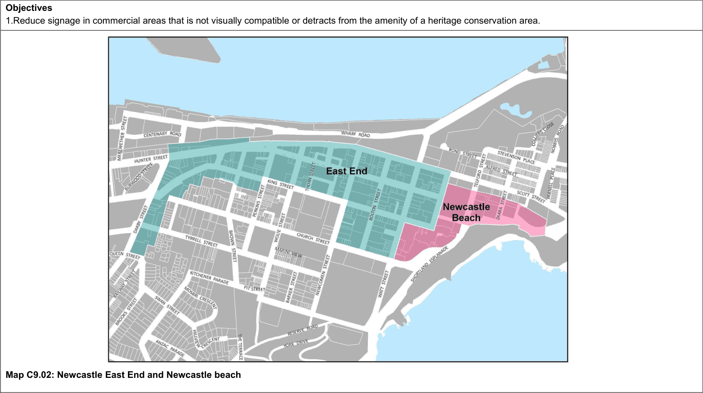
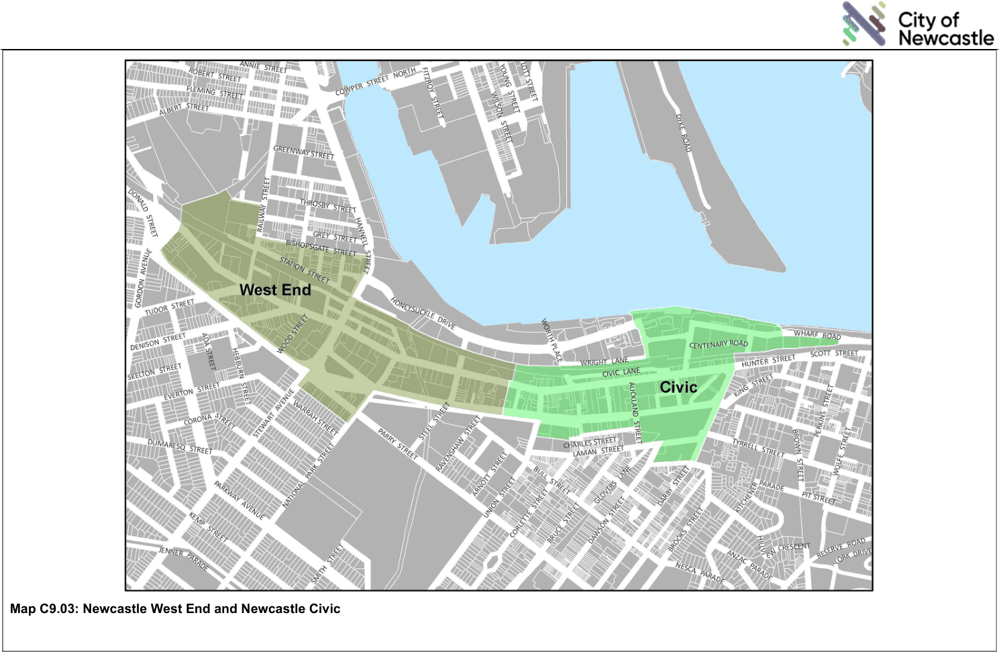
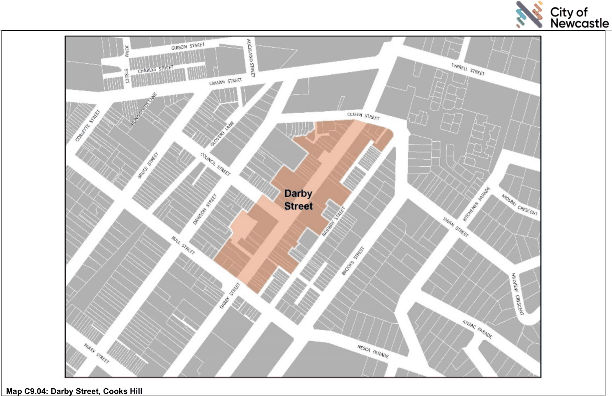
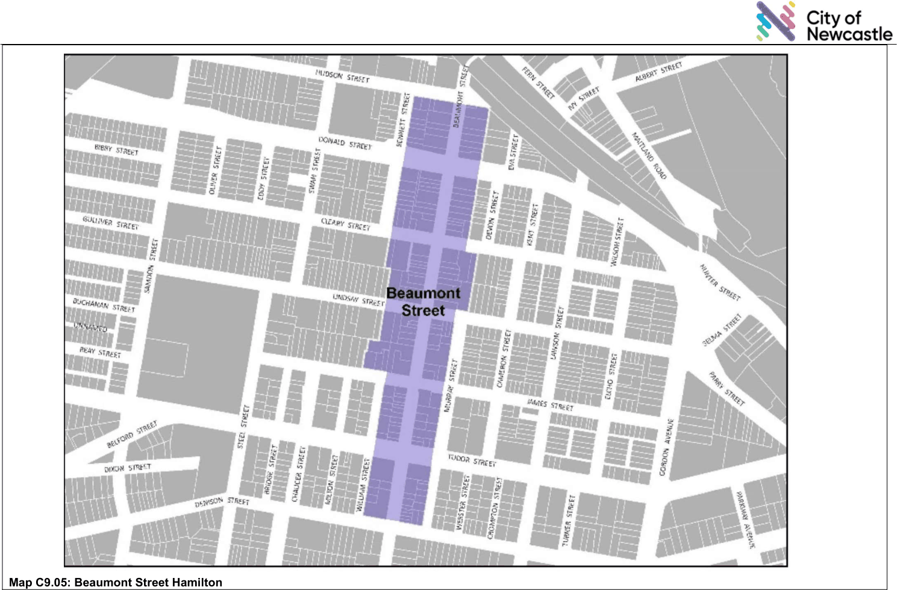

### 11.0 Heritage items and heritage conservation areas - Identified advertising and signage precincts

> [Picture on page 15: a picture, saved as a picture (images/section-c9-advertising-and-signage-page-15-2.gif, 150 dpi).]

#### Objectives

1.Reduce signage in commercial areas that is not visually compatible or detracts from the amenity of a heritage conservation area.

#### Map C9.02: Newcastle East End and Newcastle beach

Newcastle Development Control Plan 2023

C9 Advertising and signage

Page 15 of 21

| Controls (C) | Acceptable solutions (AS) | Explanatory notes |
|---|---|---|
| C-1.The extent of signage on a site within the Newcastle East End and Newcastle Beach advertising and signage precincts allows a reasonable form of identification (business / building), while: a. taking a form which is subservient to the desirable characteristics of the built and natural environment of the site and its immediate surrounds b. not having a significant adverse effect on the desired or established character, streetscape and environmental values of the area. | AS-1.Acceptable signage types within the Newcastle East End and Newcastle Beach advertising and signage precincts include: a. fascia signs b. under awning sign c. window signs d. projecting wall signs, where there is no awning. AS-2.Signage is for business identification and/or building identification only. AS-3.Projecting wall signs are: a. limited to one sign per business, per elevation b. located at ground level only (consistent with location of adjacent awnings) c. not to exceed 2.5m in length d. not to exceed more than 1.5m² in area e. erected horizontal and at no point less than 2.6m from the ground f. not to extend to within 0.6m of the vertical projection of the edge of the vehicular carriageway, including any parking space g. erected at right-angles to the building h. in accordance with the applicable illumination controls for general signage. AS-4.Signage within shopfront windows is minimised. Painted skeletal business identification signage may be considered. AS-5.Signage reflects the character and heritage significance of the identified precinct by way of style, colour, format and materials. AS-6.Signage is constructed from high quality materials, particularly metals such as bronze, brass and stainless steel. AS-7.The restoration of original painted signs and construction of new signs using traditional designs is encouraged. AS-8.Signage is to be at or below awning level. In the absence of any shop front awnings signage is to be kept at or below the height of awnings on adjacent buildings. In these circumstances, projecting wall signs (in a heritage compatible design) may be considered. AS-9.Illumination (with the exception of under awning/projecting wall signs) is not supported. | Refer to Section E2 Heritage conservation areas. |

Newcastle Development Control Plan 2023

C9 Advertising and signage

Page 16 of 21

> [Picture on page 17: a picture, saved as a picture (images/section-c9-advertising-and-signage-page-17-1.gif, 150 dpi).]

#### Map C9.03: Newcastle West End and Newcastle Civic

Newcastle Development Control Plan 2023

C9 Advertising and signage

Page 17 of 21

| Controls (C) | Acceptable solutions (AS) | Explanatory notes |
|---|---|---|
| C-2.The extent of signage on a site within the Newcastle West End and Newcastle Civic advertising and signage precincts allows a reasonable form of identification (business / building), while: a. taking a form which is subservient to the desirable characteristics of the built and natural environment of the site and its immediate surrounds b. not having a significant adverse effect on the desired or established character, streetscape and environmental values of the area. | AS-1.Signage is for business and/or building identification only. AS-2.Signage reflects the character and heritage significance of the area by way of style, colour, format and materials. AS-3.Flush wall signs are: a. located below first floor level on a frontage with public access only b. not more than 20% of the building elevation c. not illuminated if on a heritage item. AS-4.Pole/pylon signs are supported for civic buildings only. In such cases, pole/pylon signs are: a. limited to a maximum of one per site b. no higher than 4m above ground, have a minimum area of 3m² per face, and not more than two faces c. preferably compromised of simple and clearly displayed details on a white background. AS-5.Projecting wall signs are only supported in the absence of an awning. In such cases, projecting wall signs are: a. limited to one sign per elevation b. located at ground level only (consistent with location of adjacent awnings) c. not exceed 2.5m in length d. not to exceed more than 1.5m² in area e. erected horizontal and at no point less than 2.6m from the ground f. not to extend to within 0.6m of the vertical projection of the edge of the vehicular carriageway, including any parking space' g. erected at right-angles to the building. AS-6.Minimise window signage, with shopfronts being primarily used for the display of goods and services. AS-7.Lifestyle graphics, tv screens and the like are not a supported form of window signage. AS-8.Signage illumination is in accordance with the applicable illumination controls for general signage. AS-9.LED/Changing message signs (internal and external to premise) are not supported. | Refer to Section E2 Heritage conservation areas. |

Newcastle Development Control Plan 2023

C9 Advertising and signage

Page 18 of 21

> [Picture on page 19: a picture, saved as a picture (images/section-c9-advertising-and-signage-page-19-1.gif, 150 dpi).]

#### Map C9.04: Darby Street, Cooks Hill

Newcastle Development Control Plan 2023

C9 Advertising and signage

Page 19 of 21

> [Picture on page 20: a picture, saved as a picture (images/section-c9-advertising-and-signage-page-20-1.gif, 150 dpi).]

#### Map C9.05: Beaumont Street Hamilton

Newcastle Development Control Plan 2023

C9 Advertising and signage

Page 20 of 21

| Controls (C) | Acceptable solutions (AS) | Explanatory notes |
|---|---|---|
| C-3.The extent of signage on a site within the Darby Street, Cooks Hill and Beaumont Street, Hamilton advertising and signage precincts allows a reasonable form of identification (business / building), while: a. taking a form which is subservient to the desirable characteristics of the built and natural environment of the site and its immediate surrounds b. not having a significant adverse effect on the desired or established character, streetscape and environmental values of the area. | AS-1.Signage types in the Darby Street, Cooks Hill Map C9.04 and Beaumont Street, Hamilton Map C9.05 advertising and signage precincts are to comprise of: a. fascia sign b. under awning sign c. window sign d. projecting wall sign where there is no awning. AS-2.Signage is for business identification only. AS-3.Signage reflects the heritage significance of the area by way of style, colour, format, and materials. AS-4.For projecting wall signs the following controls will apply: a. limited to one sign per elevation b. located at ground level only (consistent with location of adjacent awnings) c. does not exceed 2.5m in length d. does not to exceed more than 1.5m² in area e. erected horizontal and at no point less than 2.6m from the ground f. is not to extend to within 0.6m of the vertical projection of the edge of the vehicular carriageway, including any parking space g. erected at right-angles to the building. AS-5.Window signage is to be minimised, with shopfronts being primarily utilised for display of goods and services. Lifestyle graphics, tv/video screens and the like are not a supported form of window signage. AS-6.Illumination is limited to the hours of 7am to 10pm/close of business (whichever is the lesser). AS-7.LED/Changing message signs (internal and external to premise) are not supported. | Refer to Section E2 Heritage conservation areas. |

Newcastle Development Control Plan 2023

C9 Advertising and signage

Page 21 of 21
