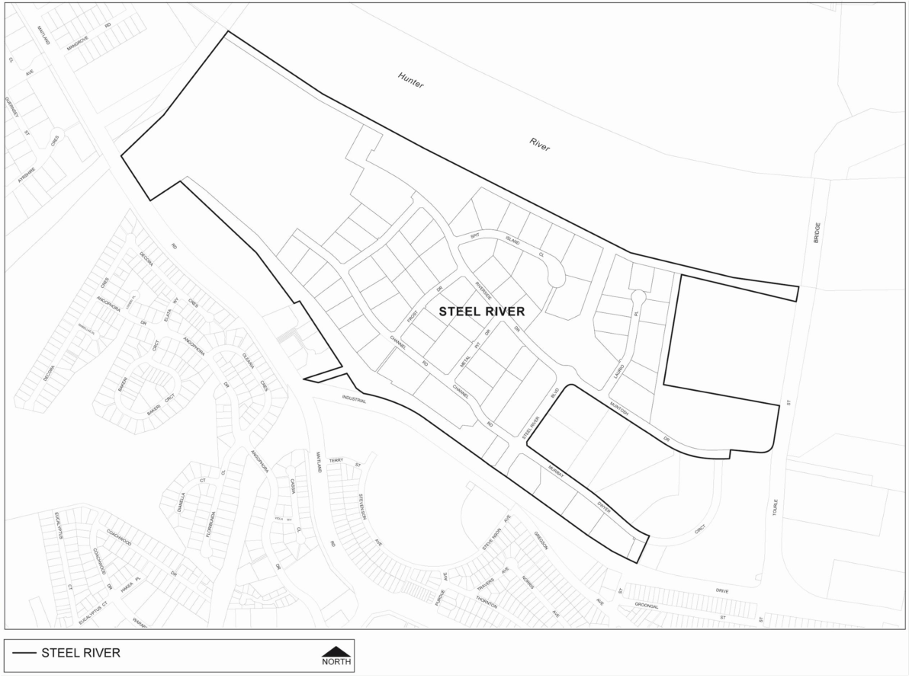

### 9.0 Lot layout, size and dimension – industrial

| Objectives 1. Encourage well designed industrial areas serving a range of general industrial needs. 2. Provide the safe and efficient movement of traffic to and from all industrial lots. 3. Protect the amenity of adjacent land uses, where necessary, from the effects of industrial development. 4. Ensure stormwater is appropriately managed. |  |
|---|---|
| Controls (C) | Explanatory notes |
| C-1.Lots have a minimum frontage of 25m except in Steel River as provided by C-2. |  |
| C-2.Within 'Steel River' lots have a minimum frontage of 60m with no direct access from Industrial Drive, Tourle Street or Pacific Highway as indicated below on Figure D1.01. | See Section D5 Industrial and State Environmental Planning Policy (Transport and Infrastructure) 2021 for further controls in Steel River. |
| C-3.Lots are rectangular in shape. |  |
| C-4.Lots are designed to address existing and proposed public open space. |  |
| C-5.Industrial subdivision provides lots that: a. are of a size that facilitates a variety of industrial and industry compatible land uses b. are not subdivided or otherwise fragmented into unviable lot sizes. |  |
| C-6.The subdivision design allows for PBS (Performance Based Standards – National Heavy Vehicle Regulator) Level 3 vehicles up to 36.5m in length to access the subdivision unless the existing connecting road network is unable to support that vehicle class (subject to NHVR and Transport for NSW approval). | PBS Level 3 vehicles are more efficient freight transportation vehicles than semi-trailers and B-Double trucks and are to be adopted as the design vehicle unless otherwise constrained. |
| C-7.Lot size allows trucks to manoeuvre on-site without reversing onto or off the lot. |  |
| C-8.Road and lot layouts are generally grid patterns and do not rely on cul-de-sacs. |  |
| C-9.Lots are adequately buffered to protect the amenity of sensitive land uses. | Sensitive land uses include, but are not limited to residential development, seniors housing, schools, hospitals, child care facilities, recreation areas, place of worship, community facilities. |
| C-10.All streets are designed to include footpaths that link to existing footpaths, road crossings, parks and public transport facilities. | All footpaths are to be designed in accordance with CN's Standard Drawings. |

> [Picture on page 14: a picture, saved as a picture (images/section-d1-subdivision-and-lot-consolidation-page-14-1.gif, 150 dpi).]

#### Figure D1.01: Steel River
