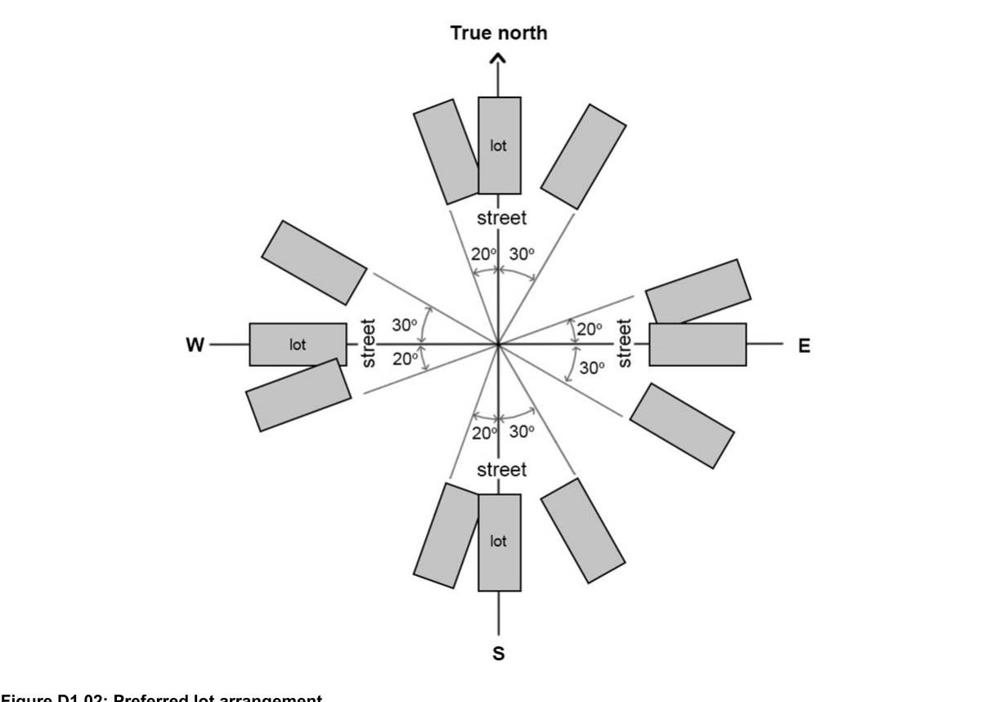

### 10.0 Solar access and orientation

#### Objectives

1\. Maximise the number of lots which have good solar access.

2\. Ensure the subdivision of land responds to the natural and built environment.

3\. Ensure that subdivision of land for residential purposes creates lots of a suitable size, configuration and orientation.

#### Controls (C)

#### Explanatory notes

The following controls apply only to subdivisions in residential zones C-1.Unless site constraints dictate, subdivision layouts are configured such that:

a. the north-south direction is within 20° west and 30° east of north

b. the east-west direction is within 30° south and 20°north of east.

See Figure D1.02 below for preferred lot arrangement. C-2.Lot orientation results in living areas and private open space of any dwelling or future dwelling being oriented to the north and Plans may be required showing dwellings positioned to avoid or minimise possible overshadowing of existing or future adjoining buildings. Where site conditions, such as slope, could constrain future development, lot sizes are increased.

potential building footprint and open space for constrained sites to ensure that relevant solar access requirements can be achieved.

> [Picture on page 16: a picture, saved as a picture (images/section-d1-subdivision-and-lot-consolidation-page-16-1.gif, 150 dpi).]

#### Figure D1.02: Preferred lot arrangement
