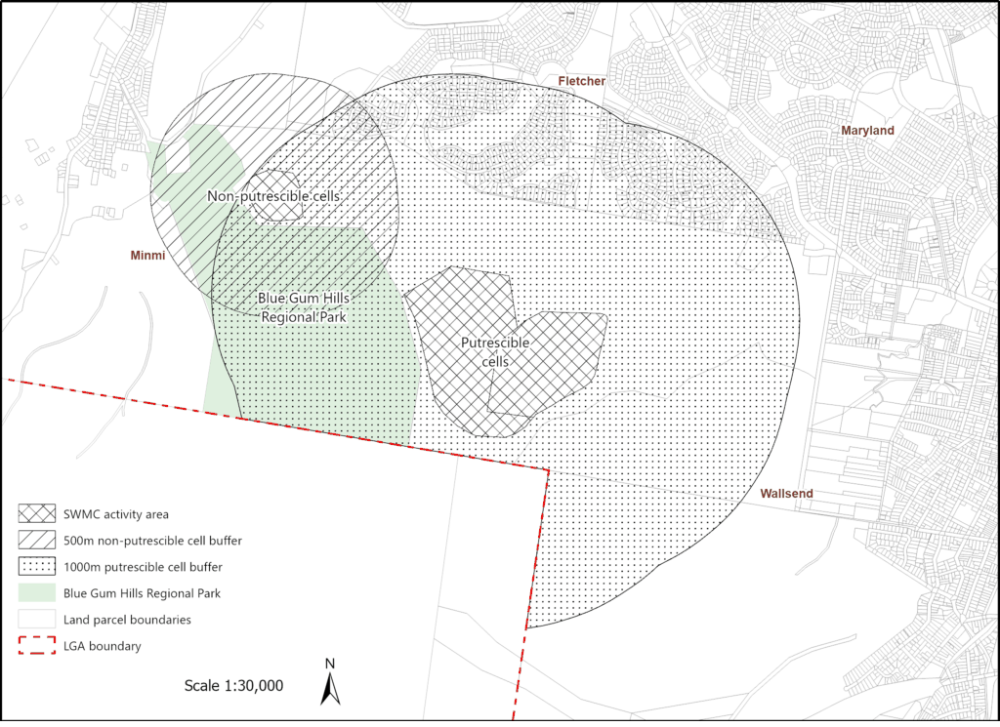
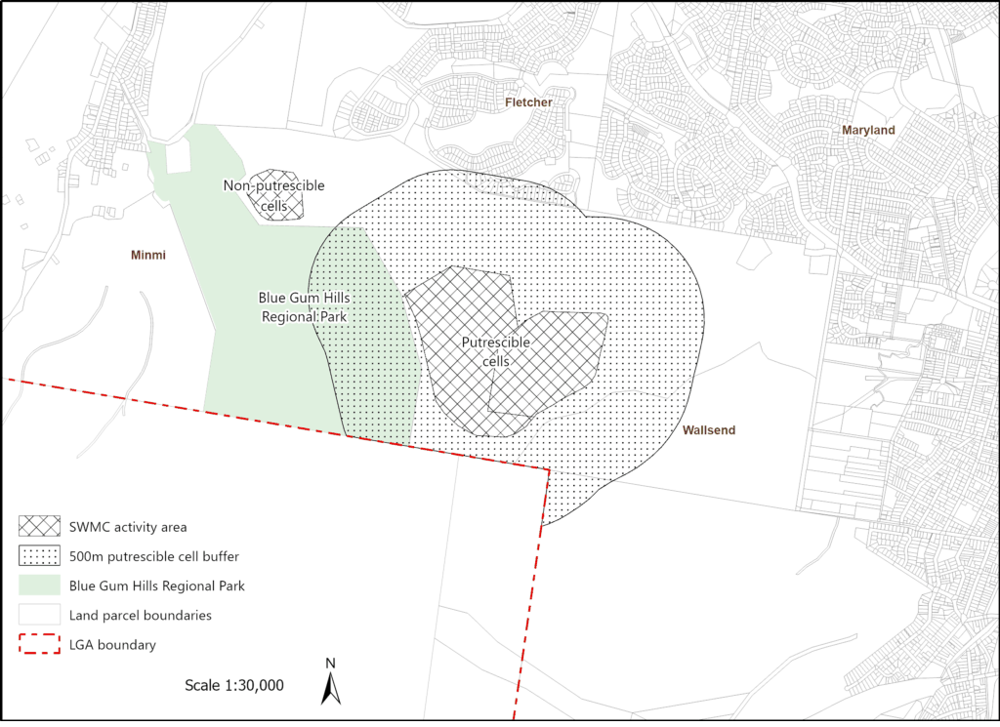

### 11.0 Waste disposal buffer area

#### Objectives

1\. Establish effective separation distances, buffers and mitigation measures for the Summerhill Waste Management Centre to minimise adverse effects on sensitive land uses and people from odour, noise, dust, ground gas and other nuisance generating activities.

2\. Ensure the long-term viability of waste and resource recovery infrastructure is secured by using defined buffer areas that protect against encroachment from incompatible land uses.

#### Controls (C)

#### Explanatory notes

C-1.Subdivision for residential and other sensitive uses should not be within 1000m of approved putrescible landfill Appropriate buffer distance must be maintained between the cells at the Summerhill Waste Management Centre, unless designed to avoid adverse odour, noise, and visual impacts refer to Figure D1.03.

landfill and sensitive land uses (receptors) to protect those receptors from impacts. Impacts might constitute discharge from

C-2.Subdivision for residential and other sensitive uses should not be within 500m of approved non-putrescible

the site of potentially explosive landfill gas, offensive odours,

landfill cells at the Summerhill Waste Management Centre, unless designed to avoid adverse odour, noise, and

noise, litter and dust.

visual impacts refer to Figure D1.03. C-3.Subdivision of land for non-residential purposes should not be within 500m of approved putrescible landfill cells at the Summerhill Waste Management Centre, unless designed to avoid adverse odour, noise, and visual impacts refer to Figure D1.04.

> [Picture on page 18: a picture, saved as a picture (images/section-d1-subdivision-and-lot-consolidation-page-18-1.gif, 150 dpi).]

#### Figure D1.03: Summerhill Waste Management Centre Buffer – Residential

> [Picture on page 19: a picture, saved as a picture (images/section-d1-subdivision-and-lot-consolidation-page-19-1.gif, 150 dpi).]

#### Figure D1.04: Summerhill Waste Management Centre Buffer – Non-residential
