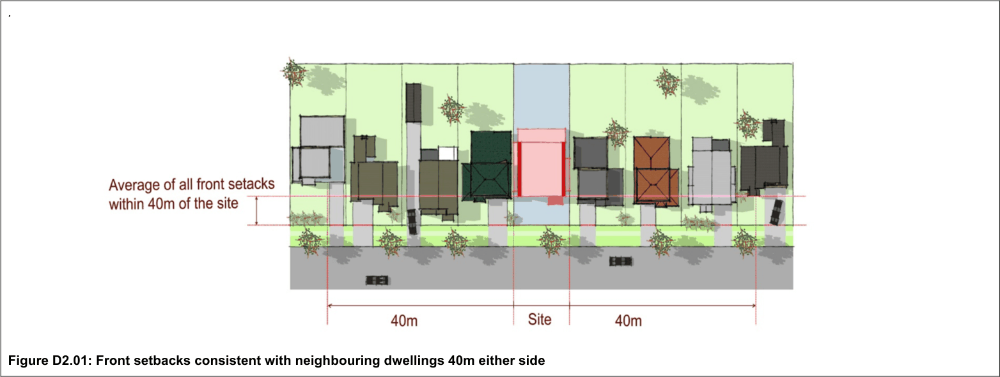
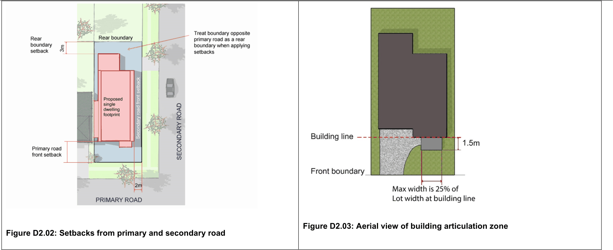
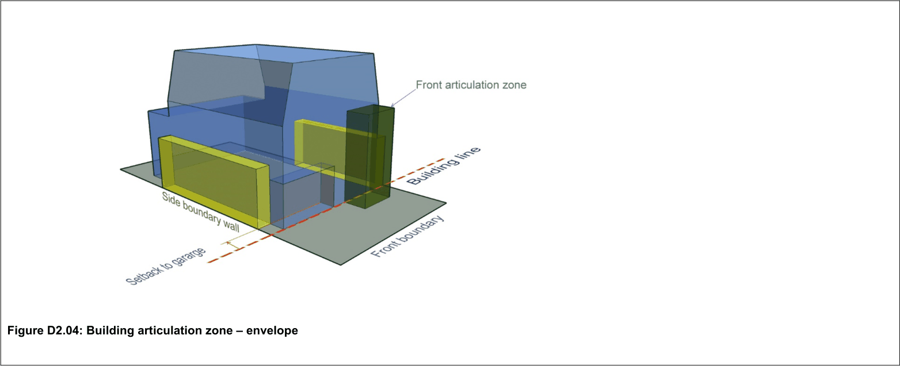

### 8.0 Street frontage appearance

#### Objectives

1\. Ensure development complements and harmonises with the positive elements of existing development in the street.

2\. Ensure setbacks are compatible with the existing or intended local streetscape.

3\. Ensure garages and carports are integrated into a development and do not dominate the streetscape.

4\. Ensure development provides passive surveillance of the street.

5\. Ensure dwellings address the street.

6\. Maximise opportunities for walking and cycling where possible.

#### Controls (C)

#### Explanatory notes

C-1.In established residential zones the proposed building is to be set back the average distance of buildings within 40m either side of the lot on the same primary road see Figure D2.01.

Ancillary development and building elements within the permitted articulation zone are not included in the setback calculation. See Figure D2.04 and refer to C-4 for further details.

Articulation zone means an area within a lot where building elements are or may be located, that consists of that part of the setback area from a primary road that is measured horizontally for a distance of 1.5m from: the required front setback (building line), or a gable or roof parapet having a surface area or more than 10m2i.

C-2.If there is no established setback the minimum front setback (building line) to the road is:

| Road type | Lots with an area of less than 300m2 minimum setback | Lots with an area 300m2 or more minimum setback |
|---|---|---|
| Primary road | 3m | 4.5m |
| Corner lot (secondary road) | 2m | 2m |
| Parallel road (eg laneway) | 3m to principal dwelling | 3m to principal dwelling |
| Classified road | As defined in any applicable environmental planning instrument or if none exists 9m. | As defined in any applicable environmental planning instrument or if none exists 9m. |

\*Refer Figure D2.02.

The front setback is predominantly landscaped however, on merit assessment, part of the setback area may be used for carports, depending on compatibility with the streetscape. Car parking spaces must be contained within the allotment boundaries.

C-3.A dwelling house, other than a dwelling house that has a setback from a primary road of less The following building elements are permitted in an articulation zone: than 3m, may incorporate an articulation zone that extends from the building line to a distance of 1.5m into the required setback from the primary road. See Figure D2.03 and Figure D2.04.

landscape area and awnings an entry feature or portico a balcony, deck, patio, pergola, terrace or verandah a window box treatment a bay window or similar feature an awning or other feature over a window a sun shading feature.

Ancillary development and building elements within the permitted articulation zone are not included in the setback calculation.

C-4.The articulation zone is a maximum 25% of the width of the lot at the building line. See Figure D2.03. C-5.Dwellings must have a front door and a window of a habitable room facing the primary road. C-6.Bathroom and ensuite windows are not to face the primary road. C-7.Dwellings on sites with two or more frontages must be designed and oriented to address both frontages and include appropriate design features and articulation. C-8.A dwelling house on a corner lot must have a window to a habitable room that is at least 1m2 in area and that faces and is visible from a secondary road.

As per Section C2 Movement networks, when determining the requirement for footpaths, considerations by CN may include, but are not limited to the following:

C-9.Development is to provide footpaths for the full width of any site frontage. Where the proposed footpath will adjoin and connect to an existing or approved footpath on an adjoining site, the width of the proposed footpath is to match this footpath width. See C2 Movement networks for detail.

the development type, scale and density planned or likely intensification of an area adjoining or surrounding footpath infrastructure and surface treatments condition of any existing footpath and need for replacement CN forecasted infrastructure and asset projects or capital works programs topography of the road reserve along subject site frontage the presence of any utilities, services, assets, street trees, street furniture or the like. CN public domain plans and standard drawings for footpaths.

For more intensive developments it may be a CN requirement to extend footways beyond the site frontage such as to connect to public transport or nearby services to support the development.

C-10.Driveway crossings must incorporate a minimum 1.5m wide section at a grade of 1 in 40 (even where there is no footpath) to facilitate footpath construction.

> [Picture on page 10: a picture, saved as a picture (images/section-d2-single-dwelling-and-ancillary-development-page-10-1.gif, 150 dpi).]
> Words printed on the picture (title and legend, copied from the PDF):
> .

Figure D2.01: Front setbacks consistent with neighbouring dwellings 40m either side

> [Picture on page 11: a picture, saved as a picture (images/section-d2-single-dwelling-and-ancillary-development-page-11-1.gif, 150 dpi).]

#### Figure D2.03: Aerial view of building articulation zone

#### Figure D2.02: Setbacks from primary and secondary road

> [Picture on page 12: a picture, saved as a picture (images/section-d2-single-dwelling-and-ancillary-development-page-12-1.gif, 150 dpi).]

#### Figure D2.04: Building articulation zone – envelope
