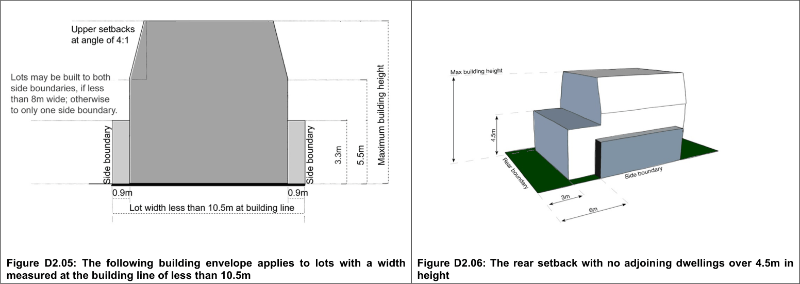

### 9.0 Side/rear setbacks (building envelope) – lots with a width less than 10.5m

#### Objectives

1\. Ensure the bulk and scale of development is consistent with and complements the prevailing built form in the street and local area.

2\. Ensure the bulk and scale of development is not overbearing for adjoining dwelling houses and their private open space.

3\. Minimise the impacts of development on the amenity and privacy of residents in adjoining dwelling houses.

4\. Prevent the loss of significant views or outlook of adjoining residents.

5\. Provide for natural light, sunlight and breezes.

6\. Retain, protect or establish significant landscaping and trees which contributes to the public domain and allows for the street landscape character to be maintained.

#### Controls (C)

#### Explanatory notes

Side and rear setbacks do not apply to:

C-1.The building is to be contained in the building envelope defined by:

a. 900mm set back from each side boundary up to a height of 5.5m then in at an angle of 4:1 up to the maximum height specified in the LEP 2012

b. buildings on lots with a width less than 8m can be built to both side boundaries

c. buildings on lots with a width of 8m-10.5m can build to one side boundary only.

See Figure D2.05.

C-2.Where boundary walls are used each boundary wall is:

any aerial, antenna, awning, eave, flue, chimney, pipe, cooling or heating appliance, any rainwater tank less than 1.8m in height or any other structure associated with the provision of a utility service, if it is located at least 450mm from the relevant boundary, and any fence, fascia, gutter, downpipe, light fitting, electricity or gas meter, driveway, hard stand space, pathway or paving, if it is located within the required setback area to the relevant boundary.

a. to be a maximum height of 3.3m or match an existing adjoining wall (whichever is greater)

b. to have a maximum length of 20m or 50% of the lot depth (whichever is the lesser)

c. be in accordance with the Building Code of Australia, be maintenance free and have an attractive finish (e.g. face brick).

See Figure D2.05.

.

C-3.Notwithstanding C-1 and C-2, buildings are not to be built to the boundary if:

a. the wall of the building on the adjoining lot is not of masonry construction and is within 900mm of the boundary

b. the wall of the building on the adjoining lot has a window facing the boundary within 900mm of the boundary.

| C-4.The setback to the rear boundary is to be at least the following: a. any part of the building up to 4.5m in height – a 3m setback b. any part of the building with a height greater than 4.5m either: i. if there are two adjoining dwellings with a height over 4.5m either a 6m setback or the average distance of those parts of the building over 4.5m, whichever is the lesser ii. if there are no adjoining dwellings over 4.5m in height - a 6m setback c. on corner lots the boundary opposite the primary road frontage taken to be the rear boundary for the purposes of applying setbacks. See Figure D2.02. d. sub-section 15 to 19 outlines exceptions to rear setbacks for ancillary structures. | In the case of corner sites, the primary street frontage is taken to be the boundary which is the shorter of both frontages. |
|---|---|
| C-5.Where a rear boundary adjoins a lane, development complies with Section C11 Development adjoining laneways. |  |

> [Picture on page 14: a picture, saved as a picture (images/section-d2-single-dwelling-and-ancillary-development-page-14-2.gif, 150 dpi).]

Figure D2.05: The following building envelope applies to lots with a width measured at the building line of less than 10.5m

Figure D2.06: The rear setback with no adjoining dwellings over 4.5m in height
