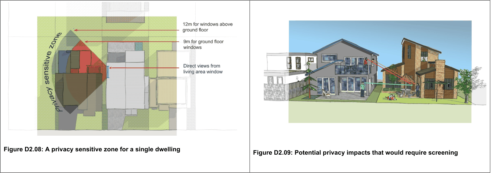

### 13.0 Visual and acoustic privacy

| Objectives 1. Provide adequate privacy to the principal area of private open space and the windows of habitable rooms. 2. Ensure dwellings do not unreasonably overlook living room windows or the principal area of private open space of neighbouring dwellings. 3. Ensure outside noise levels are controlled to acceptable levels in living rooms and bedrooms of dwellings. |  |
|---|---|
| Controls (C) | Explanatory notes |
| C-1.Noise from external sources impacting upon residential habitable areas will need to be adequately addressed to ensure appropriate internal noise levels are achieved in accordance with the appropriate legislation, guidelines and standards. This may require applicants to obtain an acoustic report or a noise impact assessment from an appropriately qualified and experienced acoustic engineer to support their application. | Further information can be found in the application requirements. A noise-producing development or noisy area may have a range of activities contributing to noise and is not limited to that produced from busy roads, railways, industries, live music venues, entertainment, gymnasiums, public parks and plazas in which people may congregate or host live music or events. |
| C-2.A minimum 9m separation is provided between the windows of habitable rooms of facing dwellings that abut a public or communal street. This distance is increased to 12m for windows above the ground floor. | Designers should consider the following measures to alleviate direct view impacts: proper consideration of privacy outcomes at site planning stage screening, including lattice off set windows innovative balcony design the slope of the site and adjoining land highlight windows. Sloping sites may rise particular privacy issues and these should be addressed through design. |
| C-3.Windows to habitable rooms are not to directly face windows to habitable rooms of adjacent dwellings. Direct views between habitable room windows of adjacent dwellings are screened or obscured where: a. ground floor windows are within an area described by taking a 9m radius from any part of the window of the adjacent dwelling. An area so defined is described as a 'privacy sensitive zone.' See Figure D2.08 b. windows above ground floor are within a privacy sensitive zone described by a 12m radius. See Figure D2.09. |  |

| C-4.Direct views from living rooms into the principal area of private open space and living rooms of adjacent dwellings are minimised through building layout, window and balcony location and design and use of screening devices including landscaping. See Figure D2.10. |  |
|---|---|
| C-5.Direct views from the principal area of private open space of dwellings into the living area windows and/or principal area of private open space of adjacent dwellings are screened or obscured within a privacy sensitive zone described by a 12m radius. See Figure D2.10. | Privacy is maintained to the principal area of private open space of adjoining properties but cannot be ensured to other general open space areas, including pools. |
| C-6.Direct views described in controls C-2 and C-3 may be obscured by one of the following measures: a. 1.8m high solid fences and walls between ground floor level windows and adjoining open space where the slope is below 10% b. screening to a height of at least 1.7m but not more than 2.2m, above the finished floor level of the balcony, deck, verandah, etc., that has a maximum area of 25% openings, is permanently fixed and is made of durable materials c. highlight windows with a minimum sill height of 1.5m above finished floor level. | Elevated ground floor level may require higher fencing to maintain privacy. |
| C-7.Bedrooms, main living areas and the principal area of private open spaces must be located away from noise sources. | Kitchen, bathroom and garage areas should be located closest to noise sources. |

> [Picture on page 22: a picture, saved as a picture (images/section-d2-single-dwelling-and-ancillary-development-page-22-1.gif, 150 dpi).]

#### Figure D2.09: Potential privacy impacts that would require screening

#### Figure D2.08: A privacy sensitive zone for a single dwelling
