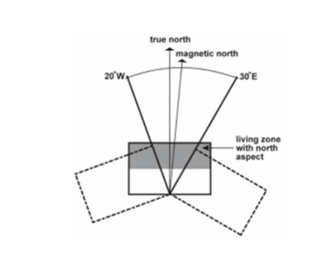

### 14.0 Solar access

| Objectives 1. Maximise solar access into living rooms and private open space of development. 2. Ensure development does not significantly overshadow living area windows and principal areas of private open space or existing solar panels of adjacent dwellings. |  |  |
|---|---|---|
| Controls (C) | Acceptable solutions (AS) | Explanatory notes |
| C-1.Dwellings must be orientated to maximise solar access to living rooms. See Figure D2.10. |  |  |
| C-2.All primary living areas and principal areas of private open space are positioned to the north or north-east where possible. |  |  |
| C-3.Maintain at least three hours of direct sunlight to the windows of living areas that face north in existing adjacent dwellings between 9am and 3pm on 21 June. See Figure D2.10 for northerly aspect windows. |  | Windows of living areas facing north are taken to be within 20O and 30O east of true north. See Figure D2.10. Solar access is maintained to the principal area of private open space of adjoining properties but cannot be ensured to other general open space areas, including pools. |
| C-4.Direct sunlight must reach 50% of the principal area of private open space of the subject dwelling for at least three hours between 9am and 3pm on 21 June. Where such areas already receive less than three hours of sunlight, development does not further reduce sunlight. |  | Where existing overshadowing by buildings and fences of the principal area of private open space of adjoining properties does not satisfy control C-2, it must be demonstrated that the existing sunlight is not unreasonably reduced. |
| C-5.Direct sunlight must reach 100% of the principal area of private open space of any adjacent dwelling for at least two hours between 9am and 3pm on 21 June. Where such areas already receive less than two hours of sunlight, development does not further reduce sunlight. |  |  |
| C-6.Consideration must be given to neighbouring properties’ solar panels and the loss of sunlight to these panels as a result of any development proposal, having regard to the performance, efficiency, economic viability and reasonableness of their location. | AS-1.Where reasonably practicable sunlight to any existing solar panels should not be reduced to less than two hours between 9am and 3pm on 21 June. | The location and placement of solar panels should take into account the potential permissible building form on adjacent properties. Impact to solar panels where unreasonably located will not result in the requirement to modify the development to protect solar access to such panels. |

> [Picture on page 24: a picture, saved as a picture (images/section-d2-single-dwelling-and-ancillary-development-page-24-1.gif, 150 dpi).]

#### Figure D2.10: Northern aspect windows
