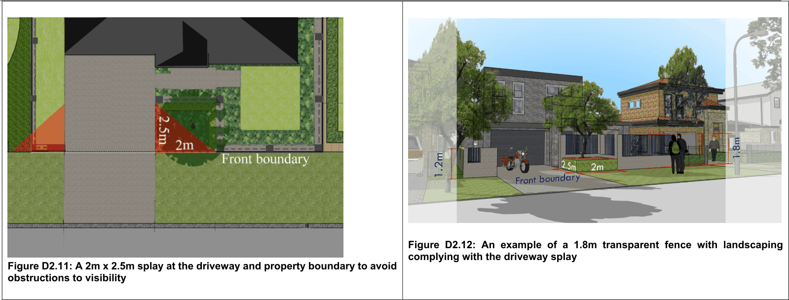

### 19.0 Ancillary development – fences

| Objectives 1. Ensure front fences and walls complement and harmonise with the streetscape character. 2. Enable outlook from dwellings to the street for safety and surveillance. 3. Provide fencing of an appropriate form and scale. 4. Enable safe vehicular access to the site and adjoining lots. 5. Limit higher front fences and walls to minimise amenity impacts. |  |
|---|---|
| Controls (C) | Explanatory notes |
| General |  |
| C-1.Fencing and walls located on bush fire prone land are constructed of non-combustible materials. |  |
| C-2.Fencing and walls do not incorporate barbed wire in its construction or be electrified. |  |
| C-3.If it is constructed of metal components - be of low reflective, factory pre-coloured materials. |  |
| C-4.If it is on a sloping site and stepped to accommodate the fall in the land. | The provisions of the Dividing Fences Act 1991 also apply. Common boundary fencing proposals may require the consent of the adjoining land owner. |
| Front fences |  |
| C-5.Front fences and walls have a maximum height of 1.2m (unless development meets C-9 or C-10) and must set to follow any change in level along the street boundary |  |
| C-6.Front fences and walls highlight the entrance to the dwelling. |  |
| C-7.The use of sheet-metal fencing / colorbond is not accepted along the front boundary. |  |
| C-8.Front fences and walls are constructed of materials compatible with the dwelling, and with attractive visible examples of fences and walls in the streetscape. |  |
| C-9.Fencing is to be located to ensure sight lines between pedestrians and vehicles exiting the site are not obscured. |  |
| C-10.Gates do not open over the public roadway or footpath. |  |

| C-11. The front fence or wall height may be increased to 1.8m for development fronting onto an arterial road if: a. the development site is not a heritage item or located in a heritage conservation area; and b. it is demonstrated that traffic volumes will have a negative impact on amenity of residents; and c. the visual impact of the fence to the street is softened through setbacks, landscaping and design; and d. fence height, landscaping and any other obstruction to visibility is limited to 1.2m in height in the 2m by 2.5m splay within the property boundary for each side of the boundary and any driveway entrance in accordance with AS/NZ 2890.1:2004 – Parking facilities – Off street car parking. See Figure D2.11. | Refer to Section E1 Built and Landscape Heritage. |
|---|---|
| C-12. The front fence or wall height may be increased to 1.8m for development which provides the principal private open space in front of the building line: a. the entire fence or wall has openings making it not less than 30% transparent see Figure D2.12. b. the visual impact of the fence or wall to the street is softened through landscaping and design see Figure D2.12. c. the fence is not on the northern side of the principal area of private open space and will not cause excessive overshadowing d. the fence or wall height, landscaping and any other obstruction to visibility is limited to 1.2m in height in the 2m by 2.5m splay within the property boundary for each side of the boundary and any driveway entrance in accordance with AS/NZ 2890. See Figure D2.11. | A transparent fence can be seen through from most viewing angles. A 30% transparent fence must have openings which make the entire fence not less than 30% transparent. Examples of fencing types that could satisfy this requirement are: a solid and transparent vertical or horizontal timber slat fence, masonry pillars with infill pickets spaced to provide 30% transparency, masonry low wall with horizontal infill slats above spaced to provide 30% transparency. See Figure D2.12. |
| Side and rear fences |  |
| C-13.Side fences on corner sites are to be designed and located so as to: a. maintain the streetscape character b. be consistent with the established pattern of fencing. |  |
| C-14.Side fences forward of the front building lines are compatible with the established front fencing in the street. |  |

> [Picture on page 30: a picture, saved as a picture (images/section-d2-single-dwelling-and-ancillary-development-page-30-1.gif, 150 dpi).]

Figure D2.12: An example of a 1.8m transparent fence with landscaping complying with the driveway splay

Figure D2.11: A 2m x 2.5m splay at the driveway and property boundary to avoid obstructions to visibility
