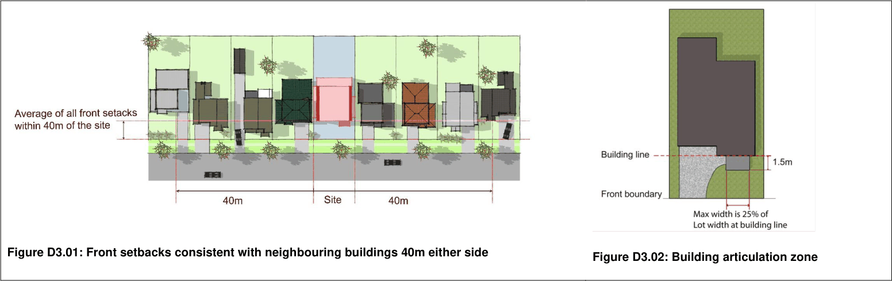

### 9.0 Front setback

| Objectives 1. Ensure front setbacks are consistent with the existing or intended local streetscape. 2. Integrate garages and carports into a development so they do not dominate the streetscape. 3. Provide appropriate articulation of facades and horizontal elements to reduce the appearance of bulk and to provide visual interest to the streetscape. 4. Ensure there is suitable space for site landscaping and deep soil areas. 5. Protect privacy and amenity for the building occupants. 6. Ensure buildings on corner sites provide an appropriate secondary street setback and maintain sight lines for the safety of pedestrians and vehicles. |  |
|---|---|
| Controls (C) | Explanatory notes |
| C-1.In an established area, the minimum front setback is the average distance of buildings within 40m either side of the lot on the same primary road. See Figure D3.01. | For dwellings within any development on a street corner, the primary street frontage is the street to which the dwelling presents its front door, front elevation, main pedestrian entry and mailbox, as relevant. The primary street frontage may vary from one dwelling within a development to another within the same development, based upon the above criteria. On corners between public roads and laneways, the primary street is always the public road. |
| C-2.If there is no established building line, the maximum front setback is 4.5m. |  |
| C-3.The secondary street minimum setback is 2m. A greater secondary setback may be required if the proposed development does not: a. positively address the secondary street b. demonstrate a good level of amenity c. maintain sight lines for the safety of pedestrians and vehicles. | In cases where each of the dwellings comprising a detached dual occupancy on a corner lot that address different streets, the primary street frontage and secondary street frontage may be different for each of the dwellings. As a result, the front setback for each of these dwellings will be determined by the street to which the dwelling presents. |
| C-4.On corner lots, if development contains two or more dwellings, at least one dwelling is to present to each street frontage. |  |
| C-5.The setback from a classified road is as specified by any applicable environmental planning instrument, or at least 9m if none exists. | Development adjoining a classified road or on land reserved for such purposes of a classified road may require concurrence with Transport for NSW. |
| C-6.The setback from a public reserve is a minimum of 3m to ensure the retention of any affected canopy trees that have a medium to long-term life expectancy. |  |

C-7.Entries to a basement car park, garage or carport are setback a minimum 1m behind the front building line. Where the building line is less than 4.5m, the entry to the basement car park, garage or carport is setback at least 5.5m from the boundary with the road. C-8. An articulation zone that extends 1.5m from the building line into the setback from the primary Articulation zone means an area within a lot where building elements are road may be provided where the setback from the primary road is 3m or greater. The articulation zone is a maximum 25% width of the lot at the building line. See Figure D3.02.

Figure D3.01: Front setbacks consistent with neighbouring buildings 40m either side

or may be located, that consists of that part of the setback area from a primary road that is measured horizontally for a distance of 1.5m from:

(a) the required front setback (building line), or

(b) a gable or roof parapet having a surface area of more than 10m2.

The following building elements are permitted in an articulation zone: (a) an entry feature or portico

• a balcony, deck, patio, pergola, terrace or verandah

• a window box treatment

• a bay window or similar feature

• an awning or other feature over a window (f) a sun shading feature.

> [Picture on page 11: a picture, saved as a picture (images/section-d3-residential-development-page-11-19.gif, 150 dpi).]

#### Figure D3.02: Building articulation zone
