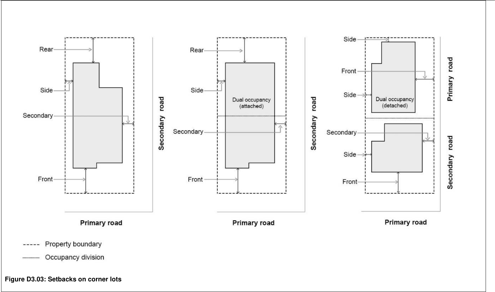
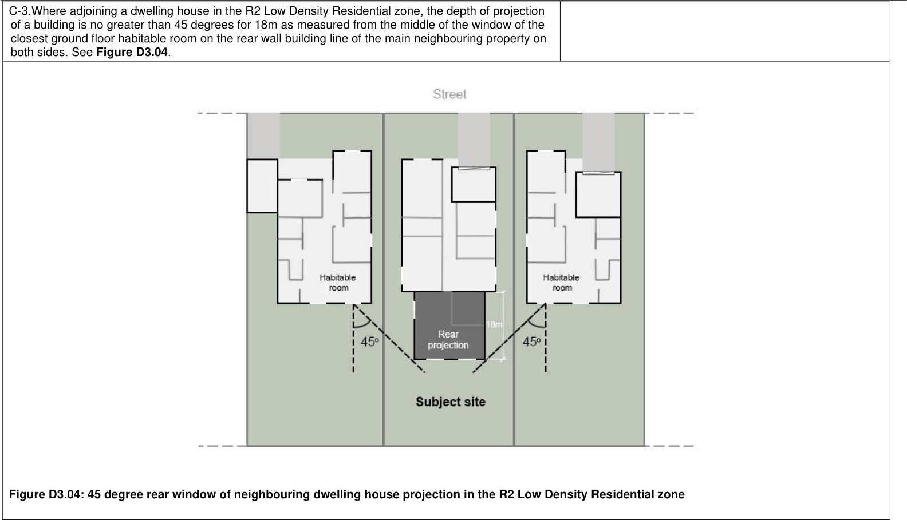

### 10.0 Side and rear setbacks – R2 Low Density Residential Zone

#### Objectives

1\. Ensure development is consistent with and complements the desired built form prevailing in the street and local area.

2\. Minimise the impacts of development on neighbouring properties with regards to view, privacy, overshadowing and sense of openness.

3\. Ensure rear setbacks provide suitable space for landscaping and deep soil areas.

4\. Maintain significant views from adjoining properties.

| Controls (C) | Explanatory notes |
|---|---|
| C-1. Where there are no locality specific controls See Figure D3.03 | Dwellings should be oriented to the front and rear of the site. Orientation |
| a. side setbacks are a minimum of 900mm from each boundary up to a height of 4.5m, then at an angle of 4:1 | to a side boundary may be considered where it is necessary to achieve good solar access to living rooms and private open space. In these |
| b. rear setbacks are a minimum of 3m for walls up to 4.5m in height and 6m for walls greater than 4.5m in height. | cases, greater side boundary setbacks will be required. Building setbacks need to be sufficient to ensure solar access, amenity and privacy to the adjoining properties. |
| C-2.On corner lots, the boundary opposite the primary road frontage, is taken to be rear boundary for purposes of applying setbacks See Figure D3.03. | In many cases the primary road and secondary road may be different for each of the dwellings comprising a dual occupancy (detached) on a corner lot, as is shown in Figure D3.03. This is because for each dwelling the primary road is the road that the dwelling faces. Accordingly, the setbacks for each of these dwellings will not necessarily align. |

> [Picture on page 13: a picture, saved as a picture (images/section-d3-residential-development-page-13-1.gif, 150 dpi).]

#### Figure D3.03: Setbacks on corner lots

> [Picture on page 14: a picture, saved as a picture (images/section-d3-residential-development-page-14-1.gif, 150 dpi).]

C-3.Where adjoining a dwelling house in the R2 Low Density Residential zone, the depth of projection of a building is no greater than 45 degrees for 18m as measured from the middle of the window of the closest ground floor habitable room on the rear wall building line of the main neighbouring property on both sides. See Figure D3.04.

Figure D3.04: 45 degree rear window of neighbouring dwelling house projection in the R2 Low Density Residential zone
