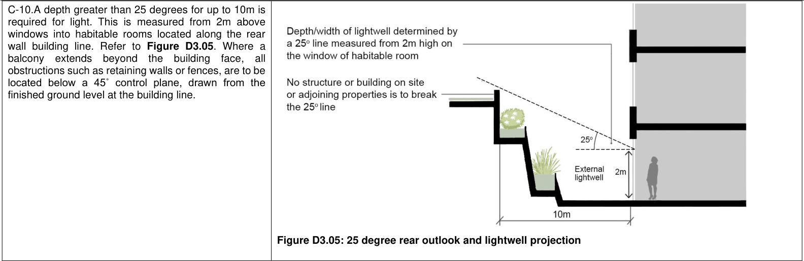

### 16.0 Amenity – solar, outlook and daylight access

| Objectives 1. Maximise the number of dwellings receiving sunlight to habitable rooms and private open space. 2. Ensure solar access enables passive solar heating in winter and provides a healthy indoor environment. 3. Ensure access to daylight is suited to the function of the room and artificial lighting is minimised. 4. Provide a sense of openness in views, and access to sunlight and daylight from rear facing habitable room windows. |  |  |
|---|---|---|
| Controls (C) | Acceptable solutions (AS) | Explanatory notes |
| C-1.Compliance with the standards for 'Solar and daylight access' detailed in the Apartment Design Guide, for all residential flat buildings required to comply with that standard. |  | SEPP 65 requires some types of residential development to meet the requirements of the Apartment Design Guide. SEPP 65 applies to development for the purpose of a residential flat building, shop top housing or mixed use development with a residential accommodation component if: a. the development consists of any of the following: i. erection of a building, ii. substantial redevelopment or the substantial refurbishment of an existing building, iii. conversion of an existing building, and b. the building concerned is at least three or more storeys (not including levels below ground level (existing) or levels that are less than 1.2m above ground level (existing) that provide for car parking), and c. the building concerned contains at least four or more dwellings. |
| C-2.Compliance with the standards for solar access in in State Environmental Planning Policy (Housing) 2021 for all applicable housing types. |  | State Environmental Planning Policy (Housing) 2021 applies to affordable and diverse housing types including, but not limited to, co-living housing, boarding houses, build-to-rent housing, seniors housing, independent living units, group homes and hostels. |
| The following controls apply to all forms of residential development |  |  |
| C-3.For an adjoining dwelling, the living room window and principal private open space receive at least two hours of direct sunlight between 9am and 3pm on the winter solstice. Where the window or principal area of private open space is already overshadowed, solar access is not further reduced. |  |  |
| C-4.Every habitable room has a window in an external wall with a total minimum glass area of at least 15% of the floor area of the room. |  |  |

| C-5.Daylight is not borrowed from other rooms, except where a room has a frontage to a classified road. |  |
|---|---|
| C-6.No part of a habitable room is more than 8m from a window. A window must be visible from all parts of a habitable room. |  |
| C-7.No part of a kitchen work surface is more than 6m from a window or skylight. |  |
| C-8.Courtyards are fully open to the sky, have a minimum dimension of one third of the perimeter wall height and minimum area of 3m2. |  |
| The following controls apply to all forms of residential development except for co-living, boarding houses and residential flat buildings that are required to comply with the Apartment Design Guide |  |
| C-9.The living room and private open space receive a minimum of two hours direct sunlight between 9am and 3pm at the winter solstice for: a. each dwelling in a dual occupancy or attached dwelling b. at least 70% of dwellings in all other forms of residential development. | AS-1.Direct sunlight is achieved when 1m² of direct sunlight on the glass is achieved for at least 15 minutes. To satisfy two hours direct sunlight, eight periods of 15 minutes will need to be achieved - the periods do not need to be consecutive. Overshadowing from existing development must be considered in calculating solar access amenity. |

> [Picture on page 24: a picture, saved as a picture (images/section-d3-residential-development-page-24-1.gif, 150 dpi).]

C-10.A depth greater than 25 degrees for up to 10m is required for light. This is measured from 2m above windows into habitable rooms located along the rear wall building line. Refer to Figure D3.05. Where a balcony extends beyond the building face, all obstructions such as retaining walls or fences, are to be located below a 45˚ control plane, drawn from the finished ground level at the building line.

#### Figure D3.05: 25 degree rear outlook and lightwell projection
