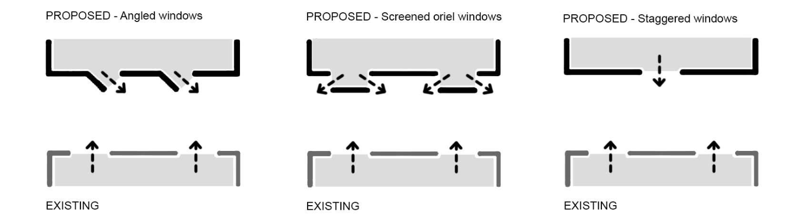

### 23.0 Amenity – visual privacy

| Objectives 1. Achieve reasonable levels of external and internal visual privacy for adjacent dwellings while retaining amenity for the dwelling. 2. Increase visual privacy without compromising access to light and air and balance outlook and views from habitable rooms and private open space. |  |  |
|---|---|---|
| Controls (C) | Acceptable solutions (AS) | Explanatory notes |
| The following controls apply to all forms of residential development |  |  |
| C-1.Compliance with the standards which relate to visual privacy detailed in the Apartment Design Guide, for all residential flat buildings required to comply with that standard. |  | Visual privacy is addressed in Chapter 3F of the Apartment Design Guide in sections relating to Separation Distances, Apartment Layout and Design, Solar and daylight access and Balconies and Private Space. |
| C-2.For all other residential development, development is located and orientated to maximise visual privacy between buildings on site and for neighbouring buildings. This is to be achieved by: a. separation distances between windows and balconies of dwellings on the same site are double the distances above b. ensuring only diagonal or oblique views of the first 10m of a neighbouring garden measured from the rear wall building line are possible c. inclusion of privacy screens where the distance from the window of a habitable room to the boundary is: i. less than 3m, and the habitable room has a finished floor level greater than 1m above existing ground level, or ii. less than 6m, and the habitable room has a finished floor level greater than 3m above ground level d. privacy screening on the edge of a terrace, balcony or verandah, where the edge is: i. less than 3m from the boundary, and habitable room has a finished floor level greater than 1m above existing ground level, or ii. less than 6m and the habitable room has a finished floor level greater than 2m above ground level. | AS-1.Screening may require the introduction of architectural devices shown in Figure D3.06. AS-2.A privacy screen is not required to: i. a bedroom window with an area less than 2m2 ii. any window that has a sill height of 1.5m or greater, or iii. any window that has a frontage to a road or public open space. AS-3.A privacy screen is not required for a balcony or terrace with an area less than 3m2, or a balcony or terrace of any size that has a frontage to a road or public space. AS-4.Where privacy screens are provided to windows, they do not cover part of the window required to meet the minimum daylight or solar access requirements or restrict ventilation. | Diagonal and oblique views are not considered direct overlooking. Privacy screens are the last resort where all other design options, such as site arrangement and internal layouts have been exhausted. |

> [Picture on page 31: a picture, saved as a picture (images/section-d3-residential-development-page-31-1.gif, 150 dpi).]

#### Figure D3.06: Window screening elements
