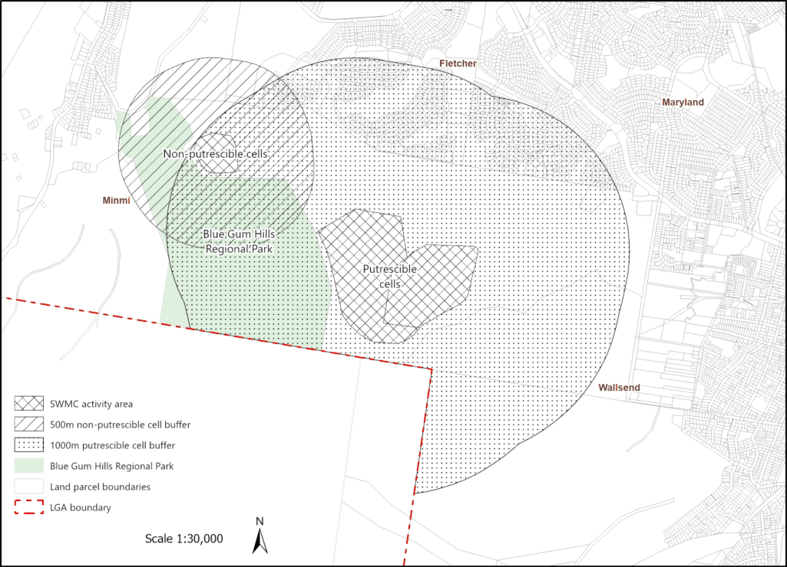

### 27.0 Amenity – waste disposal buffer area

#### Objectives

1\. Establish effective separation distances, buffers and mitigation measures for the Summerhill Waste Management Centre to minimise adverse effects on sensitive land uses and people from odour, noise, dust, ground gas and other nuisance generating activities.

2\. Ensure the long-term viability of waste and resource recovery infrastructure is secured by using defined buffer areas that protect against encroachment from incompatible land uses.

#### Controls (C)

#### Explanatory notes

C-1. Residential development excluding alterations and additions should not be within 1000m of approved Appropriate buffer distance must be maintained between the putrescible landfill cells at the Summerhill Waste Management Centre, unless designed to avoid adverse odour, noise, and visual impacts refer to Figure D3.07.

landfill and sensitive land uses (receptors) to protect those receptors from impacts. Impacts might include visual impacts or

C-2. Residential development excluding alterations and additions should not be within 500m of approved non-

discharge from the site of potentially explosive landfill gas,

putrescible landfill cells at the Summerhill Waste Management Centre, unless designed to avoid adverse odour,

offensive odours, noise, litter and dust.

noise, and visual impacts refer to Figure D3.07.

> [Picture on page 34: a picture, saved as a picture (images/section-d3-residential-development-page-34-1.gif, 150 dpi).]

#### Figure D3.07: Summerhill Waste Management Centre Buffer
