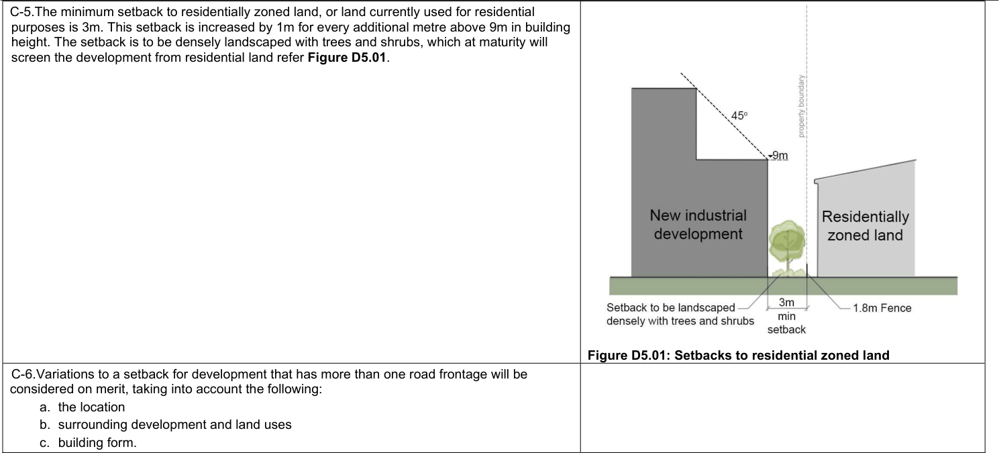

### 8.0 Building setbacks

| Objectives 1. Ensure adequate area is available at the street frontage to accommodate satisfactory landscaping, access, parking and manoeuvring of vehicles. 2. Reduce the visual impact of development on the streetscape. 3. Provide a buffer between adjoining residentially zoned land, or land currently used for residential purposes, reducing adverse impacts on surrounding land uses and residential amenity. |  |
|---|---|
| Controls (C) | Explanatory notes |
| C-1.Development is setback 5m from the front property boundary, however, this setback may be reduced by up to 50% for half the width of the site, provided that: a. the remaining portion of the development is setback a distance equivalent to the concession taken b. the building design contributes to the enhancement of the streetscape c. the setback area is landscaped d. the front setback does not have any car parking spaces. | Within established areas consideration will also be given to existing setbacks, particularly within the E3 Productivity support zone. |
| C-2.Nil setbacks to side and rear boundaries are permitted where abutting existing industrial development. | Side and rear boundary setbacks may be required to achieve minimum landscape area controls as prescribed in Section C12 Open Space and landscape. |
| C-3.On sites of 10,000m2 or more, buildings and external work and storage areas are setback a minimum of 6m from side and rear boundaries. |  |
| C-4.The minimum setback from any secondary frontage, including a lane, is a minimum of 2m. This includes storage areas. |  |

Newcastle Development Control Plan 2023

D5 Industrial

Page 6 of 19

> [Picture on page 7: a picture, saved as a picture (images/section-d5-industrial-page-7-1.gif, 150 dpi).]

C-5.The minimum setback to residentially zoned land, or land currently used for residential purposes is 3m. This setback is increased by 1m for every additional metre above 9m in building height. The setback is to be densely landscaped with trees and shrubs, which at maturity will screen the development from residential land refer Figure D5.01.

#### Figure D5.01: Setbacks to residential zoned land

C-6. Variations to a setback for development that has more than one road frontage will be considered on merit, taking into account the following:

a. the location

b. surrounding development and land uses

c. building form.

Newcastle Development Control Plan 2023

D5 Industrial

Page 7 of 19
