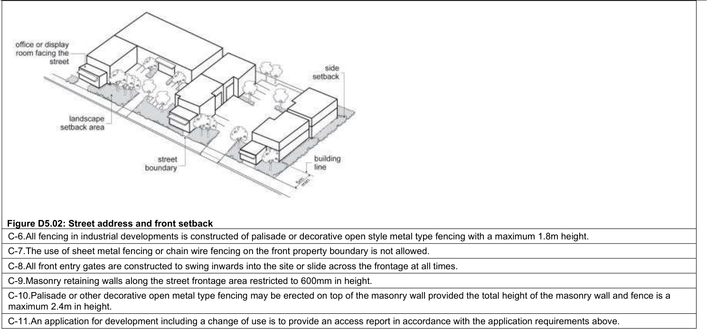

### 9.0 Character and amenity

#### Objectives

1\. Promote development that is functional and attractive in the context of its local environment through appropriate design.

2\. Ensure development is sympathetic with the streetscape character and amenity of any adjoining residential precinct.

3\. Any proposed building or proposed alterations and additions to an existing building are to minimise and ameliorate any potential adverse impacts on amenity, noise privacy or overshadowing on any adjoining residential zoned land.

4\. Provide awareness of the obligations under the Commonwealth's Disability Discrimination Act 1992.

5\. Promote lot consolidation and ensure development does not result in isolated sites.

#### Controls (C)

C-1.Buildings meet a high standard of building design to achieve a suitable level of visual and environmental quality. Attractive building design can, in most cases, be achieved simply and at comparatively low cost, and applicants are encouraged to consider variations in fascia treatments, roof lines and selection of building materials to achieve an attractive design. Design quality is determined having regard to the following:

a. elevations of buildings visible from a public road, reserve, railway or adjacent residential areas are constructed using brick, masonry, pre-coloured metal cladding, appropriately finished ‘tilt-slab’ concrete or a combination of a number of these materials. Large unrelieved expanses of wall or building mass are avoided, and such should be broken up by the use of suitable building articulation, fenestration or alternative architectural enhancements

b. showroom display areas, ancillary offices, staff amenities and other low-scale building elements are, wherever practicable, at the front of the premises and constructed in brick or masonry materials to enhance the appearance of the development. Refer to Figure D5.02

c. roofing materials consist of low-reflective materials particularly when visible from a public place or adjoining residential areas. C-2.Development is not to result in the creation of an isolated site that could have been developed in compliance with the relevant planning controls. Appropriate documentary evidence to demonstrate that a genuine and reasonable attempt has been made to purchase an isolated site based on a fair market value. C-3.Where amalgamation of the isolated site is not feasible, applicants will be required to demonstrate that an orderly and economic use and development of the separate sites can be achieved. C-4.The development of existing isolated sites is not to detract from the character of the streetscape and is to achieve a satisfactory level of amenity including solar access, visual and acoustic privacy. Development of existing isolated sites may not achieve the maximum potential, particularly height and floor space ratio, and will be assessed on merit. C-5.Where adjacent sites are developing concurrently, site planning options for development as an amalgamated site are to be explored.

Newcastle Development Control Plan 2023

D5 Industrial

Page 8 of 19

> [Picture on page 9: a picture, saved as a picture (images/section-d5-industrial-page-9-1.gif, 150 dpi).]

#### Figure D5.02: Street address and front setback

C-6.All fencing in industrial developments is constructed of palisade or decorative open style metal type fencing with a maximum 1.8m height. C-7.The use of sheet metal fencing or chain wire fencing on the front property boundary is not allowed. C-8.All front entry gates are constructed to swing inwards into the site or slide across the frontage at all times. C-9.Masonry retaining walls along the street frontage area restricted to 600mm in height. C-10.Palisade or other decorative open metal type fencing may be erected on top of the masonry wall provided the total height of the masonry wall and fence is a maximum 2.4m in height. C-11.An application for development including a change of use is to provide an access report in accordance with the application requirements above.

Newcastle Development Control Plan 2023

D5 Industrial

Page 9 of 19
