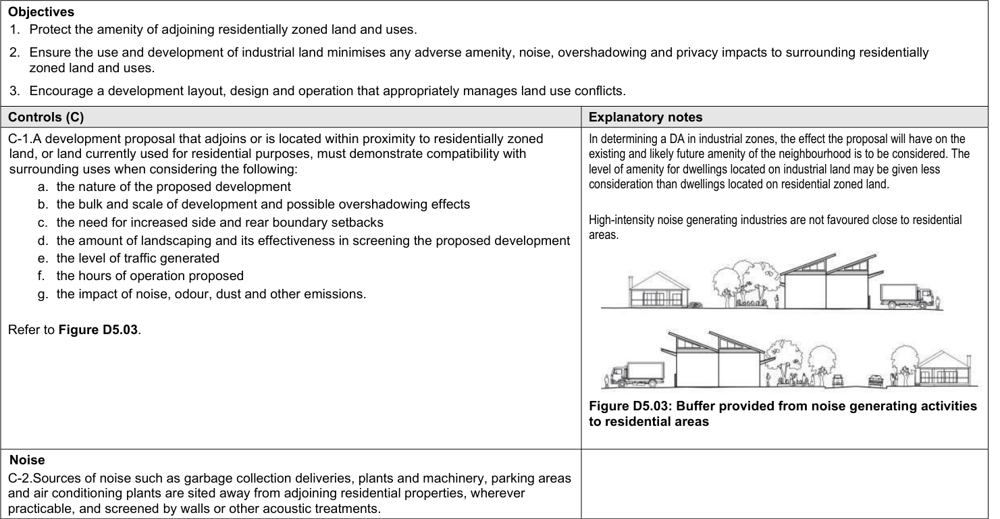

### 10.0 Development that adjoins or is located within proximity to residentially zoned land uses

> [Picture on page 10: a picture, saved as a picture (images/section-d5-industrial-page-10-2.gif, 150 dpi).]
> Words printed on the picture (title and legend, copied from the PDF):
> zoned land and uses.
> Refer to Figure D5.03.

#### Objectives

1\. Protect the amenity of adjoining residentially zoned land and uses.

2\. Ensure the use and development of industrial land minimises any adverse amenity, noise, overshadowing and privacy impacts to surrounding residentially

3\. Encourage a development layout, design and operation that appropriately manages land use conflicts.

#### Controls (C)

#### Explanatory notes

C-1.A development proposal that adjoins or is located within proximity to residentially zoned In determining a DA in industrial zones, the effect the proposal will have on the land, or land currently used for residential purposes, must demonstrate compatibility with surrounding uses when considering the following:

a. the nature of the proposed development

b. the bulk and scale of development and possible overshadowing effects

c. the need for increased side and rear boundary setbacks

existing and likely future amenity of the neighbourhood is to be considered. The level of amenity for dwellings located on industrial land may be given less consideration than dwellings located on residential zoned land.

High-intensity noise generating industries are not favoured close to residential

d. the amount of landscaping and its effectiveness in screening the proposed development

e. the level of traffic generated

f. the hours of operation proposed

g. the impact of noise, odour, dust and other emissions.

#### Noise

areas.

Figure D5.03: Buffer provided from noise generating activities to residential areas

C-2.Sources of noise such as garbage collection deliveries, plants and machinery, parking areas and air conditioning plants are sited away from adjoining residential properties, wherever practicable, and screened by walls or other acoustic treatments.

Newcastle Development Control Plan 2023

D5 Industrial

Page 10 of 19

| C-3.Noise sources impacting residential habitable areas will need to be adequately addressed to ensure appropriate internal noise levels are achieved with respect to appropriate legislation, guidelines and standards. This may require applicants to obtain an acoustic report or a noise impact assessment from an appropriately qualified and experienced acoustic engineer to support their application. | Further information can be found in sub-section 7 Application requirements. |
|---|---|
| Light spill C-4.Lighting is designed or treated to not cause light spill onto adjoining residentially zone land. | A curfew may be imposed on the operation of illuminated signage where continuous illumination may adversely impact the amenity of adjoining dwellings. |
| Privacy C-5.Building siting, window location, communal open space and fencing are designed and located to maximise privacy to adjoining residentially zoned land and uses. |  |
| C-6.Provide privacy screens where the distance from the window to a boundary to adjoining residentially zoned land is: a. less than 3m, and has a finished floor level (FFL) greater than 1m above existing ground level, or b. less than 6m and the room has a FFL greater than 3m above ground level. |  |
| Solar access C-7.Development proposals adjoining residentially zoned land, or land currently used for residential purposes maintain at least: a. three hours of sunlight to the windows of living areas that face north between 9am and 3pm on 21 June, and b. two hours of sunlight to the principal area of private open space between 9am and 3pm on 21 June. Where these requirements cannot be met, the development proposal must not result in additional overshadowing of these areas. |  |

Newcastle Development Control Plan 2023

D5 Industrial

Page 11 of 19
