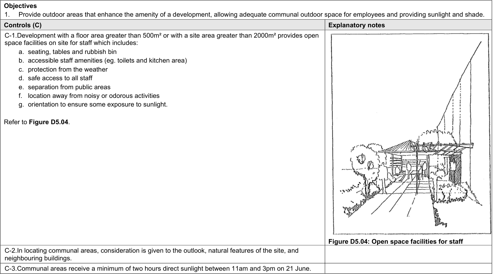

### 11.0 Communal outdoor areas

> [Picture on page 12: a picture, saved as a picture (images/section-d5-industrial-page-12-2.gif, 150 dpi).]
> Words printed on the picture (title and legend, copied from the PDF):
> Refer to Figure D5.04.

#### Objectives

1\. Provide outdoor areas that enhance the amenity of a development, allowing adequate communal outdoor space for employees and providing sunlight and shade.

#### Controls (C)

#### Explanatory notes

C-1. Development with a floor area greater than 500m² or with a site area greater than 2000m² provides open space facilities on site for staff which includes:

a. seating, tables and rubbish bin

b. accessible staff amenities (eg. toilets and kitchen area)

c. protection from the weather

d. safe access to all staff

e. separation from public areas

f. location away from noisy or odorous activities

g. orientation to ensure some exposure to sunlight.

#### Figure D5.04: Open space facilities for staff

C-2. In locating communal areas, consideration is given to the outlook, natural features of the site, and neighbouring buildings. C-3. Communal areas receive a minimum of two hours direct sunlight between 11am and 3pm on 21 June.

Newcastle Development Control Plan 2023

D5 Industrial

Page 12 of 19
