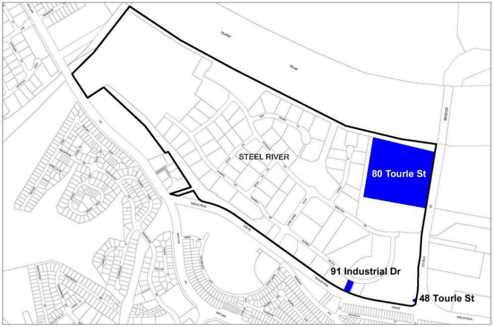

### 16.0 Land in Zone E4 General Industrial 'Steel River Precinct'

The following controls apply to all development within ‘Steel River’ as identified on Map D5.05. If there is an inconsistency between a control under this part and elsewhere within DCP 2023 this part will take precedence to the extent of the inconsistency

> [Picture on page 16: a picture, saved as a picture (images/section-d5-industrial-page-16-4.gif, 150 dpi).]

#### Map D5.05: Steel River

Note: 80 Tourle Street (Lot 1 DP874109) (former EMD Plant), 48 Tourle Street (Lot 2 DP523584) and 91 Industrial Drive (Lot11 DP842850) as shown on the map above are not part of the Steel River precinct (according to the Strategic Impact Assessment Study (1998)) and are therefore exempt from the area specific controls in 17.0 Land in Zone E4 General Industrial 'Steel River', thus the general industrial development controls apply. Please consult with City of Newcastle (CN) if you are unsure about the controls that apply to these sites. Newcastle Development Control Plan 2023

D5 Industrial

Page 16 of 19

#### Objectives

1\. Identify special controls applying to 'Steel River.'

#### Controls (C)

C-1.The consent authority will not grant consent to the carrying out of development on land to which this part applies unless:

a. the development is allowed with consent and complies with the environmental envelope, and

b. the environmental effects of any aspect of the development relating to air quality, noise emissions or water quality that have not been addressed in the ‘Strategic Impact Assessment Study’, meet any relevant standards determined by the Office of Environment and Heritage.

Newcastle Development Control Plan 2023

D5 Industrial

#### Explanatory notes

Strategic Impact Assessment Study: The study titled ‘Strategic Impact Assessment Study’ concerning land at Tourle Street and Industrial Drive, Mayfield - the Steel River Project, February 1998, approved by CN, a copy of which is available on the CN website.

Environmental envelope - all the requirements set out in Part D of the ‘Strategic Impact Assessment Study’, and includes (without limitation) the requirements relating to the following:

air quality, noise emissions and water quality industrial ecology and ecologically sustainable development air quality, noise emissions and water quality industrial ecology and ecologically sustainable development the social and economic welfare of residents and workers in Newcastle urban design and landscaping

the cultural, historic and landscape significance of the land.

Page 17 of 19
