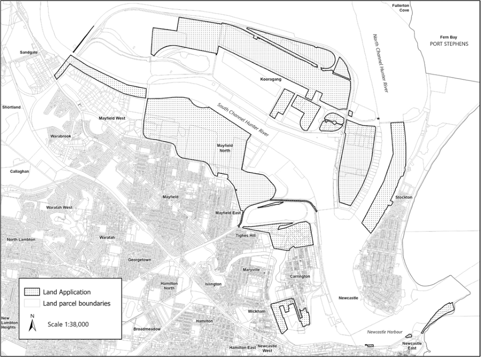

### 17.0 Land outside the Port of Newcastle lease area

The following additional controls apply to development of land zoned SP1 (Special Use) under the State Environmental Planning Policy (Transport and Infrastructure) 2021 located outside the Port of Newcastle Lease Area and shown as applicable in Map D5.06. If there is an inconsistency between a control under this section and elsewhere within DCP 2023, this section will take precedence to the extent of the inconsistency.

> [Picture on page 18: a picture, saved as a picture (images/section-d5-industrial-page-18-5.gif, 150 dpi).]

Map D5.06: Land identified under State Environmental Planning Policy (Transport and Infrastructure) 2021

Newcastle Development Control Plan 2023

D5 Industrial

Page 18 of 19
