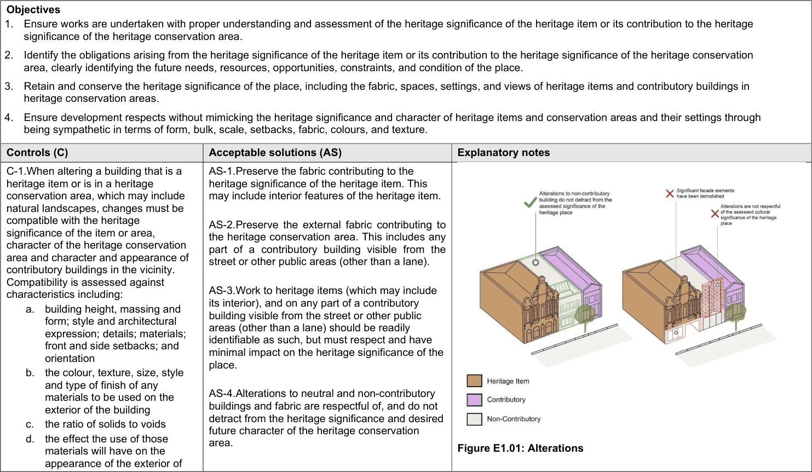
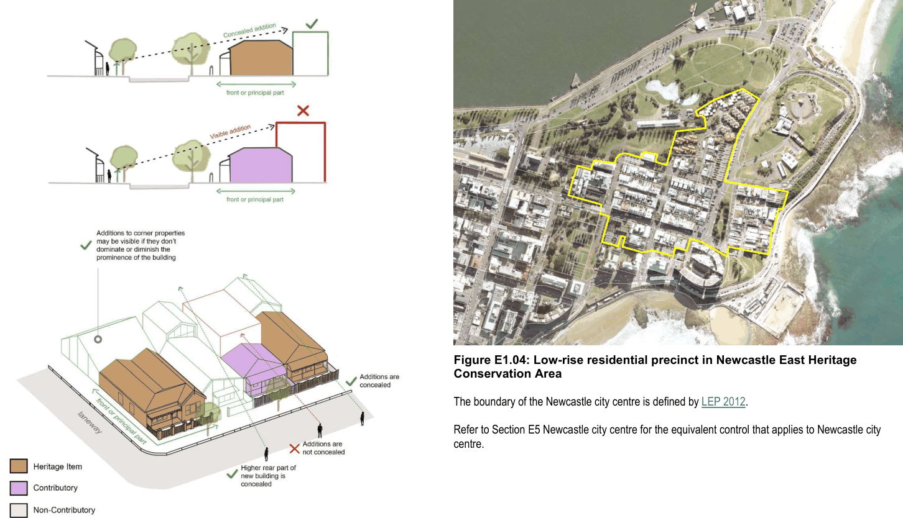

### 8.0 General

> [Picture on page 10: a picture, saved as a picture (images/section-e1-built-and-landscape-heritage-page-10-3.gif, 150 dpi).]
> Words printed on the picture (title and legend, copied from the PDF):
> heritage conservation areas.

#### Objectives

1\. Ensure works are undertaken with proper understanding and assessment of the heritage significance of the heritage item or its contribution to the heritage significance of the heritage conservation area.

2\. Identify the obligations arising from the heritage significance of the heritage item or its contribution to the heritage significance of the heritage conservation area, clearly identifying the future needs, resources, opportunities, constraints, and condition of the place.

3\. Retain and conserve the heritage significance of the place, including the fabric, spaces, settings, and views of heritage items and contributory buildings in

4\. Ensure development respects without mimicking the heritage significance and character of heritage items and conservation areas and their settings through being sympathetic in terms of form, bulk, scale, setbacks, fabric, colours, and texture.

| Controls (C) | Acceptable solutions (AS) | Explanatory notes |
|---|---|---|
| C-1.When altering a building that is a heritage item or is in a heritage conservation area, which may include | AS-1.Preserve the fabric contributing to the heritage significance of the heritage item. This may include interior features of the heritage item. |  |
| natural landscapes, changes must be compatible with the heritage significance of the item or area, character of the heritage conservation area and character and appearance of contributory buildings in the vicinity. | AS-2.Preserve the external fabric contributing to the heritage conservation area. This includes any part of a contributory building visible from the street or other public areas (other than a lane). |  |
| Compatibility is assessed against characteristics including: a. building height, massing and form; style and architectural expression; details; materials; front and side setbacks; and orientation b. the colour, texture, size, style | AS-3.Work to heritage items (which may include its interior), and on any part of a contributory building visible from the street or other public areas (other than a lane) should be readily identifiable as such, but must respect and have minimal impact on the heritage significance of the place. |  |
| and type of finish of any materials to be used on the exterior of the building c. the ratio of solids to voids d. the effect the use of those materials will have on the appearance of the exterior of | AS-4.Alterations to neutral and non-contributory buildings and fabric are respectful of, and do not detract from the heritage significance and desired future character of the heritage conservation area. | Figure E1.01: Alterations |

_______________________________________________________________________________________________________________________________________

______________________________________________________________________________________________________________________________________

| the building and of any other building in its vicinity e. the size, style, proportion and position of openings for any windows and doors which will result from, or be affected by, the carrying out of the development f. the pitch and form of the roof. | AS-1.When proposing to convert large dwelling houses into multiple dwellings, the single dwelling house appearance should be maintained to conserve the heritage significance of the building. Careful consideration of the design and siting of access to individual dwellings and car parking. AS-2.Additions to existing buildings: a. maintain the prominence of the building by setting back the addition behind the front or principal part of the building, and from other visible parts and moderating height b. retain significant roof form within the setback from the building facade together with roof elements of original fabric c. should not obscure views of facades or elevations associated with the front or principal part of the building. | Figure E1.02: Respectful additions Any development will be considered in relation to the elements of bulk and scale, setbacks, and materials and colours. |
|---|---|---|
| C-2.Additions to a heritage item or building within a heritage conservation area should be concealed and not seen from the street. | AS-1.Additions are concealed and cannot be seen from the street or other public areas (other than a lane). AS-2.All ground level additions to the side of a building are set back behind the front or principal part of the building. AS-3.Additions to corner properties may be visible but should be respectful of the heritage item or building in a heritage conservation area in terms of scale and placement, and not dominate or diminish the prominence of the host building or adjoining contributory or heritage item buildings. | These controls apply to all properties outside the Newcastle city centre. This includes land outside the Newcastle city centre zoned by LEP 2012 for mixed-use and local centre purposes such as in Darby Street, Cooks Hill and Beaumont Street, Hamilton where the existing two storey scale of buildings visible from the street are to be maintained. These controls also apply to all properties in the low-rise residential precinct of the Newcastle East Heritage Conservation Area identified in Figure E1.04 below, where the existing two to three storey scale of buildings visible from the street are to be maintained. Refer to Figure E1.03. |

_______________________________________________________________________________________________________________________________________

______________________________________________________________________________________________________________________________________

| C-3.The higher parts of a new building adjacent to a heritage item or within a heritage conservation area should be concealed and not seen from the street. |  | Refer to Figure E1.03. |
|---|---|---|
| C-4.Development of a heritage item or place within a heritage conservation area incorporates heritage interpretation at the site, where appropriate, to improve understanding and sense of place within the community. | AS-1.Development provides high quality heritage interpretation at the site, appropriate for the level of heritage significance. | Interpretation of the site may include the use of historic artefacts, the in-situ retention of relics and Aboriginal objects, signage, artwork, public access, guided walks, electronic media, architectural design and built form etc. The heritage significance of many places is not readily apparent and should be explained by interpretation. Interpretation should enhance understanding and engagement, and be culturally appropriate. |
| C-5.Development within the vicinity of a heritage item or within the vicinity of a conservation area maintains the heritage significance and character of the item or place including its site and setting. |  |  |

_______________________________________________________________________________________________________________________________________

______________________________________________________________________________________________________________________________________

> [Picture on page 13: a picture, saved as a picture (images/section-e1-built-and-landscape-heritage-page-13-2.gif, 150 dpi).]

Figure E1.04: Low-rise residential precinct in Newcastle East Heritage Conservation Area

The boundary of the Newcastle city centre is defined by LEP 2012.

Refer to Section E5 Newcastle city centre for the equivalent control that applies to Newcastle city centre.

#### Figure E1.03: Concealed additions and higher parts of a new building

_______________________________________________________________________________________________________________________________________

______________________________________________________________________________________________________________________________________
