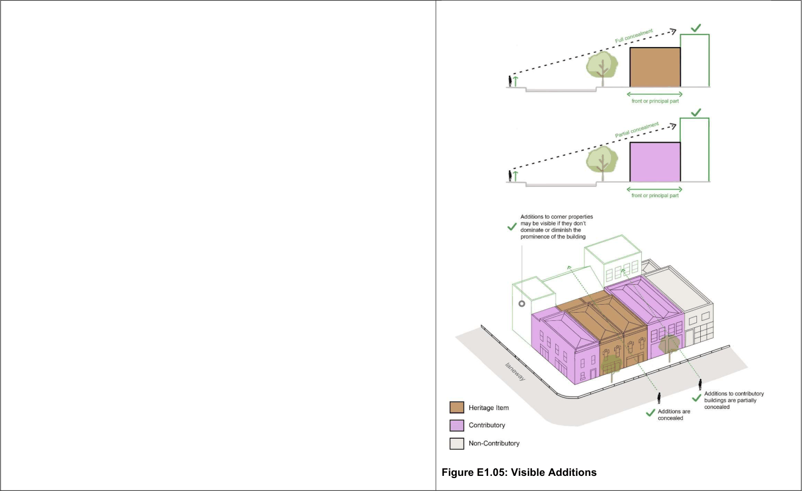
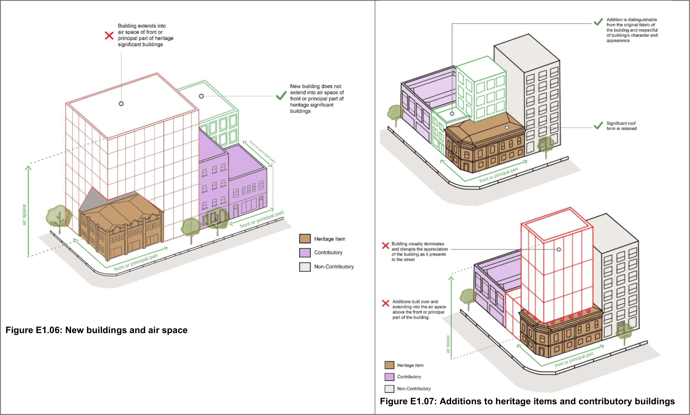

### 9.0 Exceptions in Newcastle city centre

| Objectives 1. Ensure modifications to existing heritage items or contributory buildings in heritage conservation areas does not adversely impact the heritage significance of the item or place. 2. Ensure development of heritage items and contributory buildings in heritage conservation areas in the Newcastle city centre are respectful and do not dominate or diminish the prominence of the host building or adjoining contributory or heritage item building. 3. Ensure development contributes to the economic revitalisation and strengthens the regional position of the Newcastle city centre, but otherwise respects and does not distort or obscure the heritage significance of the place. |  |  |
|---|---|---|
| Controls (C) | Acceptable solutions (AS) | Explanatory notes |
| C-1.Within the Newcastle city centre, additions to a heritage item or contributory building within a heritage conservation area are partly concealed and do not dominate or reduce the prominence of the host building in the street. C-2.Within the Newcastle city centre, higher rear parts of a new building adjacent to a heritage item or contributory building within a heritage conservation area are partly concealed and do not dominate or reduce the prominence of heritage items or contributory buildings in the street. | AS-1.Additions to heritage items and contributory buildings should be partly concealed. Some of the addition or higher rear part(s) may be visible, provided it does not dominate or reduce the prominence of the building's facade(s) in the street. AS-2.Additions to corner properties may be visible but should be respectful of the heritage item or contributory building in terms of scale and placement, and not dominate or diminish the prominence of the host building or adjoining contributory or heritage item building. AS-3.Development does not build over or extend into the air space of heritage items or contributory buildings in heritage conservation areas. | The boundary of the Newcastle city centre is defined by LEP 2012. The controls of this section do not apply to the low-rise residential precinct in Newcastle East Heritage Conservation Area identified in Figure E1.04. Refer to Section E5 Newcastle city centre for controls. |

_______________________________________________________________________________________________________________________________________

______________________________________________________________________________________________________________________________________

> [Picture on page 15: a picture, saved as a picture (images/section-e1-built-and-landscape-heritage-page-15-2.gif, 150 dpi).]

#### Figure E1.05: Visible Additions

_______________________________________________________________________________________________________________________________________

______________________________________________________________________________________________________________________________________

> [Picture on page 16: a picture, saved as a picture (images/section-e1-built-and-landscape-heritage-page-16-2.gif, 150 dpi).]

#### Figure E1.06: New buildings and air space

#### Figure E1.07: Additions to heritage items and contributory buildings

_______________________________________________________________________________________________________________________________________

______________________________________________________________________________________________________________________________________
