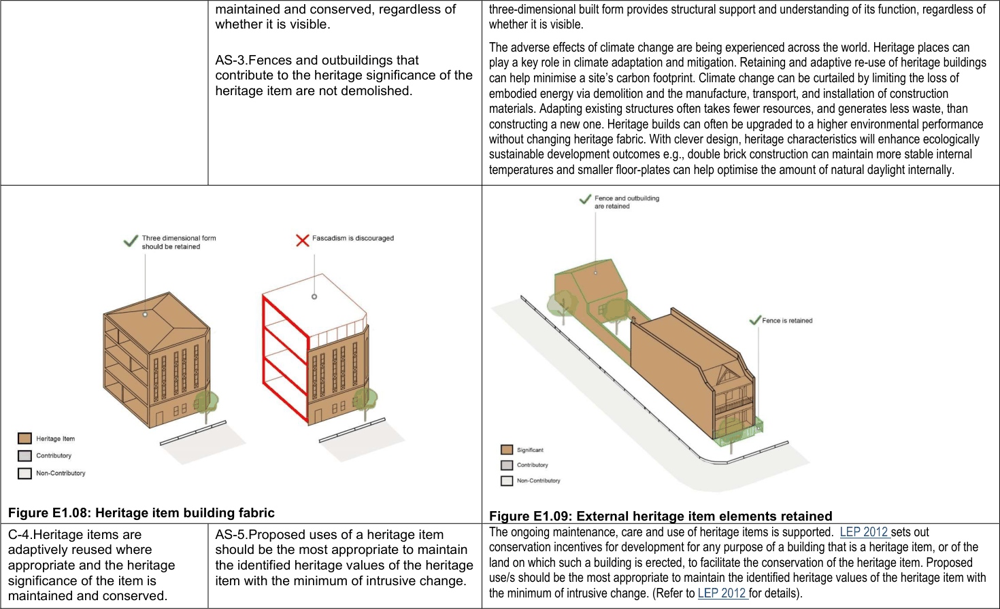

### 10.0 Heritage items

| Objectives 1. Ensure significant components of heritage items are retained and conserved, including the three-dimensional fabric and form of built heritage items. 2. Encourage heritage items to be used for purposes appropriate to their heritage significance. 3. Encourage the removal of unsympathetic alterations and additions and reinstatement of original features and details, based on historical evidence rather than conjecture. 4. Support ongoing maintenance, care and use of heritage items, while changing as little as possible so that its heritage significance is retained and conserved. 5. Maintain the curtilage and streetscape context of heritage items through appropriate design, built form, architectural style and landscaping. 6. Ensure work to a heritage item respects and does not distort or obscure the heritage significance of the place or detract from its interpretation and appreciation. |  |  |
|---|---|---|
| Controls (C) | Acceptable solutions (AS) | Explanatory notes |
| C-1.Change as much as necessary but as little as possible of any heritage item. Where appropriate this includes the retention and conservation of the: a. floor plan b. existing fabric (interior and exterior) c. use d. associations and meanings. |  | The amount of change to a heritage item should be guided by the heritage significance of the place. As advocated by the Burra Charter, do as much as necessary to care for the place and make it usable, but otherwise change as little as possible so that its heritage significance is retained. Different components of a heritage item may make a different relative contribution to its heritage value. Grading the significance of the heritage item's components helps identify possible sensitive changes. The heritage significance and protected character of a built heritage item often applies to the interior as well as exterior of the building, including its fabric and the layout of rooms and spaces. |
| C-2.Repaint existing painted surfaces in colours sympathetic to the architectural style and period of the building. | AS-1.The traditional heritage colour scheme for the heritage item may be determined based on evidence of how the building originally looked (such as from photographs and paint scrapings) or replicate a colour scheme from the period. | Heritage items look best in their original colour scheme or traditional heritage colour scheme appropriate to the architectural style and period of the property. Refer to CN's 'Traditional Finishes and Colour Schemes: A Guide, September 2015' or consult with a paint specialist for more information. A more modern scheme can be used. Select neutral colours and emphasise decorative features (such as verandah posts, architraves, and lintels) in a contrasting or lighter colour. |
| C-3.Development retains and conserves the three-dimensional fabric and form of built heritage items. | AS-1.Development does not result in the demolition of a heritage item. AS-2.The exterior face(s) of a building with its three-dimensional built form is | The demolition of heritage items is generally not supported. Demolition of a heritage item will only be allowed where irrefutable evidence is provided that the contribution of the building to the significance of the item has been destroyed or lost; or where there is demonstrated overwhelming structural instability that cannot be rectified (an example would be major damage caused by an earthquake). Facadism of heritage items is discouraged. The retention of the exterior face(s) of a building with its |

_______________________________________________________________________________________________________________________________________

______________________________________________________________________________________________________________________________________

> [Picture on page 18: a picture, saved as a picture (images/section-e1-built-and-landscape-heritage-page-18-2.gif, 150 dpi).]

three-dimensional built form provides structural support and understanding of its function, regardless of whether it is visible.

maintained and conserved, regardless of whether it is visible.

AS-3.Fences and outbuildings that contribute to the heritage significance of the heritage item are not demolished.

The adverse effects of climate change are being experienced across the world. Heritage places can play a key role in climate adaptation and mitigation. Retaining and adaptive re-use of heritage buildings can help minimise a site’s carbon footprint. Climate change can be curtailed by limiting the loss of embodied energy via demolition and the manufacture, transport, and installation of construction materials. Adapting existing structures often takes fewer resources, and generates less waste, than constructing a new one. Heritage builds can often be upgraded to a higher environmental performance without changing heritage fabric. With clever design, heritage characteristics will enhance ecologically sustainable development outcomes e.g., double brick construction can maintain more stable internal temperatures and smaller floor-plates can help optimise the amount of natural daylight internally.

#### Figure E1.08: Heritage item building fabric

AS-5.Proposed uses of a heritage item should be the most appropriate to maintain the identified heritage values of the heritage item with the minimum of intrusive change.

The ongoing maintenance, care and use of heritage items is supported.  LEP 2012 sets out conservation incentives for development for any purpose of a building that is a heritage item, or of the land on which such a building is erected, to facilitate the conservation of the heritage item. Proposed use/s should be the most appropriate to maintain the identified heritage values of the heritage item with the minimum of intrusive change. (Refer to LEP 2012 for details).

#### Figure E1.09: External heritage item elements retained

C-4.Heritage items are adaptively reused where appropriate and the heritage significance of the item is maintained and conserved.

_______________________________________________________________________________________________________________________________________

______________________________________________________________________________________________________________________________________
