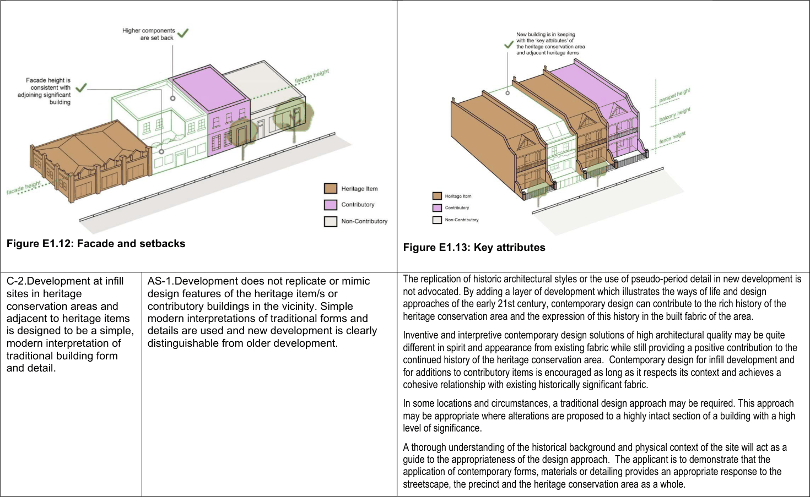

### 12.0 Infill sites

#### Objectives

1\. Maintain the heritage significance of heritage items and heritage conservation areas based on an understanding and respect for existing fabric, use, associations, and meanings of the place.

2\. Infill development is consistent with and complementary to the massing, form, rhythm, bulk, scale, setbacks, wall height, building height, roof pitch, parapet and ridge line of neighbouring heritage items and contributory buildings which predominate in the street.

3\. Infill development in heritage conservation areas and adjacent to heritage items is clearly distinguishable and does not mimic the established heritage character.

| Control (C) | Acceptable solutions (AS) | Explanatory notes |
|---|---|---|
| C-1.Development at infill sites in heritage conservation areas and adjacent to heritage items | AS-1.Buildings are in keeping with the architectural character of heritage items and the heritage significance and desired future character of the heritage conservation area, such as: |  |
| respects and is sympathetic to the design of its neighbours and the character of the heritage | a. building height, massing and form; style and architectural expression; details; materials; front and side setbacks; and orientation and fencing |  |
| conservation area yet does not mimic the established | b. prevailing streetscape height and scale. |  |
| character or visually dominate or disrupt the appreciation of the heritage place. | AS-2.Parapets, cornices, spandrels and balconies are to adopt the general horizontal alignments displayed by neighbouring buildings with sympathetic interpretations. AS-3.Awnings, blinds, sun hoods and recessed balconies form integral elements in the design and articulation of facades and should be consistent with the predominant pattern, proportion and repetition of such elements in the street. AS-4.Building elements such as windows, doors, recessed walls and other architectural features are to be used to minimise large expanses of blank walls and glazed areas. |  |

_______________________________________________________________________________________________________________________________________

______________________________________________________________________________________________________________________________________

> [Picture on page 24: a picture, saved as a picture (images/section-e1-built-and-landscape-heritage-page-24-2.gif, 150 dpi).]

#### Figure E1.13: Key attributes

#### Figure E1.12: Facade and setbacks

| C-2.Development at infill sites in heritage conservation areas and adjacent to heritage items | AS-1.Development does not replicate or mimic design features of the heritage item/s or contributory buildings in the vicinity. Simple modern interpretations of traditional forms and | The replication of historic architectural styles or the use of pseudo-period detail in new development is not advocated. By adding a layer of development which illustrates the ways of life and design approaches of the early 21st century, contemporary design can contribute to the rich history of the heritage conservation area and the expression of this history in the built fabric of the area. |
|---|---|---|
| is designed to be a simple, modern interpretation of traditional building form and detail. | details are used and new development is clearly distinguishable from older development. | Inventive and interpretive contemporary design solutions of high architectural quality may be quite different in spirit and appearance from existing fabric while still providing a positive contribution to the continued history of the heritage conservation area. Contemporary design for infill development and for additions to contributory items is encouraged as long as it respects its context and achieves a cohesive relationship with existing historically significant fabric. In some locations and circumstances, a traditional design approach may be required. This approach may be appropriate where alterations are proposed to a highly intact section of a building with a high level of significance. A thorough understanding of the historical background and physical context of the site will act as a guide to the appropriateness of the design approach. The applicant is to demonstrate that the application of contemporary forms, materials or detailing provides an appropriate response to the streetscape, the precinct and the heritage conservation area as a whole. |

_______________________________________________________________________________________________________________________________________

______________________________________________________________________________________________________________________________________
