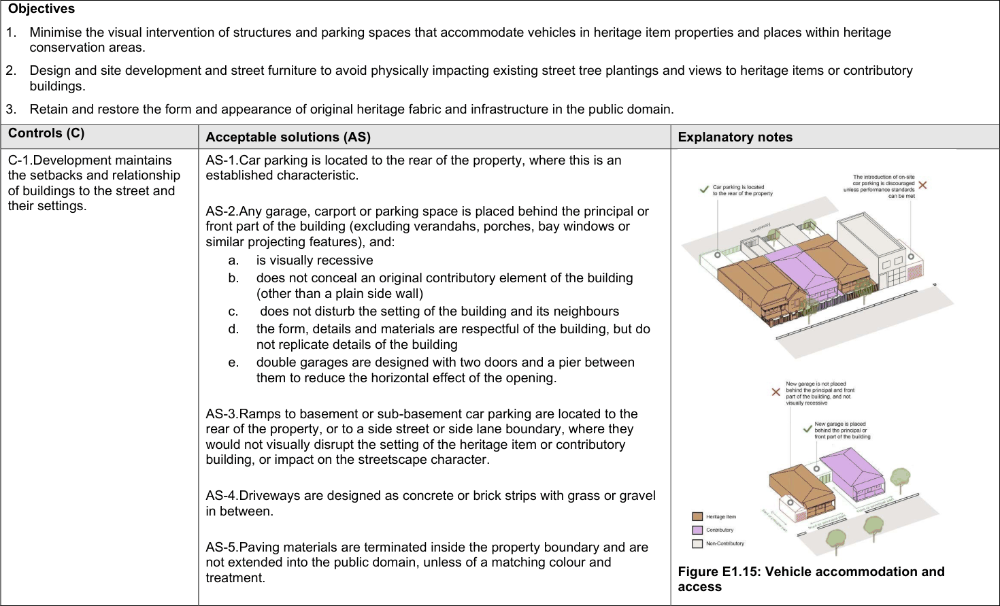
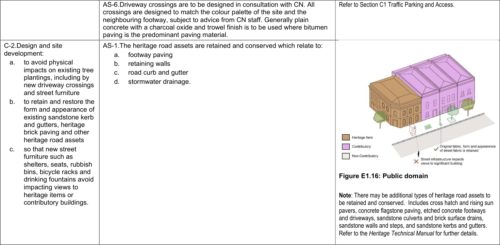

### 14.0 Vehicle accommodation, access and the public domain

> [Picture on page 27: a picture, saved as a picture (images/section-e1-built-and-landscape-heritage-page-27-3.gif, 150 dpi).]
> Words printed on the picture (title and legend, copied from the PDF):
> conservation areas.
> buildings.

#### Objectives

1\. Minimise the visual intervention of structures and parking spaces that accommodate vehicles in heritage item properties and places within heritage

2\. Design and site development and street furniture to avoid physically impacting existing street tree plantings and views to heritage items or contributory

3\. Retain and restore the form and appearance of original heritage fabric and infrastructure in the public domain.

#### Controls (C)

#### Acceptable solutions (AS)

#### Explanatory notes

C-1.Development maintains the setbacks and relationship of buildings to the street and their settings.

AS-1.Car parking is located to the rear of the property, where this is an established characteristic.

AS-2.Any garage, carport or parking space is placed behind the principal or front part of the building (excluding verandahs, porches, bay windows or similar projecting features), and:

Figure E1.15: Vehicle accommodation and access

a. is visually recessive

b. does not conceal an original contributory element of the building (other than a plain side wall)

c. does not disturb the setting of the building and its neighbours

d. the form, details and materials are respectful of the building, but do not replicate details of the building

e. double garages are designed with two doors and a pier between them to reduce the horizontal effect of the opening.

AS-3.Ramps to basement or sub-basement car parking are located to the rear of the property, or to a side street or side lane boundary, where they would not visually disrupt the setting of the heritage item or contributory building, or impact on the streetscape character.

AS-4.Driveways are designed as concrete or brick strips with grass or gravel in between.

AS-5.Paving materials are terminated inside the property boundary and are not extended into the public domain, unless of a matching colour and treatment.

_______________________________________________________________________________________________________________________________________

______________________________________________________________________________________________________________________________________

> [Picture on page 28: a map, saved as a picture (images/section-e1-built-and-landscape-heritage-page-28-2.gif, 150 dpi); the street names and other small labels are on the picture.]
> Words printed on the picture (title and legend, copied from the PDF):
> C-2.Design and site
> a. to avoid physical
> impacts on existing tree
> plantings, including by
> new driveway crossings
> and street furniture
> form and appearance of
> existing sandstone kerb
> and gutters, heritage
> brick paving and other
> heritage road assets
> furniture such as
> shelters, seats, rubbish
> bins, bicycle racks and
> drinking fountains avoid
> impacting views to
> heritage items or

Refer to Section C1 Traffic Parking and Access.

AS-6.Driveway crossings are to be designed in consultation with CN. All crossings are designed to match the colour palette of the site and the neighbouring footway, subject to advice from CN staff. Generally plain concrete with a charcoal oxide and trowel finish is to be used where bitumen paving is the predominant paving material. AS-1.The heritage road assets are retained and conserved which relate to:

a. footway paving

b. retaining walls

c. road curb and gutter

d. stormwater drainage.

#### Figure E1.16: Public domain

b. to retain and restore the

c. so that new street

Note: There may be additional types of heritage road assets to be retained and conserved.  Includes cross hatch and rising sun pavers, concrete flagstone paving, etched concrete footways and driveways, sandstone culverts and brick surface drains, sandstone walls and steps, and sandstone kerbs and gutters. Refer to the Heritage Technical Manual for further details.

_______________________________________________________________________________________________________________________________________

______________________________________________________________________________________________________________________________________
