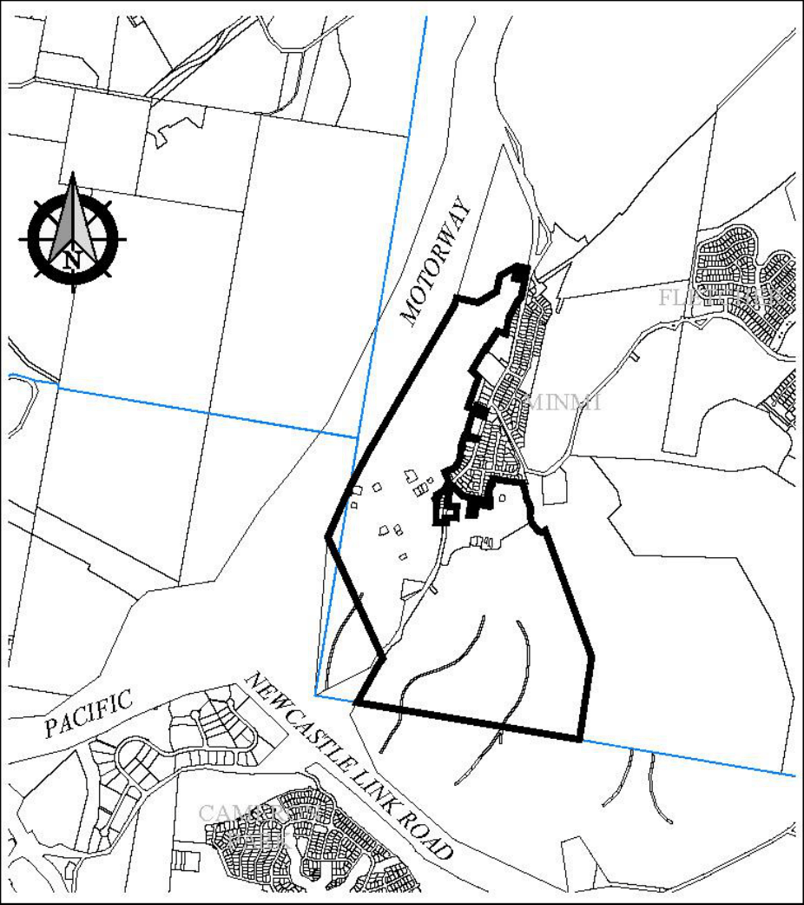

### 4.0 Minmi precinct development guidelines

See following pages.

#### Related sections

The following sections will apply to development:

Part D – Development controls by land use

C1 Traffic, parking and access

C4 Stormwater

C6 Waste management

C12 Open space and landscaping.

The following sections may also apply to development:

B1 Flood management

B2 Bush fire protection

B3 Mine subsidence

B4 Aboriginal cultural heritage

B5 Historical archaeology

B7 Contamination

C2 Movement networks

C3 Vegetation preservation and care

C5 Soil management

C7 Safety and security

C8 Social impact

E1 Built and landscape heritage

Page 2 of 2

E10 Minmi extension

Newcastle Development Control Plan 2023

### • Village Centre Precinct

### • Link Road North Precinct

### • Minmi Extension Precinct

Prepared by ADW Johnson Pty Ltd on behalf of Winten Property Group

#### 9 NOVEMBER  2018

#### Introduction

The Minmi Link Road Precinct Guidelines (herein referred to as the Guidelines) are guidelines prepared under the terms of Concept Approval MP 10_0090 for future development requiring consent on land to the west and south of the Minmi Township, between the M1 Motorway and Blue Gum Hills Regional Park.

The Guidelines relate to three Precincts being:

• Village Centre Precinct;

• Link Road North Precinct (being that portion within the Newcastle Local Government Area); and

• Minmi Extension Precinct.

Together these precincts (inclusive of Link Road North Precinct that also sits within the Lake Macquarie Local Government Area (LGA)) will be developed to allow approximately 2280 dwellings, as well as mixed use and local centre uses.

#### Relationship with Concept Approval MP 10_0090

Concept Approval MP 10_0090 applies to land within the three Precincts, as well as surrounding lands within the Newcastle, Lake Macquarie and Cessnock local government areas (LGA). The Concept Approval includes approval in summary for:

• A five stage development with up to 3,300 dwellings across the 520 ha development site (Newcastle and Lake Macquarie LGA’s);

• Supporting commercial / retail development of up to a total of approximately 8,000 sqm of commercial gross floor area within a new village centre and high street centre;

• Urban design guidelines subject to further modifications;

• Dedication of approximately 1,561 ha of conservation lands to the NSW Government;

• Indicative staging; and

• Associated infrastructure.

The broader Concept Plan Urban Design Guidelines (known as Appendix A dated May 2014 and Appendix B dated November 2014) (herein referred to as the CPUDG) were modified to satisfy the requirements of Condition 1.13 of Concept Approval MP 10_0090, as required by Condition 1.12. Those form part of the Concept Approval (excluding indicative lot layout and indicative road layout).

The CPUDG have been utilised to inform these Guidelines, as relevant, to collectively satisfy Condition 1.13 for the relevant precincts. The Guidelines have been prepared in a form that will enable adoption of the provisions as site specific controls within Newcastle Development Control Plan 2012 (Newcastle DCP 2012) at a future date. While the CPUDG provide higher level background information, these subject Guidelines are to be used for future development assessment.

Part D of the Concept Approval identifies further assessment requirements for subdivision development applications, irrespective of the Guidelines, including matters relating to lots with slopes

greater than 20%, landscaping and public domain, staging plans, biodiversity, flooding, stormwater management and water quality, groundwater, contamination, mine subsidence, traffic and access, heritage, traffic noise, noise and odour, bushfire management, construction impacts, utilities and perimeter roads. These requirements apply irrespective of the Guidelines and are not necessarily repeated.

The Guidelines are additional information to guide future development applications and are not stand alone.

#### Land to which the Guidelines Applies

The Guidelines apply to all land within the heavy line marked on Map 1 – Site Area

#### Map 1: Site Area

> [Picture on page 5: a picture, saved as a picture (images/section-e10-minmi-extension-village-centre-and-link-road-nor-page-5-11.gif, 150 dpi).]

Development (type/s) to which the Guidelines applies to

The Guidelines apply to all development within the Precincts requiring development consent. The primary purpose is to guide development for the purposes of subdivision (and associated works) on the site, and to also provide guidance for other development types permissible on this land.

#### Applicable Legislation and Environmental Planning Instruments

The provisions of Newcastle Local Environmental Plan 2012 also apply to development applications to which the Guidelines apply, other than where those provisions are inconsistent with the Concept Approval, as per the Transitional Arrangements for Part 3A.

In the event of any inconsistency between the Guidelines and the above listed environmental planning instrument, the Concept Approval and these associated Guidelines will prevail to the extent of the inconsistency.

Note 1: Additional environmental planning instruments may also apply in addition to those listed above. Note 2: State Environmental Planning Policy (Exempt and Complying Codes) 2008 may also apply to development in the Minmi Urban Release Area. Note 3: State Environmental Planning Policy (Housing for Seniors or People with a Disability) 2004 may also apply to development within the site.

#### Relationship to Newcastle DCP 2012

The provisions of Newcastle Development Control Plan 2012 (Newcastle DCP 2012) also apply to development applications to which the Guidelines apply, other than where those provisions are inconsistent with the Concept Approval.

The Guidelines identify precinct specific provisions that may be a departure from provisions contained in the Newcastle DCP 2012. In the event that any inconsistency arises from the reading of the Guidelines with the Newcastle DCP 2012, these Guidelines will prevail to the extent of the inconsistency.

The following sections of the Newcastle DCP 2012 and associated technical manuals may also apply to development to which the Guidelines apply. However, this is only where they are relevant to a particular development, and only where the provisions are not inconsistent with the terms of the Concept Approval, its further environmental assessment requirements and these Guidelines. It is noted that the Further Environmental Assessment Requirements for subdivision development applications are detailed in the Concept Approval.

• Any applicable land use specific provision under Part 3.00, including 3.01 Subdivision, 3.02 Single Dwellings, 3.03 Residential Development, 3.10 Commercial Uses;

• 4.01 Flood Management;

• 4.02 Bush Fire Protection;

• 4.03 Mine Subsidence;

• 4.04 Safety and Security;

• 4.05 Social Impact;

• 5.01 Soil Management;

• 5.02 Land Contamination;

• 5.03 Tree Management (except only for development other than subdivision);

• 5.04 Aboriginal Heritage;

• 5.05 Heritage Items;

• 5.06 Archaeological Management;

• 7.02 Landscape Open Space and Visual Amenity;

• 7.03 Traffic, Parking and Access;

• 7.04 Movement Networks;

• 7.05 Energy Efficiency;

• 7.06 Stormwater;

• 7.07 Water Efficiency;

• 7.08 Waste Management;

• 7.09 Advertising and Signage;

• 7.10 Street Awnings and Balconies; and

• 7.11 Development Adjoining Laneways.

#### Associated Technical Manual/s

Nil (there is no technical manual specifically linked to this Guideline, however, a suite of Technical Manuals apply under Newcastle DCP 2012).

#### Additional Information

• Concept Approval (MP10_0090) for land at Minmi, Link Road and Stockrington, including as modified;

• Coal and Allied Northern Estates Minmi – Link Road Concept Plan Design Guidelines by RPS (Appendix A, dated May 2014); and

• Coal and Allied Northern Estates Minmi – Link Road Urban Design Guidelines by RPS (Appendix B dated November 2014).

#### Definitions

A word or expression used in this development control plan has the same meaning as it has in Newcastle Local Environmental Plan 2012, unless it is otherwise defined in Newcastle DCP 2012 or the Guidelines.

#### Aims of the Guidelines

1\. To provide stage specific Urban Design Guidelines in accordance with Condition 1.13 of the Concept Approval (MP10_0090);

2\. To ensure that each Precinct is developed generally consistent with the Concept Approval (MP10_0090), including as modified, applying to the site;

3\. To ensure that the development potential of the urban release area is optimised given its strategic location and is efficiently used to contribute to the projected growth of the locality, diversification in housing choice and encourage local centre development;

4\. To identify indicative lot layout and access principles for each precinct that are specific to the locality or not otherwise specifically addressed in Part D of the Concept Approval or elsewhere;

5\. To acknowledge site topography and past mining constraints, identify principles to guide subdivision earthworks and retaining, and ensure that lots are physically capable of development and have appropriate levels of amenity and access;

6\. To identify key requirements relating to other development types that are specific to the locality, to encourage development that enhances the built environment and where not addressed elsewhere; and

7\. To acknowledge, respect and respond to the existing built and natural environment within the fabric of the development, having regard to the outcomes of the Concept Approval.
