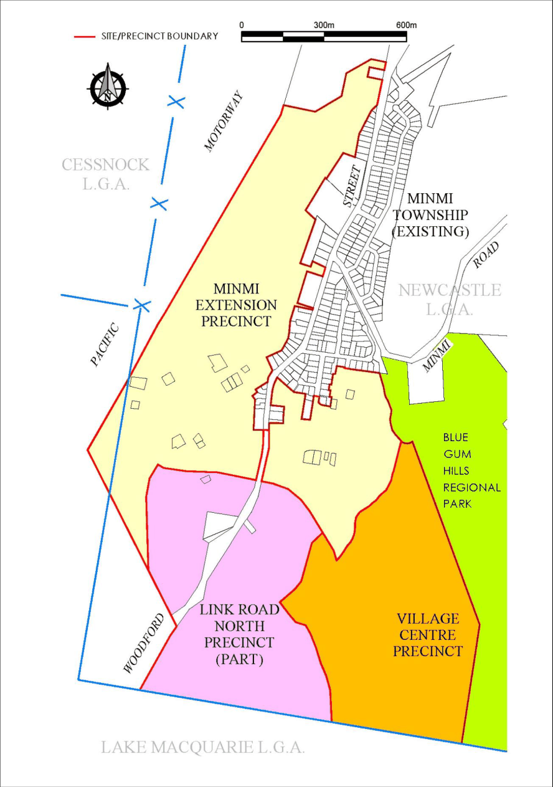

### 1.0  Character Statement

The Guidelines apply to land within three precincts as shown on Map 2 – Precincts.

#### Map 2: Precincts

> [Picture on page 8: a picture, saved as a picture (images/section-e10-minmi-extension-village-centre-and-link-road-nor-page-8-4.gif, 150 dpi).]

#### A. Village Centre Precinct

The Village Centre Precinct is situated to the centre of the urban release area.  Natural watercourses define its northern and western edges, with Blue Gum Hills Regional Park adjoining its eastern boundary.  Opportunity exists to provide linkages to the Regional Park. Link Road North Precinct (within Lake Macquarie LGA) borders the precinct to the south. The urban structure on or adjacent to the Local Government Area boundary is to consider positioning of roads and lots and their relationship with local government boundaries, governance and servicing.

This precinct is proposed as a new activity hub for the locality. It includes land zoned for local centre development either side of a new sub-arterial road to and through the precinct, which will form part of the bus network.  Future built form is intended to create a cohesive streetscape to the collector road frontage and includes increased density and height.

The activity hub is supported by an area of medium density residential zoned land to the east, and fringing residential on the precincts northern and western extents through to the natural watercourses.

A mix of lot and housing densities will be included across the precinct, with a target dwelling yield of approximately 430 dwellings, inclusive of the yield from the proposed independent living units.

Slopes across the precinct sit primarily between 0-15%, with some localised steeper areas and local higher point to the east of the new bus route. The majority of the precinct is subject to risks and restrictions due to past mining activities. Given these characteristics and in order to optimise use and density in this precinct as identified in the Concept Approval, it is envisaged that targeted bulk earthworks will be undertaken at subdivision stage including over proposed lots, while minimising disturbance within the riparian corridors (as zoned E2)

#### B. Link Road North Precinct (where within Newcastle LGA)

Link Road North Precinct is located to the north of the Newcastle Link Road and west of the Village Centre Precinct. The majority of the Precinct sits within the Lake Macquarie Local Government Area, which is excluded from these Guidelines. The urban structure on or adjacent to the Local Government Area boundary is to consider positioning of roads and lots and their relationship with local government boundaries, governance and servicing.

This precinct is zoned for low density residential and sits either side of existing Woodford Street, which will function as a collector road dividing the precinct. Land to the west of Woodford Street includes localised steeper areas and shares boundaries to an existing heritage item and the Minmi Extension Precinct to the north. East of Woodford, the land slopes down to a natural watercourse with slopes between 0-20%, with some localised steeper areas. A flatter area of land sits between two natural watercourses, which can include a neighbourhood park. Parts of the precinct are subject to risks and restrictions due to past mining activities. Given these characteristics, and in order to optimise use and density in this precinct as identified in the Concept Approval, it is envisaged that targeted bulk earthworks will be undertaken at subdivision stage including over proposed lots, while minimising disturbance within the riparian corridors (as zoned E2).

A mix of lot and housing densities will be included across the precinct. Together with the precinct that extends into the adjoining LGA, the overall precinct has a target dwelling yield of approximately 1600 dwellings. Approximately 442 of these dwellings are anticipated to be situated in the Newcastle LGA.

#### C. Minmi Extension Precinct

The Minmi Extension Precinct is located west and south of Minmi township. The M1 Motorway defines its western edge and it adjoins two other development precincts to the south and south-east. A natural watercourse with flooding constraints separates the western part of the precinct generally north to south. Land has been heavily disturbed and constrained from past mining activities, with a former railway line (heritage item) extending along the eastern edge of the natural watercourse into the precinct, which also includes mining heritage and a mapped historic archaeological site. The precinct surrounds numerous individual privately own lots and is in proximity to existing heritage items.

The precinct is zoned for low density residential and includes two historically important parks (‘Workshop Park’ and ‘Garden House Park’) and a linear park along the former railway line. The Garden House Park sits at the top of the ridge, east of Woodford Street and is a mapped historic archaeological site.

The precinct otherwise has slopes across the precinct primarily between 0-15%, with some localised steeper areas. The majority of the precinct is subject to risks and restrictions due to past mining activities. Given these characteristics and in order to optimise use in this precinct, it is envisaged that targeted bulk earthworks will be undertaken at subdivision stage over some of the residential zoned land including proposed lots, subject to heritage and archaeological considerations, while minimising disturbance within the riparian corridors (as zoned E2).

Protecting the heritage character and setting of Minmi township is a key consideration for the design and use of land in this precinct. This has included protection and / or interpretation of heritage items and places of historic significance, retention of road linkages and lot size controls.  A mix of lot and housing densities will be included across the precinct, with a target dwelling yield of approximately 250 dwellings.
