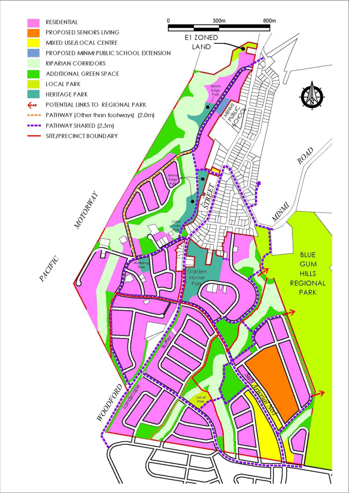
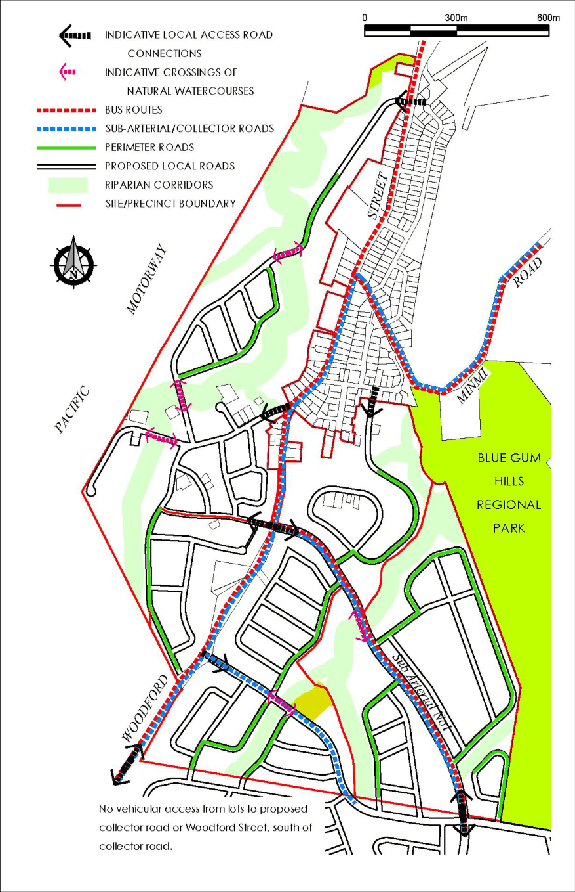
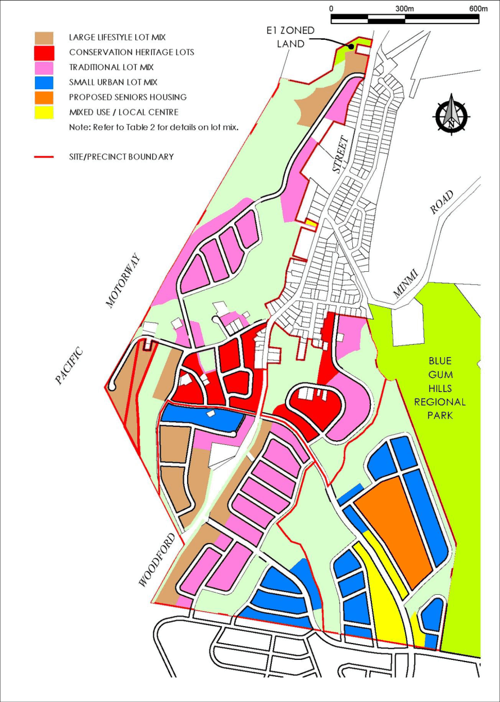
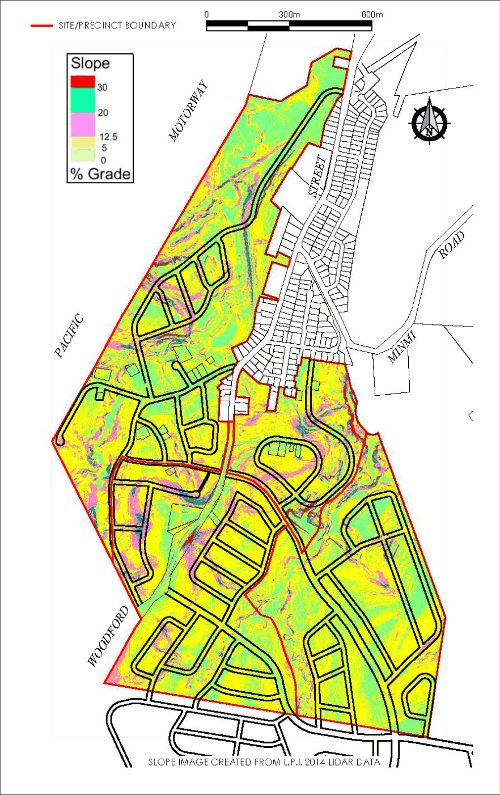
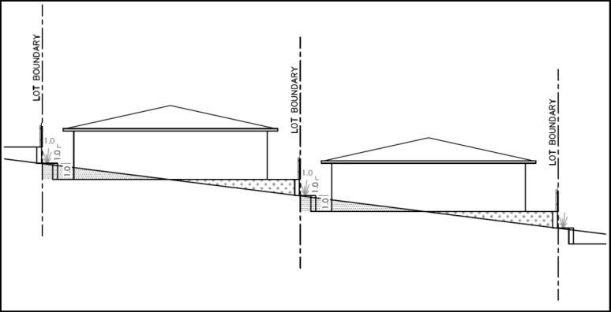
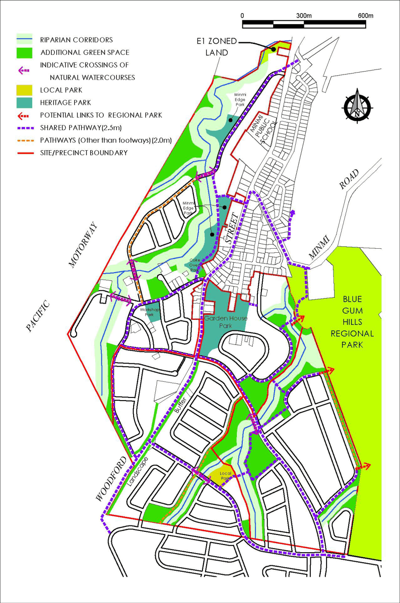

### 2.0  Subdivision Design and Layout

#### Objectives

1\. To ensure the subdivision of the precincts are undertaken in a coordinated manner that reinforces the desired future character for each precinct;

2\. To provide land capable of supporting future residential and commercial land uses;

3\. Within the context of Objective 2 above, undertake earthworks that respond to the natural topography of the site, while identifying opportunities for the retention of vegetation particularly within land zoned E2 Environmental Conservation;

4\. To provide opportunities for choice in housing to cater for changing demographics within the community; and

5\. To consider and incorporate the existing scattered isolated lots and dwellings into the subdivision layout.

#### Controls

1\. A revised road and lot layout for each precinct shall be provided with the first development application for subdivision of any land in each precinct and be generally in accordance with the Overall Urban Structure, Movement and Access and Lot Layout Principles Plans illustrated in Figures 1, 2 and 3;

> [Picture on page 12: a picture, saved as a picture (images/section-e10-minmi-extension-village-centre-and-link-road-nor-page-12-1.gif, 150 dpi).]

#### Figure 1: Overall Urban Structure Plan

Notes: Overall Urban Structure is based on Concept Plan only with modification for key initial principles and is subject to further assessment as part of future development applications.

Condition 1.16 of the Concept Approval requires suitable land to be identified for recreation facilities within the development area, unless alternative arrangements can be made to accommodate the required facilities within general proximity to the development site through negotiations with Council. The location of the recreation facilities (or alternative arrangements) are to be submitted to the Director General for approval prior to determination for subdivision of Stage 3, 4 or 5 of the Concept Plan MP10_0090. Should the recreational facilities be provided within the development area, the applicant shall have regard to the above Urban Structure Plan in determining an appropriate location.

> [Picture on page 13: a picture, saved as a picture (images/section-e10-minmi-extension-village-centre-and-link-road-nor-page-13-1.gif, 150 dpi).]

#### Figure 2: Indicative Movement and Access Principles Plan

Note: Road and Lot Access is based on Concept Plan only with modification for key initial principles and is subject to further assessment as part of future development applications.

> [Picture on page 14: a picture, saved as a picture (images/section-e10-minmi-extension-village-centre-and-link-road-nor-page-14-1.gif, 150 dpi).]

#### Figure 3: Indicative Lot Type and Diversity Principles Plan

Note: Road and Lot Access is based on Concept Plan only with modification for key initial principles and is subject to further assessment as part of future development applications.

2\. Roads shall be designed generally in accordance with Element 7.04 – Movement Networks of Newcastle DCP 2012 and having regard to the road types as nominated by the Indicative Movement and Access Plan (Figure 2). Exceptions to width and configuration may be acceptable where justified and agreed with Council;

3\. Public roads are to be designed with maximum grades of 12% for proposed bus routes, or maximum 16% for all other road types. Site regrading may be required to achieve these maximum gradients. In exceptional circumstances where a maximum longitudinal grade of 16% cannot be achieved, and subject to prior agreement by Council, development applications for subdivision may propose split level carriageways or reinforced concrete roads. Concrete roads shall have an absolute maximum of 20% longitudinal grade for not more than 100m in length and servicing not more than ten (10) dwellings;

4\. The road network, including any proposed fire trails, should be designed having regard to the requirements of Planning for Bushfire Protection 2006;

5\. Vehicular ingress and egress for all residential lots with frontage to Woodford Street or Sub Arterial Road No 1 is to be provided via rear or side roads. This control also applies to sites and development within the B1 and B2 Zones, unless it can be demonstrated through a traffic assessment that direct access to Woodford Street or Sub Arterial Road 1 is acceptable;

6\. Residential lots are to be provided that generally reflect the Lot Typologies detailed in Table 1. Where a lot type is not specified (for example, a battle axe or fan shaped lot), lots shall be provided in accordance with Element 3.01 – Subdivision of Newcastle DCP 2012;

#### Table 1: Controls for Residential Lot Types

| Residential Lot Type | Frontage Range | Typical Frontage | Typical Lot Size Range (m2) |
|---|---|---|---|
| Terrace / Townhouse Lot | 7m – 10.4m | 8.5m | 200 – 300 |
| Small Courtyard Lot | 10.5m – 13.4m | 12.5m | 300 – 375 |
| Large Courtyard Lot | 13.5m – 14.9m | 14m | 375 -450 |
| Traditional Lot | 15m – 19.9m | 15 – 17m | 450 – 800 |
| Lifestyle Lot | 20m + | 20m | 800 + |
| Heritage Character Lot | N/A | N/A | 600 + |
| Multi-Dwelling Housing Super Lot | 18m | Variable | 1000+ |

Notes:

• Allotment frontage is the primary variable to determine an allotment classification for setbacks;

• Where an allotments depth results in a larger than typical total lot area, the frontage will still be the determining factor to classify setbacks and building type, unless otherwise agreed by Council;

• Heritage Character Lots are controlled by area rather than frontage, refer to Control 7.

• To be classified as a Lifestyle Lot, the allotment must meet both the Minimum Lot Size and Minimum Frontage controls;

• Battle-axe allotment classification is determined by width. The measurement for the front boundary is to be made at the useable part of the lot.

7\. Lots identified as Conservation Heritage Character Lots within the Minmi Extension Precinct (as shown in Figure 3) shall have a minimum lot size of 600m2;

8\. Lots on land with slopes greater than 20% shall have a minimum lot size of 1000m2, unless otherwise agreed;

9\. Lots on land with slopes greater than 25% shall have an adequate area for a dwelling to be constructed which is not greater than 25% slope, and be capable of providing vehicular access to the dwelling at a grade not greater than 25%;

10\. Each precinct is to accommodate a variety of lot types as outlined in Table 1, other than the Minmi Extension Precinct – Conservation Heritage Character Area in Figure 3 which is to be limited to lots with a minimum size of 600m2. The allocation and mix of lot types is to be in accordance with the minimum targets outlined in Table 2 below, having regard to the desired future character for each precinct whilst taking into account slope and site characteristics;

#### Table 2: Guide for Lot Variety per Precinct for Residential Land

| Figure 3 Lot Mix | Minimum % of Lot Typology by Precinct |  |  |  |
|---|---|---|---|---|
|  | Lot Type | Village Centre Precinct | Link Road North Precinct | Minmi Extension Precinct |
| Small Urban Lot Mix | Townhouse / Terrace Lots Small Courtyard Lots Large Courtyard Lots Traditional Lots Lifestyle Lots | 5 10 0 30 0 | 0 10 0 60 0 | N/A – no Blue Area within Minmi Extension Precinct |
| Traditional Lot Mix | Townhouse / Terrace Lots Small Courtyard Lots Large Courtyard Lots Traditional Lots Lifestyle Lots | N/A – no Pink Area within Village Centre Precinct | 0 5 0 70 0 | 0 5 0 90 0 |
| Large Lifestyle Lot Mix | Townhouse / Terrace Lots Small Courtyard Lots Large Courtyard Lots Traditional Lots Lifestyle Lots | N/A – no Brown Area within Village Centre Precinct | N/A N/A N/A 0 80 | N/A N/A N/A 0 80 |

Notes:

• Council may impose a restriction as to the use of the land (at the time of subdivision) on Super Lots proposed for an intended lot / dwelling type;

• A percentage target of 0% denotes that there is no minimum target for the particular lot typology in the Lot Mix Area. It should not be interpreted to mean that lots of this type are not permissible in that particular Lot Mix Area;

• Lifestyle Lots are permissible in any Lot Mix Area where site constraints necessitate a larger lot type. For example, additional area required to accommodate slope or APZ; and

• Super Lots may be provided for future permissible development in the zone.

11\. Development applications for subdivision including vacant Townhouse / Terrace, Small Courtyard or Large Courtyard Lots are to nominate any mandatory and optional built to boundary walls;

12\. Cut and fill associated with subdivision development should be responsive to the design constraints associated with the natural site topography, noting that significant earthworks will be required to accommodate required subdivision works. This includes roads, drainage, stormwater management basins, asset protection zones and utility infrastructure, as well as responding to past mining activity constraints where feasible to do so at subdivision stage. Existing slope characteristics are illustrated in Figure 4;

13\. Extension of the footprint of cut and fill on proposed lots at subdivision stage, including benching, retaining and battering, is permissible where required to achieve land capable of supporting future residential development and in appropriate locations to achieve lot diversity and dwelling yields identified by the Concept Approval.  Inclusion and integration of cut and fill on proposed lots in appropriate locations can reduce the vertical extent of cut and fill required otherwise for subdivision works and reduces the need for unco-ordinated cut and fill by future individual lot owners for the construction of dwellings.  Earthworks shall be designed at subdivision stage generally in accordance with the principles in as described in Table 3 and Figure 5;

> [Picture on page 18: a picture, saved as a picture (images/section-e10-minmi-extension-village-centre-and-link-road-nor-page-18-1.gif, 150 dpi).]

#### Figure 4: Existing Slope Characteristics

#### Table 3: Guide for Subdivision Earthworks and Retaining

| Slope Category | Subdivision Based Principles |
|---|---|
| Category A (existing slopes up to 12.5%) | Optional lot benching and retaining at subdivision stage, generally consistent with Table 4 and Figure 4 of these Guidelines. |
| Category B (existing slopes between 12.5% - 20%) | Earthworks to blend slopes with other civil works and alter slope category to Category A, plus optional lot benching and retaining at subdivision stage as above. |
| Category C (existing slope greater than >20%) | Other than localised works associated with civil works, limited on lot earthworks, benching or retaining, with future dwelling design and construction to absorb slope, with potential also for retention of some on lot vegetation. Earthworks may be required to achieve an on lot building envelope and lot access less than 25%. |

#### Table 4: Guide for Retaining Wall Heights at Subdivision Stage

|  | Retaining Walls and Heights (m) |
|---|---|
| Front Boundary | Max 1m cut or fill |
| Side Boundary | Where retaining walls are to be constructed as part of the subdivision works, max 1.5m cut or fill (where single face retaining proposed), or as below. Where retaining walls are to be constructed following subdivision stage, max 1m cut or fill on each lot’s side boundary. Walls to be contained within the lot being retained with 1m wall on high side requiring no boundary offset and including provision for future fencing and 1m wall on low side to be offset from side boundary by 1m (as illustrated in Figure 5). |
| Rear Boundary | Max 2m cut or fill |

> [Picture on page 19: a picture, saved as a picture (images/section-e10-minmi-extension-village-centre-and-link-road-nor-page-19-5.gif, 150 dpi).]

#### Figure 5: Typical Cut and Fill Principles in Section

14\.  In some circumstances of cut, retaining walls may exceed those nominated for parts of the retaining wall. In these cases, other than rear boundaries, the retaining wall must not exceed an absolute maximum of 1.8m at a single point and must average heights indicated in Table 4;

15\. All retaining walls are to include a sub-soil drainage system and are to be constructed of decorative masonry (or similar high-quality material) and natural colours, where retaining walls present to the street / public domain. Retaining walls are to include provision for future fencing;

16\. Retaining walls are to be located entirely within the boundaries of the subject property;

17\. Core natural watercourse and their riparian widths are mapped in Figure 6 (per the Concept Plan), and zoned E2. As a general design principle, these core natural watercourses should be retained as part of the character of the precincts and to maximise retention of vegetation, however any proposed works and land uses within the identified riparian corridors are to have regard for the relevant Department of Primary Industry – Office of Water – guidelines relating to works within riparian corridors. In E2 zoned land outside the core natural watercourses and associated riparian corridors subdivision works are to be generally avoided, other than the clearing of vegetation and minor earthworks to accommodate the construction of necessary infrastructure such as detention basins, stormwater outlet structures, road and service crossings, cycleways and paths;

18\. Bushfire protection measures, such as Asset Protection Zones, Managed Fuel Zones and fire trails, are to be provided in accordance with Planning for Bushfire Protection 2006;

19\. Public Open Space shall be located generally in accordance with Figure 6, or where otherwise justified and agreed with Council and/or required under the applicable local infrastructure plan and as described in Table 5;

#### Table 5: Public Open Space

| Type | Location |
|---|---|
| Neighbourhood Park | 1 x park in Link Road North Precinct |
| Historic Heritage Parks | 1 x park in Minmi Extension Precinct (Garden House Park) 1 x park in Minmi Extension Precinct (Workshop Park) 1 x lineal park associated with former railway line and heritage item, including Coke Oven Park and Minmi edge and entry areas |

Note: Land dedication is subject to agreement with Council. Should Council decline dedication of land, other suitable land uses and ownership arrangements may be proposed, provided Council is satisfied that other satisfactory arrangements for Public Open Space will be made.

20\. Key pedestrian assets shall be located generally in accordance with Figure 6, or where otherwise justified and agreed with Council and include:

• Potential pathway connections to Regional Park;

• Shared pathway/cycleway along alignment of heritage railway tracks within the lineal park and connecting to the heritage park (Workshop Park);

Each development application for subdivision is to outline footpaths and shared paths in road verges to be provided relative to overall movement network, open space and activity nodes and road types and character.

21\. Development applications for subdivision creating residential lots adjoining Sub Arterial Road No 1 through the Village Centre Precinct and to Woodford Street (north of its intersection with the proposed Sub Arterial Road No 1), must consider the management of urban design outcomes and, where required by a traffic noise impact assessment, acoustic privacy. The following principles should be considered:

• Where possible, residential lots should be designed so that future dwellings are oriented to front those primary roads;

• Where possible, direct vehicular access from residential lots to those primary roads should be discouraged. In general, vehicular access should be provided by a side or rear road and/or rear access way;

• Where it is not practicable to orient future dwellings to those primary roads, suitable fencing shall be provided and landscaping shall be incorporated into the road reserve to soften potential visual impacts of fencing along these roads at subdivision stage to ensure a consistent view; and

• Any setbacks or building requirements required by a traffic noise impact assessment are to be listed on the title of each affected lot.

22\. A landscape buffer should be incorporated along Woodford Street, south of its intersection with the proposed Sub Arterial Road No 1 (refer to Figure 6), to soften visual impacts. While dwellings are not required to orient to Woodford Street in this location, fencing along this extent is to be provided at subdivision to ensure a consistent view where dwellings will be oriented away from Woodford Street.

> [Picture on page 22: a picture, saved as a picture (images/section-e10-minmi-extension-village-centre-and-link-road-nor-page-22-1.gif, 150 dpi).]

#### Figure 6: Indicative Open Space and Drainage Principles

Note: Road and Lot Access is based on Concept Plan only with modification for key initial principles and is subject to further assessment as part of future development applications.
