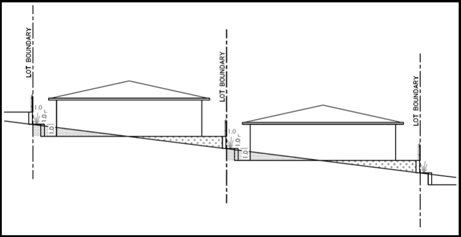

### 3.0  Development Other Than Subdivision

Note: The relationship of these Guidelines to the Concept Approval MP 10_0090, Newcastle LEP 2012 and Newcastle DCP 2012 are explained in the Introduction of these Guidelines, and controls under those documents are not repeated here. It is anticipated that parts of the urban release area may satisfy requirements to become exempt or complying development under the provisions of another Environmental Planning Instrument, including any Housing Code, Greenfield Housing Code or other Code, and may, subject to satisfying relevant provisions, proceed separate to these Guidelines.

#### A. VILLAGE CENTRE DEVELOPMENT

#### Objectives

1\. To identify any specific development controls for development other than subdivision on B1 Neighbourhood Centre and B2 Local Centre zoned lands, within the Minmi Extension and Village Centre Precincts respectively.

#### Controls

1\. Address the relevant land use specific provisions in accordance with Elements 3.03 – Residential Development and 3.10 – Commercial Development of Newcastle DCP 2012, and where relevant residential development provisions in these Guidelines (refer Section B below);

2\. Address the other provisions in accordance with Newcastle DCP 2012 (outlined in the Introduction of these Guidelines), where relevant and not contrary to the Concept Approval;

3\. Development on lots fronting Sub Arterial Road No 1 shall be designed to have vehicle access to the side or rear, and not direct from the primary road, unless otherwise supported by a traffic assessment submitted with the development application for the proposed land use.  The built form must address the primary road;

4\. The allowable Floor Space Ratio (commercial floor space to Site Area) is 1:1 for all commercial / mixed use areas. Non-commercial space is in addition to this ratio; and

5\. Building heights are to be in accordance with Newcastle LEP 2012, and any building height and type restrictions identified by Subsidence Advisory NSW to address past mining constraints, following completion of subdivision works.

#### B. RESIDENTIAL DEVELOPMENT

#### Objectives

1\. To identify any specific development controls for development of R2 and R3 zoned lands within the Precincts.

#### Controls

1\. Address the relevant land use specific provisions in accordance with Elements 3.02 – Single Dwellings and 3.03 – Residential Development of Newcastle DCP 2012, other than where agreed to be inconsistent with the Concept Approval and/or these Guidelines;

2\. Address the other provisions in accordance with Newcastle DCP 2012, where relevant and other than where agreed to be inconsistent with the Concept Approval and/or these Guidelines;

3\. Building Heights are to be in accordance with Newcastle LEP 2012, and any building height and type restrictions identified by Subsidence Advisory NSW to address past mining constraints, following completion of subdivision works;

4\. To design house types that respond to their lot configuration including size, shape and orientation and to promote residential amenity and streetscape. Attached dwellings, semi-attached and detached dwelling houses are to be provided generally in accordance with Table 7;

5\. A maximum site coverage of 60% applies to Terrace / Townhouse Lots;

6\. Development for housing is to be designed to respond to the lot configuration including slope, generally conforming to the post subdivision land form outside of the building footprint with additional cut and fill minimised and the need for retaining walls reduced by not exceeding retaining walls and heights nominated in Table 6, particularly when lots have been benched at subdivision stage. Any variations to existing retaining walls will require justification, design and certification by a Structural Engineer;

#### Table 6: Guide for Retaining Wall Heights

|  | Retaining Walls and Heights (m) |
|---|---|
| Front Boundary | Max 1m cut or fill |
| Side Boundary | Where retaining walls are to be constructed following subdivision stage, max 1m cut or fill on each lot’s side boundary. Walls to be contained within the lot being retained with 1m wall on high side requiring no boundary offset and including provision for future fencing and 1m wall on low side to be offset from side boundary by 1m (as illustrated in Figure 7). |
| Rear Boundary | Max 2m cut or fill |

> [Picture on page 24: a picture, saved as a picture (images/section-e10-minmi-extension-village-centre-and-link-road-nor-page-24-18.gif, 150 dpi).]

#### Figure 7: Typical Cut and Fill Principles in Section

7\. On sloping sites, if the controls in Table 6 are unable to be achieved then construction methods other than slab on ground are to be used such as split level, pier foundations or suspended floor house design to minimise cut and fill. If elevated construction is used then underfloor services must be screened, however all construction must meet the relevant bushfire requirements;

8\. Development on lots adjoining proposed Sub Arterial Road No 1 through the Village Centre Precinct and to Woodford Street (north of its intersection with proposed Sub Arterial Road No 1), must consider the management of urban design outcomes, and where required by a traffic noise impact assessment, noise mitigation. The following principles should be considered:

• Where possible, dwellings are to be oriented to front those primary roads;

• Vehicular access should be provided by side or rear road and/or rear access way;

• Where it is not practicable to orient dwellings to those primary roads, suitable fencing shall be provided and landscaping shall be incorporated into the road reserve to soften potential visual impacts of fencing along these roads. Fencing along these roads must be consistent with any existing fencing installed as part of the Estate subdivision works; and

• Development must consider any requirements or restrictions on title relating to noise mitigation, unless it can be demonstrated through a traffic noise impact assessment (specific to that lot and development type) is provided with the development application.

9\. For controls relating to on-lot stormwater infrastructure, applicants are to refer NDCP Section

7.06 Stormwater. Specifically, the requirements for ‘Coastal Wetland Catchments’ are applicable to land covered by the Guidelines;

10\. Having regard to the requirements of NDCP Section 7.06 Stormwater, development on Terrace / Townhouse Lots or Small Lots may utilise options such as slimline water tanks (under eaves) or rainwater bladders (which can be stored under houses / decks); and

11\. For controls relating to private open space and landscaping requirements, applicants are to refer to NDCP Section 3.02.05 and 3.02.06. For further guidance on appropriate plant species, applicants should refer to Council’s Landscape Technical Manual.

Table 7: Controls for Residential Lots (attached dwelling, semi-detached dwelling or dwelling house, excl multi-dwelling and other forms of residential accommodation involving more than one dwelling

on individual lot)

| Lot Types | Front Setback |  | Side Setback |  |  |  |  | Max Length | Rear Setback |  |  |  |
|---|---|---|---|---|---|---|---|---|---|---|---|---|
|  | Habitable Rooms | Garage | Built to Boundary |  | Non-built to Boundary |  | Corner Lots – Secondary Street Frontage | and Height of Built to Boundary Wall | Habitable Rooms | Garage | Max. Garage Type | Max Garage Width |
|  |  |  | Ground Floor | First Floor | Ground Floor | First Floor |  |  |  |  |  |  |
| Terrace / Townhouse Lot | As per NDCP |  | As per NDCP |  | For recesses and walls setback from boundary a minimum clearance of 0.9m | For recesses and walls setback from boundary a minimum clearance of 1.2m | 1.5m | As limited by building setbacks and building height controls | Nil to access way or local road |  | Double garage permitted from rear lane | 6.5m to rear lane |
|  |  |  | As per NDCP |  | As per NDCP | 1.2m |  |  | As per NDCP where not to a rear lane | n/a | Single/tandem garage permitted to primary street | 3.2m to a primary street |
| Small Courtyard Lot | As per NDCP |  | One side only | 1.2m | As per NDCP | 1.2m | As per NDCP | Max. 15m long; Max 3.5m high | Nil to access way or local road |  | Double garage permitted from rear lane | 6.5m to a rear lane |
|  |  |  |  |  |  |  |  |  | As per NDCP | n/a | Single/tandem permitted for single storey dwelling on lots up to and including 11.5m wide double garage permitted for 2 storey dwelling on lots up to and including 11.5m wide | 3.2m for single storey and 6.0m for double storey on lots up to 11.5m wide |
|  |  |  |  |  |  |  |  |  |  |  | Double garage permitted for lots > 11.5m wide | 6.5m or 50% of the frontage, whichever is less |
| Large Courtyard Lot | As per NDCP |  | One side only | 1.2m | As per NDCP | 1.2m | As per NDCP | Max. 15m long; Max 3.5m high | Nil to access way or local road |  | Double | 6.5m |
|  |  |  |  |  |  |  |  |  | As per NDCP | n/a |  |  |
| Traditional & Heritage Character Lots | As per NDCP |  | Not applicable |  | As per NDCP | 1.5m | As per NDCP | Not applicable | Nil to access way or local road |  | Double | 6.5m |
|  |  |  |  |  |  |  |  |  | As per NDCP | n/a |  |  |
| Lifestyle Lot | As per NDCP |  | Not applicable |  | 1.5m for lots up to 20m wide 2.0m for lots > than 20m wide | 2.0m for lots up to 20m wide 2.5m for lots > than 20m wide | 2.5m | Not applicable | Nil to access way or local road |  | Double or triple permitted if Garage width design controls are met | 6.5m or 9.0m where the third garage opening is setback a further 900mm or oriented with door openings perpendicular to the street |
|  |  |  |  |  |  |  |  |  | As per NDCP | n/a |  |  |

1\. Setbacks are as per the above table unless otherwise dimensioned on an approved plan by Newcastle City Council.

2\. Mandatory and Optional Built to Boundary Walls are to be nominated on approved subdivision plans.

3\. Where Optional Built to Boundary Walls are not adopted, standard Non Built to Boundary Setbacks will apply.

4\. Allotments are to be nominated into the above categories at the time of approval by Newcastle City Council on approved subdivision plans.

5\. Garages fronting laneways comply with the Australian Standard for vehicles entering and leaving the garage.
