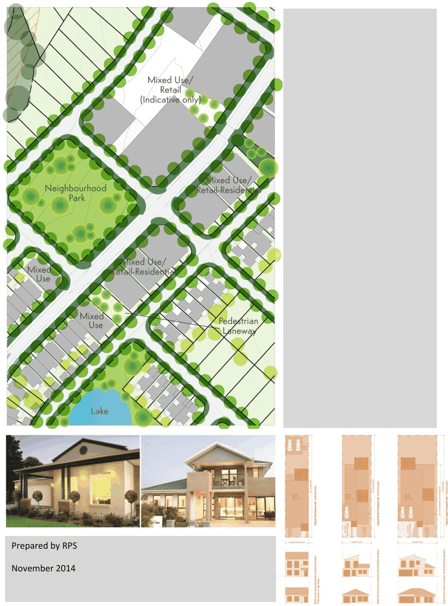
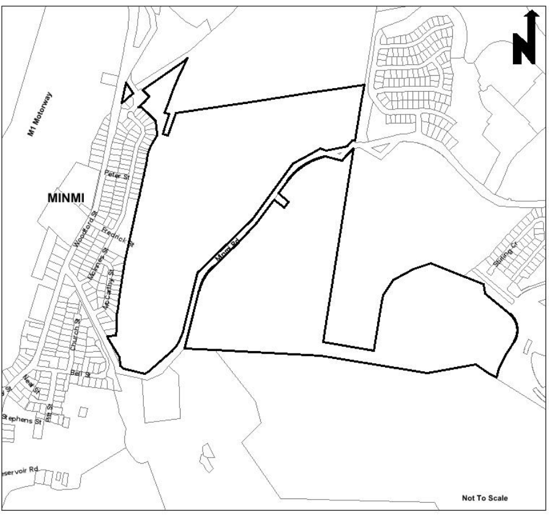

#### Section E11 Minmi East Precinct

#### Table of contents

1.0 Introduction ........................................................................................................................................................ 2

2.0 Application ......................................................................................................................................................... 2

3.0 Objectives .......................................................................................................................................................... 2

4.0 Minmi East Precinct development guidelines ................................................................................................... 2 Related sections ....................................................................................................................................................... 2

Page 1 of 2

E11 Minmi East Precinct

Newcastle Development Control Plan 2023

### 1.0 Introduction

Concept Approval MP 10_0090 for the development of the site was issued by the Minister for Planning and Infrastructure on 6 August 2013 under the provisions of Section 75O and 75P of the Environmental Planning and Assessment Act 1979.

Condition 1.13 of that Concept Approval required the preparation of urban design guidelines, in a form consistent with the Newcastle Development Control Plan, to guide future development on the land. On 18 December 2014 the Department of Planning and Environment approved the Minmi East Precinct Development Guidelines (herein referred to as the Guidelines). This section adopts the Guidelines as approved.

### 2.0 Application

The Guidelines apply to all development within the Minmi East Precinct requiring development consent.

### 3.0 Objectives

1\. Ensure that the Minmi East Precinct is developed in a manner generally consistent with the Concept Approval (MP10_0090) for the site.

### 4.0 Minmi East Precinct development guidelines

See following pages.

#### Related sections

The following sections will apply to development:

• Part D – Development controls by land use

• C1 Traffic, parking and access

• C4 Stormwater

• C6 Waste management

•    C12 Open space and landscaping

The following sections may also apply to development:

• B1 Flood management

• B2 Bush fire protection

• B3 Mine subsidence

• B4 Aboriginal cultural heritage

• B5 Historical archaeology

• B7 Contamination

• C2 Movement networks

•    C3 Vegetation preservation and care

•    C5 Soil management

• C7 Safety and security

• C8 Social impact

• E1 Built and landscape heritage

Page 2 of 2

E11 Minmi East Precinct

Newcastle Development Control Plan 2023

### Minmi East Precinct Development Guidelines

> [Picture on page 3: a picture, saved as a picture (images/section-e11-minmi-east-precinct-page-3-2.gif, 150 dpi).]
> Words printed on the picture (title and legend, copied from the PDF):
> Prepared by RPS
> November 2014

### Minmi East Precinct Development Guidelines

#### Relationship with Concept Approval MP 10_0090

The Minmi East Precinct Guidelines (herein referred to as the Guidelines) are standalone guidelines prepared under the terms of Concept Approval MP 10_0090.  However the Guidelines have been prepared in a form which will enable adoption of the provisions as site specific controls within Newcastle Development Control Plan 2012 (Newcastle DCP 2012) at a future date.

The Guidelines, as well as the Concept Plan Urban Design Guidelines (known as Appendix A and Appendix B of Minmi, Link Road and Stockrington Concept Plan Environmental Assessment prepared by Urbis dated February 2011 and subsequently updated versions of the Concept Plan Urban Design Guidelines known as Appendix A dated May 2014 and Appendix B dated November 2014) have been prepared to collectively satisfy the requirements of Condition 1.13 of Concept Approval MP 10_0090.  Concept Approval MP 10_0090 applies to land within the Minmi East Precinct, as well as surrounding lands within the Newcastle, Lake Macquarie and Cessnock local government areas.  The Concept Approval includes approval in summary for:

A five stage development with up to 3,300 dwellings across the 520 ha development site; Supporting commercial / retail development of up to a total of 8,000 sqm within a new village centre and high street centre; Urban design guidelines subject to further modifications; Dedication of approximately 1,561 ha of conservation lands to the NSW Government; Indicative staging; and Associated infrastructure.

#### Land to which the Guidelines applies

The Guidelines apply to all land within the heavy line marked on Map 1 – Minmi East.

#### Map 1: Minmi East

> [Picture on page 5: a picture, saved as a picture (images/section-e11-minmi-east-precinct-page-5-4.gif, 150 dpi).]

Development (type/s) to which the Guidelines applies to

The Guidelines apply to all development within Minmi East requiring development consent.

#### Applicable environmental planning instruments

The provisions of Newcastle Local Environmental Plan 2012 also apply to development applications to which the Guidelines apply to. In the event of any inconsistency between the Guidelines and the above listed environmental planning instrument, the environmental planning instrument will prevail to the extent of the inconsistency.

#### Relationship to Newcastle DCP 2012

The Guidelines identify provisions that may be a departure from provisions contained in the Newcastle DCP 2012.  In the event that any inconsistency arises from the reading of the

Guidelines with the Newcastle DCP 2012, the development controls and objectives in the Guidelines will prevail to the extent of the inconsistency.

The following sections of the Newcastle DCP 2012 will also apply to development to which the Guidelines apply, noting the above paragraph with respect to any inconsistencies that may arise.

> [Picture text on page 6 is stored in the PDF without readable letters (no character map), so it could not be copied; see the original PDF.]

Any applicable land use specific provision under Part 3.00;

7.02 Landscape Open Space and Visual Amenity, except for Townhouse and Small Courtyard lots as defined in Table 1, where controls are provided within this Guideline;

### 7.03 Traffic, Parking and Access;

### 7.05 Energy Efficiency;

### 7.06 Stormwater;

7.07 Water Efficiency; and

7.08 Waste Management.

The following sections of the Newcastle DCP 2012 may also apply to development to which the Guidelines apply, noting the above paragraph with respect to any inconsistencies that may arise.

4.01 Flood Management – all land which is identified as flood prone land under the Newcastle Flood Policy or within a PMF or area likely to flood;

### 4.02 Bush Fire Protection – within mapped bushfire area/zone;

### 4.03 Mine Subsidence – within mine subsidence area;

4.04 Safety and Security – development with - accessibility to general public, access to laneways, communal areas, or residential with three or more dwellings;

4.05 Social Impact – where required under ‘Social Impact Assessment Policy for Development Applications’, 1999;

5.01 Soil Management – works resulting in any disturbance of soil and/or cut and fill;

5.02 Land Contamination – land on register/where risk from previous use;

5.03 Tree Management – trees within 5m of a development footprint or those trees likely to be affected by a development;

5.04 Aboriginal Heritage – known/likely Aboriginal heritage item/site and/or potential soil disturbance;

5.05 Heritage Items – known heritage item or in proximity to a heritage item;

5.06 Archaeological Management – known/likely archaeological site or potential soil disturbance; and

7.04 Movement Networks – where new roads, pedestrian or cycle paths are required

#### Associated technical manual/s

Nil

#### Additional information

Concept Approval (MP10_0090) for land at Minmi, Link Road and Stockrington; Coal and Allied Northern Estates Minmi – Link Road Concept Plan Design Guidelines by RPS (Appendix A, dated May 2014); and Coal and Allied Northern Estates Minmi – Link Road Urban Design Guidelines by RPS (Appendix B dated November 2014). Minmi / Link Road and Stockrington Estate Noise Mitigation Review, Renzo Tonin and Associates, 21 October 2013.

#### Definitions

A word or expression used in this development control plan has the same meaning as it has in Newcastle Local Environmental Plan 2012, unless it is otherwise defined in this development control plan.

#### Aims of the Guidelines

1\. To ensure that the Minmi East Precinct is developed in accordance with the Concept Approval (MP10_0090) for the site.

2\. To ensure a general contemporary urban village character, within a setting characterised by natural water bodies and native vegetation within the area, is provided.

3\. To ensure connectivity between Blue Gum Hills Regional Park, High Street and the sporting complex is achieved through a network of open spaces and pedestrian routes within the site.

4\. To contribute to the projected growth of the Precinct and strengthen the local employment base.

5\. To manage nutrient or stormwater flow rates to ensure the health of Minmi Creek and other waterways.

6\. To conserve reasonably undisturbed bushland.
