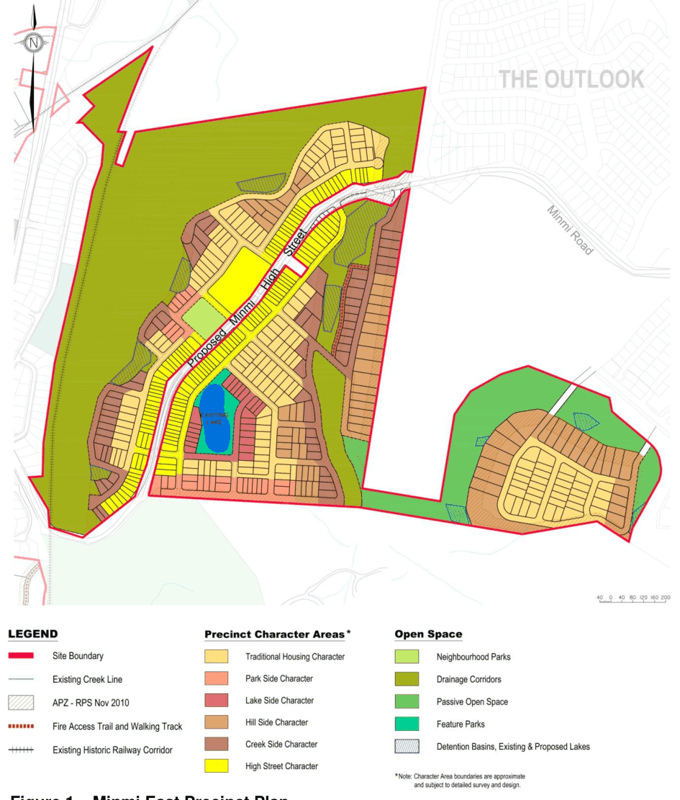
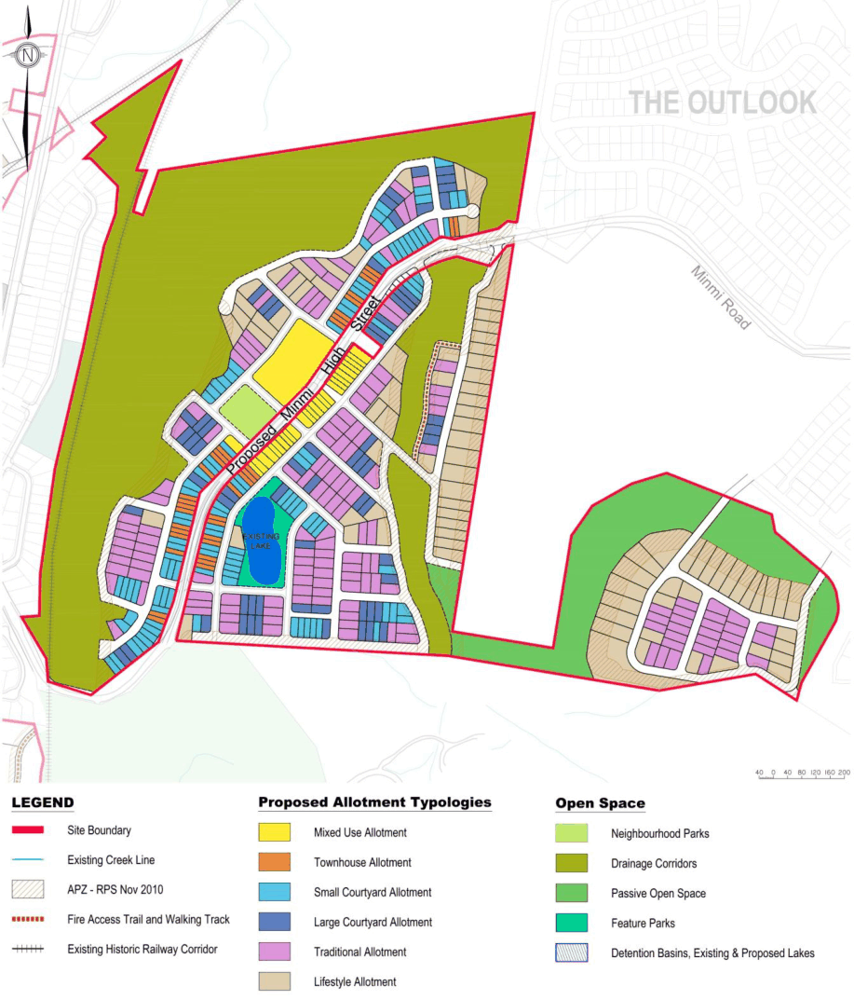
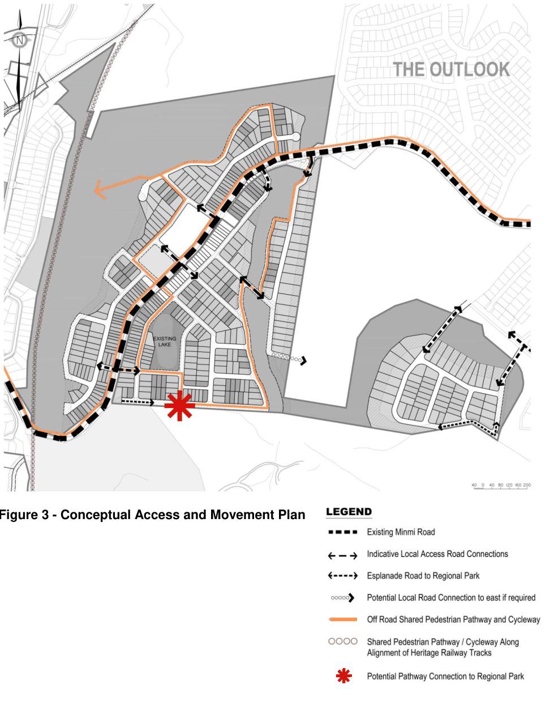
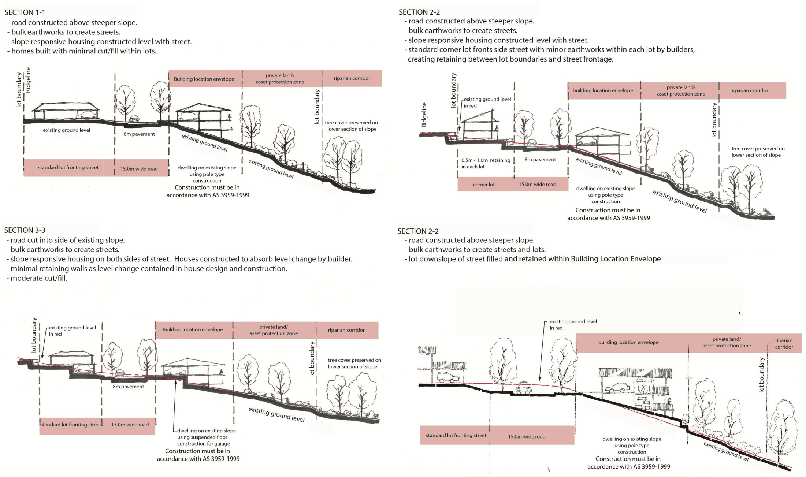

## 1 Urban Structure

#### Subdivision within Minmi East Objectives

1\. To reinforce the desired future character for Minmi and surrounding development;

2\. To provide opportunities for choice in housing to cater for a diverse demographic community; and

3\. To provide subdivisions that respond to the site’s characteristics.

#### Controls

1\. A revised lot layout for the entire Minmi East Precinct shall be provided with the first development application for subdivision of any land and be generally in accordance with the Minmi East Precinct Plan, Indicative Lot Typologies Plan and Conceptual Access and Movement Plan as shown in Figure 1, 2 and 3.

2\. Lot typology, lot frontage, minimum lot size and depth shall be provided in accordance with Table 1 and noting Precinct Character Areas as illustrated in Figure 1 and details provided in Section A.1.8 of the Concept Plan Urban Design Guidelines dated May 2014.

3\. Road widths are to be in accordance with Element 7.04 – Movement Networks of Newcastle DCP 2012.

4\. Access ways (or laneways) that service the higher density areas are to have a road reserve width of 10 metres (8 metres road pavement).

5\. Preferred options for roads and lots on steeper land shall be in accordance with

#### Figure 4.

6\. Buildings on lots greater than 15% are to employ construction techniques in accordance with Figure 4 with slope taken at the building location.

> [Picture on page 9: a picture, saved as a picture (images/section-e11-minmi-east-precinct-page-9-1.gif, 150 dpi).]

#### Figure 1 – Minmi East Precinct Plan

Further details of the Precinct Character Areas can be found in Section A.1.8 in the Appendix A (Concept Plan Urban Design Guidelines) dated May 2014.

> [Picture on page 10: a picture, saved as a picture (images/section-e11-minmi-east-precinct-page-10-1.gif, 150 dpi).]

#### Figure 2 – Indicative Lot Typologies Plan

> [Picture on page 11: a picture, saved as a picture (images/section-e11-minmi-east-precinct-page-11-1.gif, 150 dpi).]

#### Figure 3 - Conceptual Access and Movement Plan

#### Table 1: Controls for Lot Typology, lot frontage, minimum lot size and depth

| Lot Typology | Frontage Range | Minimum Lot Size | Minimum Lot Depth | Housing | Storeys | Vehicle Access | Site Cover |
|---|---|---|---|---|---|---|---|
| Townhouse | 7m – 10.4m | 175m2 | 25m | Attached, semi detached, detached | Single or two | Front or rear lane | 60% |
| Small Courtyard | 10.5m – 13.5m | 262m2 | 25m | Detached single dwelling | Single or two | Front or rear lane | 60% |
| Large Courtyard | 13.6m – 15.0m | 387m2 | 28.5m | Detached single dwelling | Single or two | Front | 60% |
| Traditional | 15.1m – 17.5m | 450m2 | 30m | Detached single dwelling | Single or two | Front | 50% |
| Lifestyle Lots | 17.6m + | 800m2 | 30m | Detached single dwelling | Single or two | Front | 40% |

Note:

1\. Allotment frontage is the primary variable to determine an allotments classification for setbacks and building type

2\. Where an allotment’s depth results in a larger than typical total lot area the frontage will still be the determining factor to classify setbacks and building type

3\. To be assessed as a Lifestyle Lot, the allotment must meet both the Minimum Lot Size and Minimum Frontage

4\. Battleaxe allotment classification is determined by width.  The measurement for the front boundary is to be made at the useable part of the lot.

> [Picture on page 13: a picture, saved as a picture (images/section-e11-minmi-east-precinct-page-13-1.gif, 150 dpi).]

#### Figure 4 – Preferred options for roads and lots on steeper land
