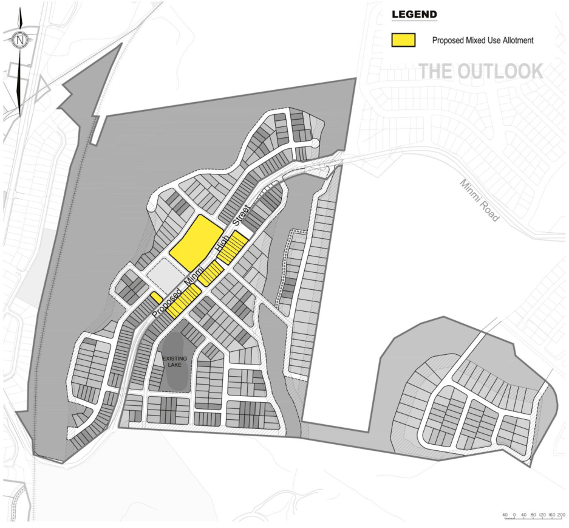
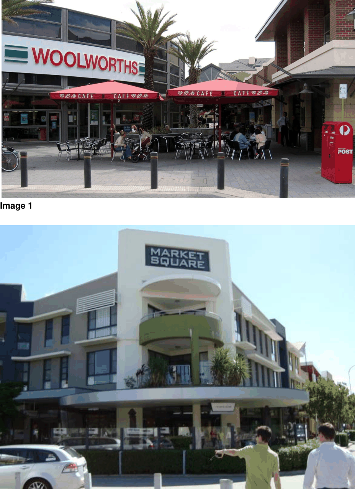
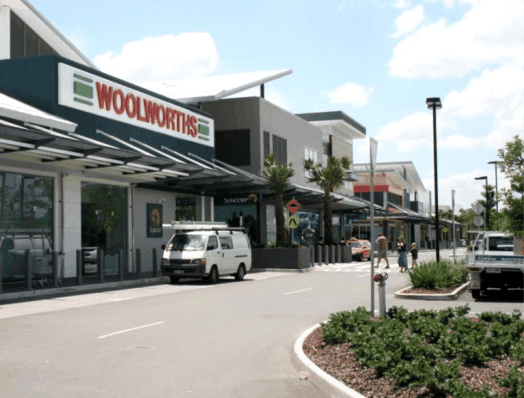
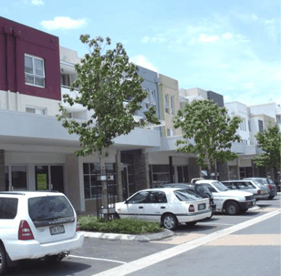
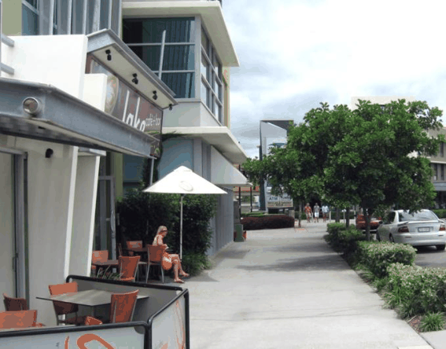
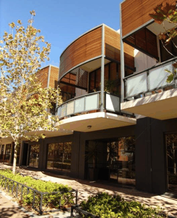
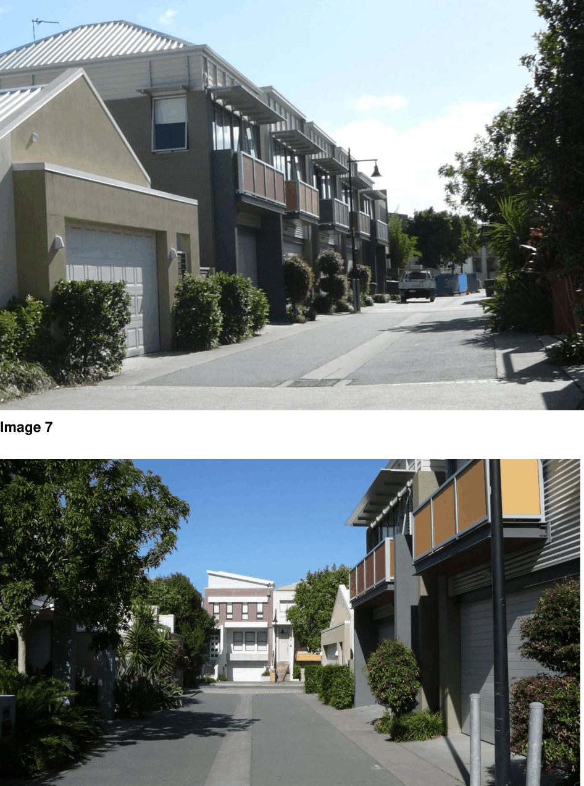

## 2 Mixed Use Development

#### A. Site Layout Objectives

To ensure allotments of appropriate location, size, orientation and shape to accommodate a functional and desirable mixed use development.

#### Controls

1\. Proposals are to clearly define spaces for pedestrians, utilities, service, parking and storage areas and establish links with the public realm;

2\. Buildings are orientated towards the primary street including built form on mixed use allotments fronting Minmi Road;

3\. Buildings provide covered walkways, outdoor seating and landscaping where possible;

4\. Proposals locate the majority of parking, service areas, refuse and mechanical services behind buildings and/or screened from key streets and public open space; and

5\. Floor Space Ratio (commercial floor space to site area) is 1.5:1 for all commercial/mixed use areas. Non commercial space is in addition to this ratio.

#### B. Building Articulation Objectives

The building facade design should reflect the use type of the building and enhance the pedestrian comfort of the streetscape.

#### Controls

1\. Building facade treatment reflects the activities carried out within the building;

2\. Ground floor facades of buildings are articulated and provide interest for pedestrians; and

3\. Vehicular entrance openings are integrated within the design of the building.

#### C. Corner Sites Objectives

To ensure the corner location of a building addresses both streets.

#### Controls

1\. Buildings incorporate features such as corner entrances, window articulation, built elements and material changes to highlight and reinforce the corner.

#### D. Building Access Objectives

To provide identifiable entrances for buildings and land uses within the mixed use development.

#### Controls

1\.  Buildings provided a primary entrance to a mixed use development and distinguish it from secondary entrances; and

2\. Design entrances of buildings are clearly visible and connect to the street frontage, are well-lit at night and provide clear numbering.

#### E. Street Interface Objectives

Mixed use development is to connect to the street activity and provide a pedestrian-friendly environment.

#### Controls

1\. Proposals locate active uses such as shops and cafes at the front of the building;

2\. Proposals utilise areas of the public realm, for spill over activities such as outdoor dining;

3\. Where possible proposals provide tenancies as small as possible at ground level to generate an area which is welcoming and pedestrian-friendly;

4\. Buildings have windows and wall openings at street level which are of a size that respects the human scale; and

5\. Buildings incorporate windows, display cases and other elements along side streets.

#### F. Noise Mitigation Objectives

To minimise external noise between unlike land uses and allow ventilation inside buildings (in particular apartments).

#### Controls

1\. Noise attenuation for buildings are addressed primarily through the placement of uses and then the design of the built form.

#### G. On-Site Facilities Objectives

To provide facilities and efficient, comprehensive services to ensure the comfort of users with minimal impact on adjacent precincts.

#### Controls

1\. Buildings are designed so that residential service areas (e.g. letterboxes, laundry facilities, rubbish bin and clothes drying areas) are separate from non-residential service areas;

2\. Proposals demonstrate the management of services/plant/equipment/metering such that the responsibility and cost for the maintenance is clearly defined;

3\. Proposals locate loading facilities at the rear of the development and parking for large sites behind buildings or in the basement;

4\. Proposals ensure that ground level parking comprise interface landscaping treatment to enhance streetscape and pedestrian environment;

5\. Proposals shall consider titling issues and provide community schemes as required for each land use and level of the building; and

6\. Parking areas are to take into account multiple uses. In some instances parking between non-residential land use maybe shared.

#### H. Mixed-use allotments fronting Minmi Road Objective

Mixed use allotments fronting Minmi Road, highlighted on the Indicative Lot Typologies Plan shown in Figure 5, shall have vehicle access from the rear, and not direct from Minmi Road. As indicated in Section A above, the built form must address Minmi Road.

> [Picture on page 17: a picture, saved as a picture (images/section-e11-minmi-east-precinct-page-17-1.gif, 150 dpi).]

Figure 5 – Mixed Use Allotments shown on Indicative Lot Typologies Plan Controls

1\. Vehicle access to the rear of buildings may be provided as part of an integrated private carparking layout accessed from local roads in the case of a local shopping centre (Refer to example Images 1-4 on the following pages).

2\. Vehicle access to the rear of buildings may be provided direct from a public road such as an Access Way or Laneway as indicated in Section 1 or local roads as contained in Element 7.04 – Movement Networks of Newcastle DCP 2012 (Refer to example Images 5-8).

> [Picture on page 18: a picture, saved as a picture (images/section-e11-minmi-east-precinct-page-18-1.gif, 150 dpi).]

#### Image 1

#### Image 2

Images 1 and 2 are examples of Mixed use allotment fronting Minmi Road, with retail on ground and apartments above, in the case of a an integrated mixed use shopping centre.

> [Picture on page 19: a picture, saved as a picture (images/section-e11-minmi-east-precinct-page-19-1.gif, 150 dpi).]

#### Image 3

> [Picture on page 19: a picture, saved as a picture (images/section-e11-minmi-east-precinct-page-19-3.gif, 150 dpi).]

#### Image 4

Images 3 and 4 are examples of Mixed use allotment with vehicle access at rear as part of a private integrated carparking layout, accessed from local roads, in the case of a local

> [Picture on page 19: a picture, saved as a picture (images/section-e11-minmi-east-precinct-page-19-7.gif, 150 dpi).]

shopping centre.

> [Picture on page 19: a picture, saved as a picture (images/section-e11-minmi-east-precinct-page-19-9.gif, 150 dpi).]

#### Image 5

#### Image 6

Images 5 and 6 are examples of Mixed use smaller allotment fronting Minmi Road, with retail/commercial on ground and apartments above.

> [Picture on page 20: a picture, saved as a picture (images/section-e11-minmi-east-precinct-page-20-1.gif, 150 dpi).]

#### Image 7

#### Image 8

Images 7 and 8 are examples of Mixed use smaller allotment fronting Minmi Road, with rear vehicle access, direct from a public road such as an Access Way or Local Road.
