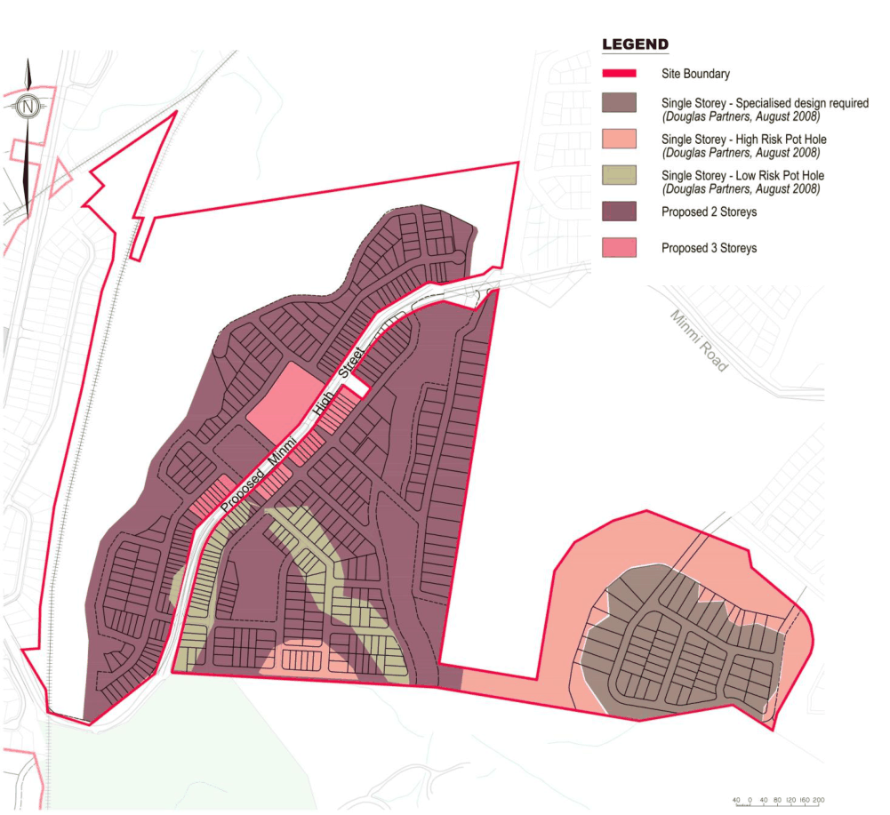

## 3 General Residential Development

Note:  Master Planning for the Minmi East Precinct has identified five (5) lot typologies and dwelling types that respond to the site characteristics and will reinforce future character.

A. Lot typology, lot frontage, minimum lot size and depth and site coverage. Objectives

1\. To reinforce the desired future character for Minmi and surrounding development;

2\. To provide choice in housing to cater for a diverse demographic community; and

3\. To provide housing that responds to the site’s characteristics.

Controls - Lot typology, lot frontage, minimum lot size and depth and site coverage

1\. Lot typology, lot frontage, minimum lot size and depth and site coverage shall be provided in accordance with Table 1 as provided in Section 1of these Guidelines.

2\. Lot typology will be located generally in accordance with Figure 2 as provided in Section 1 of these Guidelines.

#### B. Lot Type Intent and Setbacks Objectives

1\. To promote housing types appropriate to the lot size, shape and orientation;

2\. To promote a layout that complements existing development in the area;

3\. To provide adequate residential amenity within the development

4\. To ensure that buildings address the street and promote active street frontages;

5\. To ensure that development enhances the visual character of the street;

6\. To limit the visual impact of garages on the streetscape;

7\. To ensure corner buildings address both street frontages;

8\. To ensure privacy for residents and minimise overshadowing.

Note:  Table 1 illustrates the indicative Lot Intent and built form.

#### Building and Setback Controls, Garage Type / Width Controls

Setbacks, maximum length and height of built to boundary walls, maximum garage types and widths shall be provided in accordance with Table 2.

Table 2: Controls for setbacks, maximum length/height of built to boundary walls, garage types, access issues etc

| Lot Types | Front Setback |  | Side Setback |  |  |  |  |  | Max Length and Height of Built to Boundary Wall | Rear Setback |  | Max. Garage Type | Max Garage Width |
|---|---|---|---|---|---|---|---|---|---|---|---|---|---|
|  | Habitable Rooms | Garage | Built to Boundary |  | Non built to Boundary |  | Corner Lots – Secondary Street Frontage |  |  | Habitable rooms | Garage |  |  |
|  |  |  | Ground Floor | First Floor | Ground Floor | First Floor | Ground Floor | First Floor |  |  |  |  |  |
| Townhouse Frontage Range: 7m – 10.4m | 4.5m | 5.5m | Both sides for lots 8m wide and less |  | For recesses and walls setback from boundary a minimum clearance of 0.9m | For recesses and walls setback from boundary a minimum clearance of 1.2m | 1.5m | 1.5m | As limited by building setbacks and building height controls | Nil to access way or local road |  | Double garage permitted from rear lane | 6.5m to rear lane |
|  |  |  | One side only for lots > 8m wide |  | 0.9m | 1.2m |  |  |  | 3m up to 4.5m high; 6m above 4.5 where not to a rear lane | n/a | Single/tandem garage permitted to primary street | 3.2m to a primary street |
| Small Courtyard Frontage Range: 10.5m – 13.5m | 4.5m | 5.5m | One side only | 1.2m | 0.9m | 1.2m | 2.5m | 2.5m | Max. 15m long; Max 3.5m high | Nil to access way or local road |  | Double garage permitted from rear lane | 6.5m to a rear lane |
|  |  |  |  |  |  |  |  |  |  | 3m up to 4.5m high; 8m above 4.5m | n/a | Single/tandem permitted for single storey dwelling on lots up to and including 11.5m wide double garage permitted for 2 storey dwelling on lots up to and including 11.5m wide | 3.2m for single storey and 6.0m for double storey on lots up to 11.5m wide |
|  |  |  |  |  |  |  |  |  |  |  |  | Double garage permitted for lots > 11.5m wide | 6.0m or 50% of the frontage, whichever is less |
| Larger Courtyard Frontage Range: 13.6m – 15.0m | 4.5m | 5.5m | One side only | 1.2m | 0.9m | 1.2m | 2.5m | 2.5m | Max. 15m long; Max 3.5m high | Nil to access way or local road |  | Double | 6.5m |
|  |  |  |  |  |  |  |  |  |  | 3m up to 4.5m high; 8m above 4.5m | n/a |  |  |
| Traditional Frontage Range: 15.1m – 17.5m | 4.5m | 5.5m | Not applicable |  | 0.9m | 1.5m | 2.5m | 2.5m | Not applicable | Nil to access way or local road |  | Double | 6.5m |
|  |  |  |  |  |  |  |  |  |  | 3m up to 4.5m high; 8m above 4.5m | n/a |  |  |
| Lifestyle Lots Frontage Range: 17.6m + | 4.5m | 5.5m | Not applicable |  | 1.5m for lots up to 20m wide 2.0m for lots > than 2.0m wide | 2.0m for lots up to 20m wide 2.5m for lots > than 20m wide | 2.5m | 2.5m | Not applicable | Nil to access way or local road |  | Double or triple permitted if Garage Width design controls are met | 6.5m or 9.0m where the third garage opening is setback a further 900mm or oriented with door openings perpendicular to the street |
|  |  |  |  |  |  |  |  |  |  | 3m up to 4.5m high; 8m above 4.5m | n/a |  |  |

1\. Setbacks are as per the above table unless otherwise dimensioned on an approved plan by Newcastle City Council

2\. Mandatory and Optional Built to Boundary Walls are to be nominated on approved subdivision plans.

3\. Where Optional Built to Boundary Walls are not adopted, standard Non Built to Boundary Setbacks will apply.

4\. Allotments are to be nominated into the above categories at the time of approval by Newcastle City Council on approved subdivision plans.

5\. Garages fronting laneways comply with the Australian Standard for vehicles entering and leaving the garage.

6\. Mixed Use development fronting Minmi Road (Large Lot Mixed Use and Small Lot Mixed Use – Refer Section 2, H) and residential lots fronting Minmi Road will have rear vehicle access via an Access Way or Local Road depending upon subdivision layout.

#### C. Building Height Objectives

1\. To ensure a final housing product that responds to its site, in particular mining constraints;

2\. To minimise overshadowing of adjacent lots and private open space;

3\. To ensure solar access to principal living areas and to promote energy efficient design.

#### Controls

Building Heights are to be in accordance with the Newcastle LEP 2012 and Figure 6 - Indicative Building Height Map.

> [Picture on page 23: a picture, saved as a picture (images/section-e11-minmi-east-precinct-page-23-11.gif, 150 dpi).]

#### Figure 6 – Indicative Building Height Map

#### D. Private Open Space and Landscaping Objectives

1\. To promote landscaping on individual lots;

2\. To promote an attractive streetscape;

3\. To ensure private open space is usable.

#### Private Open Space Controls

1\. Private Open Space is to be in accordance with Element 7.02 Landscape Open Space and Visual Amenity of Newcastle DCP 2012 except for Townhouse and Small Courtyard Lots which shall comply with the following: Townhouse – minimum area of 16m2 and a minimum dimension of 3m. Small Courtyard Lot - minimum area of 24m2 and a minimum dimension of 4m.

2\. Private open space is to be directly accessible from a principal living area;

3\. Covered Private Open Spaces such as a patio are to be contained within the nominated side and rear setbacks.

#### Fencing Controls

1\. Front fences and walls are to be no more than 1.2m. This height may be increased to 1.8m where: The development fronts Minmi Road; and The fence has openings which make it not less than 50% transparent.

2\. The use of sheet-metal fencing is not permissible to any street boundary, and must not be visible from the street or public space.

#### Landscaping controls

1\. Use of native plant species is encouraged;

2\. In established areas, landscaping is to relate to the scale of other elements of the streetscape and the landscape of adjoining development;

3\. To the fullest extent possible, appropriate vegetation should be used to provide shade to the northerly and westerly elevations of buildings in summer, while allowing sunlight in winter;

4\. The provision of landscaping to the street frontage of new development is to be substantial, enhance the appearance of the development and assist with streetscape integration.

5\. Where a 4.5m front setback is nominated, the area between the street front boundary and the building line is to be used as a prime deep soil zone for taller tree planting and will not be included as the nominated private open space. If a private open space area is oriented to the street it is integrated with the primary building line setback and roof form.

#### E. Sloping Sites, Earthworks and Retaining walls Objectives

1\. To design housing types that respond to their lot configuration including size, shape, slope and orientation;

2\. To encourage the design of dwellings to conform to the natural land form;

3\. To minimise cut and fill and reduce the need for retaining walls.

#### Controls

1\. Retaining walls and heights must not exceed those nominated in Table 3:

#### Table 3: Controls for retaining walls and heights

|  |  | Townhouse | Small Courtyard | Large Courtyard | Traditional and Lifestyle |
|---|---|---|---|---|---|
| Front Boundary | Max. cut height in metres Max. fill height in metres | 0.5 1.0 | 1.25 1.0 | 1.4 1.0 | 1.5 1.0 |
| Side Boundary | Max. cut height in metres Max. fill height in metres | 0.5 0.5 | 0.7 0.7 | 0.7 0.7 | 1.0 1.0 |
| Rear Boundary | Max. cut height in metres Max. fill height in metres | 1.5 1.0 | 1.5 1.0 | 1.5 1.0 | 2.0 2.0 |

Note:

1\. In some situations of cut, retaining walls may exceed those nominated for parts of the retaining wall. In these cases the retaining wall must not exceed an absolute maximum of 1.8m at one point only and must average heights indicated in the above table.

2\. For Traditional and Lifestyle Lots, rear boundary cut and fill heights are increased to 2m due to housing on slope issues as contained in Section B.1.3.3 of the Coal and Allied Northern Estates Minmi – Link Road Urban Design Guidelines, (Appendix B dated January 2014).

2\. On sloping sites, if the controls in Table 3 are unable to be achieved then construction methods other than slab on ground are to be used such as pole homes, suspended slabs and reduced building pads to minimise cut and fill. If elevated construction is used then underfloor services must be screened, however as noted in Figure 4, all construction must be in accordance with AS 3959-1999;

3\. Slope is taken at the building location;

4\. Retaining walls are to be located fully within the boundaries of the subject property; and

5\. Retaining walls forward of the building line to any street, park or lane front or visible from any public realm cannot exceed 1.0m in height. All other retaining walls cannot exceed 1.8m in height without stepping elements incorporated. Retaining walls must be constructed in natural materials and colours

#### F. Asset Protection Zones Objectives

1\. Development shall be consistent with the requirements of Planning for Bushfire Protection 2006;

2\. The management of existing vegetation within Asset Management Zones (APZs) involves both selective fuel reduction (removal, thinning and pruning) and the retention of vegetation. Valuable native trees and shrubs should be retained as clumps or islands;

3\. Perimeter roads are to be designed for any future residential development.  A perimeter road forms part of the APZ and will provide a separation between the building and the boundary of the bush fire hazard; and

4\. Fire trails may function as a strategic control line around the hazard side of the Inner Protection Area, if they are connected to the public road system at frequent intervals. A fire trail is not a substitute for a perimeter road and any proposals will need to demonstrate clear benefits over the use of a perimeter road.

#### Controls

1\. Lots must comply with the APZs as determined during the DA process;

2\. Vegetation that can be retained as clumps or islands without compromising the effectiveness of APZs is to be identified within applications for subdivision;

3\. Any perimeter road should be fully sealed and have a minimum road reserve width of 8m minimum kerb to kerb, with the following design specifications;

Roads should be two wheel drive, all weather roads; Roads should be two-way: i.e. at least two traffic lane widths with shoulders on each side, allowing traffic to pass in opposite directions;

Roads should be through roads where possible, any dead end roads should not be more than 200m in length with a 12m radius turning circle and clearly sign posted as such; The capacity of road surfaces and bridges should be sufficient to carry fully loaded fire fighting vehicles (approximately 28 tonnes or 8 tonnes per axle); and Roads should be clearly sign posted and buildings clearly numbered.

4\. The width and design of fire trails shall enable safe and ready access for fire fighting vehicles; and

5\. Fire trails are to be trafficable under all weather conditions. Where the fire trail joins a public road, access shall be controlled to prevent use by non authorised persons.
