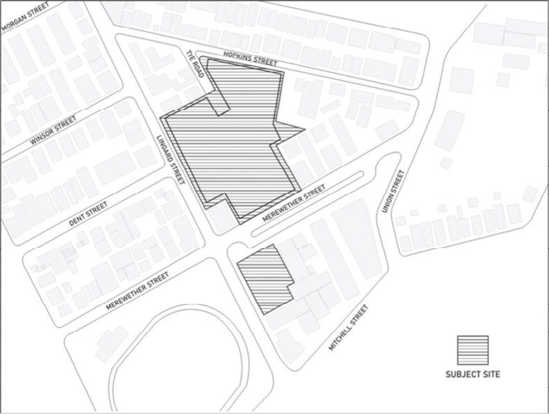

### 2.0 Application

This section applies to all land mapped as hatched on Map 1 (bounded by Lingard Street, Merewether Street, Hopkins Street and Tye Road).

> [Picture on page 2: a picture, saved as a picture (images/section-e12-lingard-hospital-precinct-page-2-8.gif, 150 dpi).]

#### Map 1: Lingard Hospital Precinct Site

#### Development (type/s) to which this section applies

This section applies to all development applications for health services facilities.
