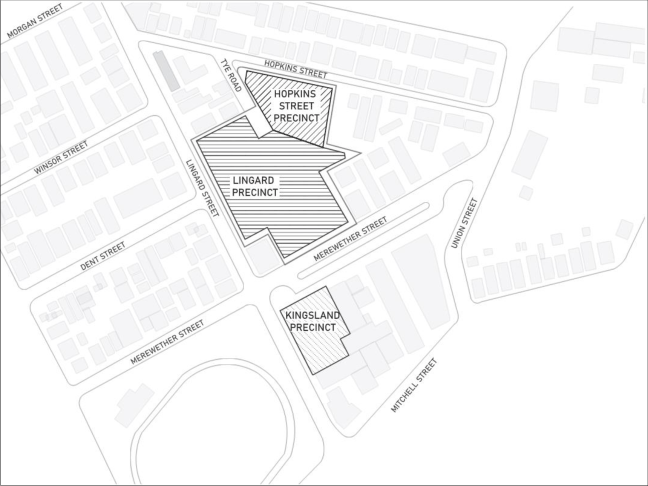

### 6.0 Preamble

The original Lingard Hospital is located at 23 Merewether Street, Merewether, situated within the local government area (LGA) of Newcastle.  A recently completed expansion of the health precinct exists across the street at 8 Lingard Street, Merewether.  There is a potential to expand the health precinct to include an adjoining site at 27 Hopkins Street, Merewether.

The site is located within the suburb of Merewether and is situated approximately three kilometres south-west from the high street (Hunter Street) of Newcastle CBD. Merewether is dominated by a low density residential land uses for the majority of the suburb and is bordered by medium density residential development to the north where it meets the commercial core of The Junction precinct, approximately 450 metres from the site.

This original and principal Lingard Hospital premises is situated on land surrounded by residential uses zoned R3 Medium Density Residential, comprising single and two-storey residential built form. The recent expansion of the health services facility opposite the primary Lingard Hospital premises is sited amidst a solitary mixed business and warehouse block, zoned B5 Business Development, encompassing predominantly two-storey employment uses and built form.

In March 1971, consent was granted for construction of a single storey private hospital, with 106 beds.  The Lingard Hospital precinct has continued to grow, expand and adapt to the needs of the community, today presenting a large staff across a range of speciality medical sectors. Since 2020, the Lingard Hospital has operated two distinct precincts, with investigations undertaken to expand into a third precinct. These have been identified through analysis of current land use and character, and consideration of the envisaged future development, see Map 2.

> [Picture on page 4: a picture, saved as a picture (images/section-e12-lingard-hospital-precinct-page-4-21.gif, 150 dpi).]

#### Map 2: Precincts

#### Lingard precinct

The Lingard Precinct is the primary and original Hospital Campus where the majority of the Lingard services are located and provided. This Precinct has frontages to the south-east on Merewether Street and south-west on Lingard Street, and rear lane access on the north side via Tye Road. The block shape is irregular, sharing boundaries with residential lots. The allotment is almost entirely occupied with the hospital structure.  Due to the age of the existing hospital, the aim for this precinct is renewal of facilities.

#### Kingsland precinct

The Kingsland Precinct was first established in 2016, with consulting suites completed in 2020 and is currently used for day surgery, with limited health consulting rooms. The Precinct has frontages to the north-west on Merewether Street and south-west on Lingard Street. The block is roughly rectangular, sharing boundaries with three neighbouring commercial allotments. The allotment is entirely occupied by the two-storey building structure. Substantial carparking exists in the basement levels.  Due to recent development activity directly north-east of this Precinct, opportunities to expand the Kingsland Precinct are likely limited to the south-east.

#### Hopkins precinct

The Hopkins Precinct is not currently occupied by a health related use and is currently occupied by a residential complex. This precinct directly adjoins the Lingard Precinct to the south and has road frontages to Hopkins Street and Tye Road. The opportunities for the Hopkins Precinct will be determined based on changing health demands in the region.

#### Indicative staging order of future development

Stage 1: Development to add an additional storey to Kingsland precinct

Stage 2: Development of Hopkins Street

Stage 3: Refurbishment of existing Lingard precinct Hospital
