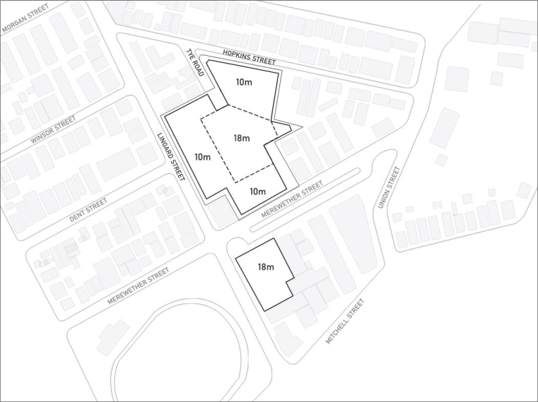

### 8.0 Site layout

#### Objectives

1\. The proposed development is positioned and oriented on the site to minimise the impact on surrounding properties and uses.

#### Controls

General controls applying to all development to which this section applies

The development layout is generally in accordance with Map 3 unless an equivalent or improved planning outcome is identified as a result of the site analysis design process.

> [Picture on page 7: a picture, saved as a picture (images/section-e12-lingard-hospital-precinct-page-7-1.gif, 150 dpi).]

#### Map 3: Indicative site layout
