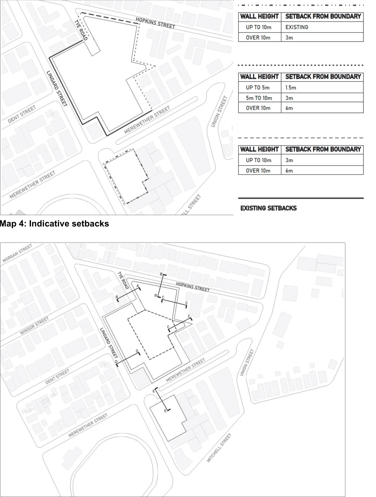
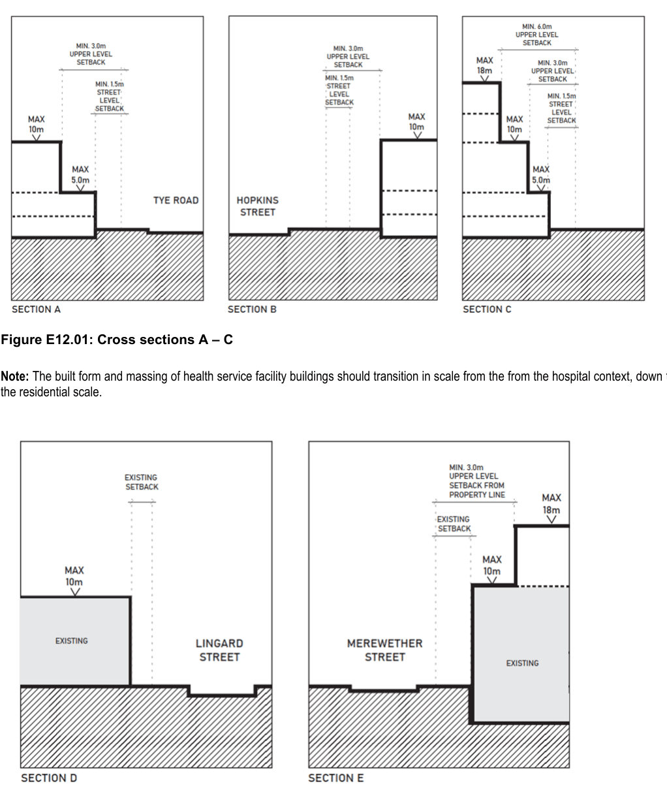

### 9.0 Building envelope

#### Objectives

1\. The building height is consistent with the desired scale and character of the street and locality, creates an articulated and visually interesting skyline, and provides an acceptable impact on the amenity of adjoining properties.

2\. Setbacks are established by the context and established urban form, ensure that built form engages with the public domain, and minimise the impact on the amenity of adjoining properties.

3\. Buildings and sites are designed to preserve the amenity of adjacent public open spaces.

#### Controls

General controls applying to all development to which this section applies

1\. The maximum building height is in accordance with the relevant statutory requirements and site-specific criteria.

2\. Setbacks to boundaries shared with residential uses, where the residential uses are within 3m of the boundary are:

a. 1.5m setback up to 3m in height

b. 3m setback from 3m - 6m in height, and

c. 4.5m setback above 6m in height.

3\. For circumstances where the criteria detailed directly above does not apply, building setbacks are consistent with those shown on Map 4, Map 5 and Figure E12.01, unless an equivalent or improved planning outcome is identified as a result of the site analysis design process.

4\. Development does not unreasonably reduce the total area of public open space (such as Mitchell Park) that receives direct sunlight between 9am to 3pm on June 21.

> [Picture on page 8: a picture, saved as a picture (images/section-e12-lingard-hospital-precinct-page-8-3.gif, 150 dpi).]

#### Map 4: Indicative setbacks

#### Map 5: Cross section locations

> [Picture on page 9: a picture, saved as a picture (images/section-e12-lingard-hospital-precinct-page-9-1.gif, 150 dpi).]

#### Figure E12.01: Cross sections A – C

Note: The built form and massing of health service facility buildings should transition in scale from the from the hospital context, down to the residential scale.

#### Figure E12.02: Cross sections D – E
