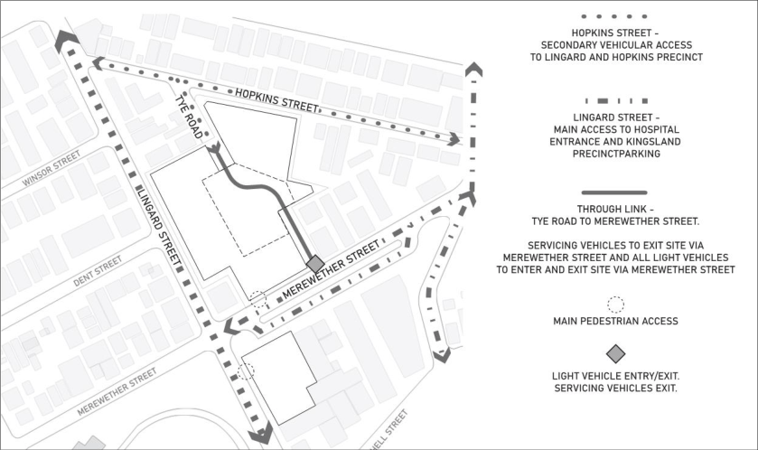
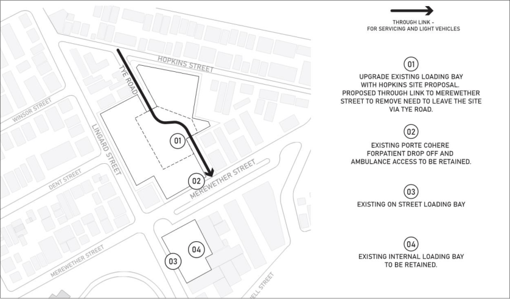

### 15.0 Transport and movement

#### Objectives

1\. The movement network has a clear structure, is functional and provides for the safe, efficient and equitable movement of pedestrians, cyclists and vehicles.

2\. Transport and movement elements are a considered part of the overall urban design and minimise impact on the public domain, surrounding properties and the locality.

#### Controls

General controls applying to all development to which this section applies

1\. Development proposals which, in the opinion of Council, may cause significant impacts on the surrounding movement network, are supported by a Traffic Impact Study (TIS), prepared by a suitably qualified and experienced transport professional.

2\. Issues addressed in the TIS are to include, but not limited to:

a. review of the existing and proposed traffic network, traffic operating conditions and flows

b. existing car parking supply and likely demand, as well as servicing requirements

c. existing trip generation and estimate of trip generation of the development

d. public transport services within the vicinity of the proposed development

e. impacts of generated traffic on the surrounding road network and the locality

f. safety of access between the site and the adjacent road network

g. pedestrian infrastructure, generation and movements

h. recommended improvement works

i. linkages with existing and proposed bicycle and pedestrian routes.

3\. The TIS will also include measures proposed to increase mode share to public transport and improve access to services.

4\. The TIS should be prepared having regards for the entire heath Precinct together with the proposed development. The TIS must provide traffic modelling for the local road intersections and signalised intersections and such modelling must provide cumulative post development traffic data generated by the entire Lingard Hospital Precinct (that is Kingsland, Lingard and Hopkins). The TIS should consider the impacts from the Precincts and provide recommendations for improvements and management of the local and signalised intersections.

5\. Development is in accordance with the relevant transport and movement criteria contained separately within

C1 Traffic, parking and access and C2 Movement networks, unless an equivalent or improved planning outcome is identified as a result of the site analysis design process, TIS and/or advice from Council.

6\. Access and servicing of the site in accordance with Map 6 and Map 7, particularly the through link from Tye Road to Merewether Street, is subject to improved results and outcomes identified in the TIS.

7\. Major development of the site is to demonstrate that safe entry treatment at the intersection of Hopkins Street and Tye Road can be achieved and implemented.

8\. All vehicles are to enter and leave site in forward motion.

9\. Vehicular access is located to minimise impact on the streetscape and surrounding local context.

10\. Sufficient area is provided for the safe manoeuvring of large trucks and service vehicles as required for operation of the development.

11\. The size and layout of loading areas are appropriate for the use and ongoing operation of the development.

12\. Clear delineation of the loading areas is provided to ensure safe ongoing operation.

13\. Dedicated service vehicle circulation may be considered to ensure safe movement of pedestrian, vehicles and service vehicles.

14\. Major development of the site is to demonstrate that safe vehicle, pedestrian and cyclist movement at the intersection of Merewether Street and Lingard Street to the Lingard and Kingsland Precincts can be achieved and implemented.

15\. Provide accessible pedestrian paths from street front boundary to building entries, separated from any vehicular circulation or parking.

16\. Provide marked crossings where pedestrian access crosses any road or driveway.

17\. Provide an accessible pedestrian circulation path from all car parking areas to building entries.

18\. Provide dedicated circulation path, separate to any road or drive, adjacent building from carpark to building entry.

19\. Safe pedestrian access routes are provided to improve connectivity across the overall site and to the locality.

20\. Public access is restricted to areas unsafe or unsuitable for public access in the form of fencing or barriers.

21\. Public access is restricted to areas not visible from the public domain outside of business hours.

22\. Safe and legible access to staff and visitor bicycle parking is provided that is not in conflict with vehicular access and circulation.

23\. Provision is made for future pedestrian connections between Lingard and Kingsland precincts.

> [Picture on page 16: a picture, saved as a picture (images/section-e12-lingard-hospital-precinct-page-16-19.gif, 150 dpi).]

#### Map 6: Access

> [Picture on page 17: a picture, saved as a picture (images/section-e12-lingard-hospital-precinct-page-17-1.gif, 150 dpi).]

#### Map 7: Servicing
