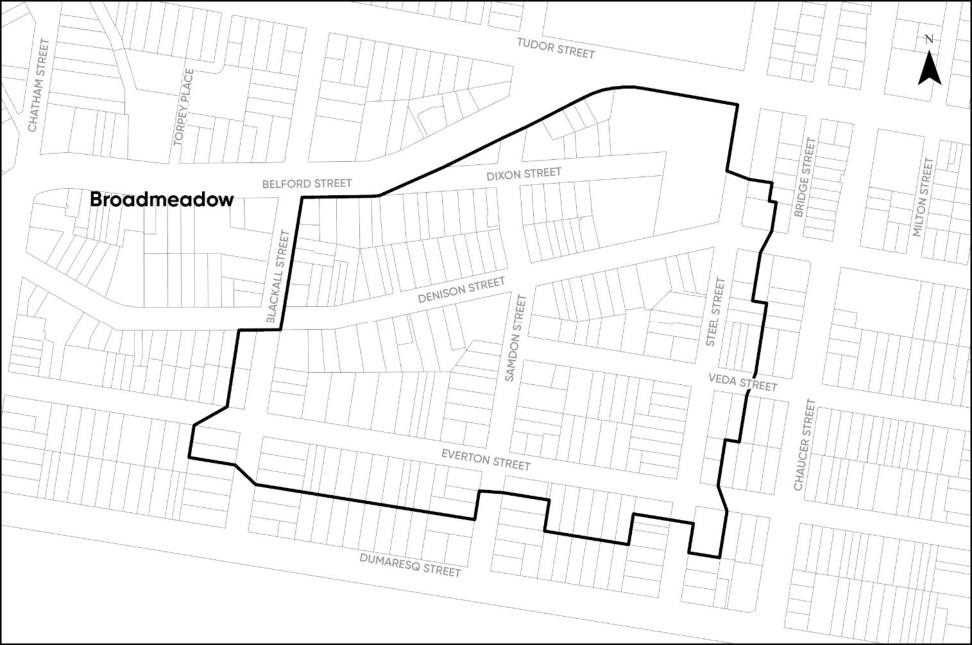

### 6.0 Cameron's Hill Heritage Conservation Area

This section applies to land within Cameron's Hill Heritage Conservation Area as listed in Schedule 5 and mapped in LEP 2012- Heritage Map (HER_004C).

It maps the area for controls provided in Section E1 Built and landscape heritage and is to be read with that section and the heritage significance and desired future character statements of this section, to understand the heritage requirements.

> [Picture on page 3: a picture, saved as a picture (images/section-e2-heritage-conservation-areas-page-3-7.gif, 150 dpi).]

#### Map E2.01: Land application – Cameron's Hill Heritage Conservation Area

#### Key period of significance – circa 1840 to 1940

Cameron's Hill has historical significance for its association with the early decades of the Australian Agricultural Company (AACo). The area demonstrates the early days of nongovernment coal mining in the local area and represents the founding of Hamilton. Its earliest settlement was an assortment of mine workings, primitive slab huts and lean-tos, a few brick houses, and a brickyard, clustered around the AACo's 'D' Pit. This influenced the emerging townships on the surrounding flat land. Following the closure of the mine, the area gradually transitioned into a residential suburb, closely influenced by the decisions and activities of the AACo. The study area is a notable example of patterns of domestic life in the local area, illustrating the transition from its origins as an industrial mining area to a residential area for the more affluent social classes. This contrasts to development that occurred on the surrounding flat and flood prone land, formerly known as Happy Flat and Pit Town. This provides a demonstration of social hierarchies and living standards in the nineteenth and twentieth centuries.

Cameron's Hill has strong associations with the Colliery Department of the AACo and its senior staff, whose influence defined the development of Hamilton and surrounds.

The area has aesthetic significance at a local level, demonstrating characteristics that define the late Victorian and Federation periods in Australian urban development, with early buildings and the street layout closely influenced by the development of the AACo's mining operations. Surviving buildings from the mid to late nineteenth century provide evidence of this period of mining operations. The elevated position and subdivision following the closure of the 'D' Pit resulted in the proliferation of grander residences in the early twentieth century.

Cameron's Hill is a significant representative example of a Federation period residential subdivision in the Newcastle area. It retains a substantial proportion of original dwellings, forming cohesive and attractive streetscapes with an established sense of place. The area demonstrates a range of characteristics associated with this time. It is highly intact, being developed in a relatively condensed period. The area is strongly characterised by intact streetscapes and contributory dwellings including particularly fine examples of the Federation Arts and Crafts style.
