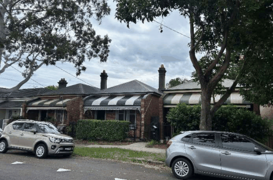
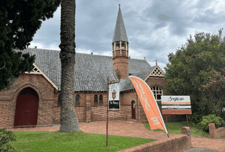
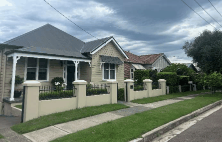
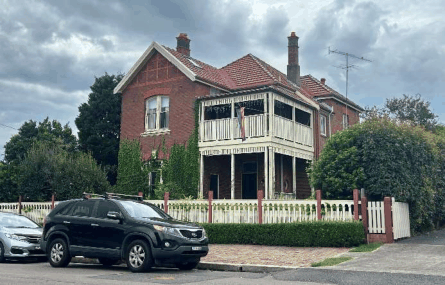
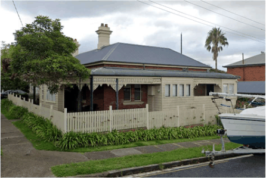
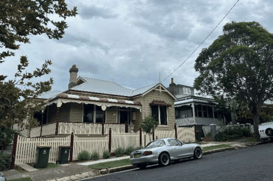

### 6.2 Desired future character statement

The character of the Cameron's Hill Heritage Conservation Area is made up of a variety of building styles and settlement patterns dating from the late 19th century and early decades of the 20th century. The special character of Cameron's Hill is to be preserved, celebrated and maintained through the retention of contributory buildings, street trees, existing subdivision pattern and elements of visual interest and heritage significance.

Elements to preserve and/or sensitively restore or reconstruct (based on evidence of original appearance) include: A range of contributory and historic buildings built before the Second World War, particularly intact or historically significant groupings, heritage items, iconic structures, and the appearance and layout of streets. Single storey scale of housing stock, with a small number of two-storey residences in elevated positions, that is an original defining feature of the area. An existing subdivision pattern and street layout, including preserving the human scale of development, the fine grain and the groupings of intact Federation era weatherboard and brick cottages and bungalows, as well as larger villa residences, which have high contributory value to the streetscape. Contributory dwellings that retain ornate timber details demonstrative of the Arts and Crafts movement. Dwellings that display a good degree of integrity and intactness, incorporating typical details such as verandahs, corrugated metal and terracotta tile roofs, timber barge boards and joinery, finials, decorative chimneys, and coloured glass windows. Mature trees in gardens and the public domain. Public open space including the Hamilton Rotary Park. Heritage picket and brick fences. Exposed face brick and stone of existing building facades and front fencing. A traditional road layout and street furniture such as sandstone kerbing and guttering, brick paving, and other features of historical interest.

Items of heritage significance individually listed as heritage items in Schedule 5 of LEP 2012, including retention of the three-dimensional form and adaptive re-use of heritage item buildings.

The following images demonstrate the characteristic features of the Cameron's Hill Heritage Conservation Area.

> [Picture on page 5: a picture, saved as a picture (images/section-e2-heritage-conservation-areas-page-5-4.gif, 150 dpi).]

> [Picture on page 5: a picture, saved as a picture (images/section-e2-heritage-conservation-areas-page-5-5.gif, 150 dpi).]

Figure E2.01: St Peters Anglican Church, one of the many heritage items in Cameron's Hill contributing significantly to the streetscape.

> [Picture on page 5: a picture, saved as a picture (images/section-e2-heritage-conservation-areas-page-5-9.gif, 150 dpi).]

Figure E2.02: Typical group of Federation era brick cottages maintaining consistent urban form with design elements resulting in a harmonious streetscape.

> [Picture on page 5: a picture, saved as a picture (images/section-e2-heritage-conservation-areas-page-5-14.gif, 150 dpi).]

Figure E2.04: Small number of two-storey villa residences in elevated positions.

> [Picture on page 5: a picture, saved as a picture (images/section-e2-heritage-conservation-areas-page-5-17.gif, 150 dpi).]

Figure E2.03: Single storey scale of housing stock with different architectural styles from mid-19th and early 20th centuries contributing to distinct visual character in Cameron's Hill.

> [Picture on page 5: a picture, saved as a picture (images/section-e2-heritage-conservation-areas-page-5-22.gif, 150 dpi).]

Figure E2.05: Dwellings that retain ornate timber details demonstrative of the Arts and

#### Crafts movement.

Figure E2.06: Typical streetscape consisting of a single storey building built between mid-19th and early 20th century, mature trees in gardens within public domain.
