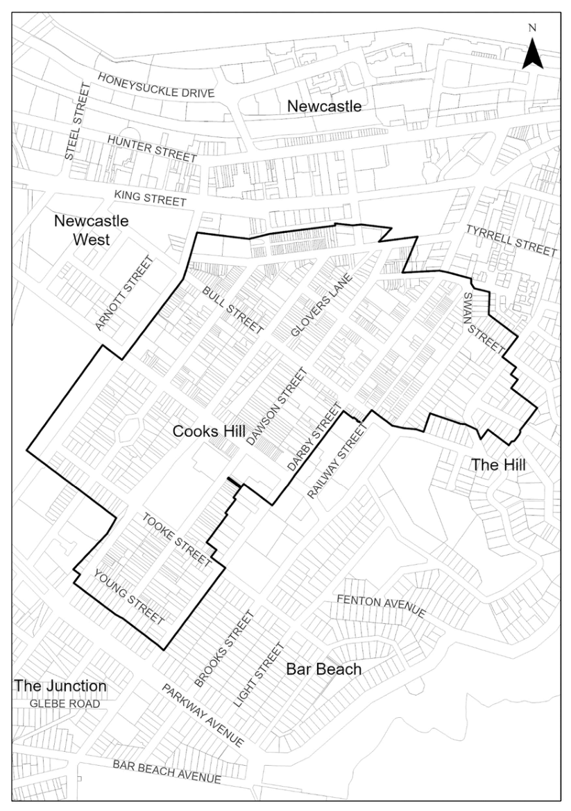

### 7.0 Cooks Hill Heritage Conservation Area

This section applies to land within Cooks Hill Heritage Conservation Area as listed in Schedule 5 and mapped in LEP 2012- Heritage Map (HER_004G).

It maps the area for controls provided in Section E1 Built and landscape heritage, and is to be read with that section and the heritage significance and desired future character statements of this section, to understand the heritage requirements.

> [Picture on page 6: a picture, saved as a picture (images/section-e2-heritage-conservation-areas-page-6-7.gif, 150 dpi).]

#### Map E2.02: Land application – Cooks Hill Heritage Conservation Area

#### Key period of significance – circa 1850 to 1940

Cooks Hill Heritage Conservation Area is culturally significant on a number of levels. As a residential and commercial precinct, it is regarded for its special historical character, liveable streetscapes, diverse range of historic residential and commercial buildings and tree lined streets. The age of the suburb, relative to other suburbs of the Newcastle local government area (LGA), is apparent in the style and form of buildings and eclectic street layout.

It has a significant visual character comprising buildings which represent all of the common architectural styles including mid-19th century workers' houses and terraces, federation bungalows, inter-war cottages and post-war residential flat buildings. A critical mass of contributory buildings, traditional streetscapes, significant trees, sandstone kerb and gutters, artefacts, heritage listed hotels, shops and parklands create a strong sense of place and a distinctive historic identity valued by local residents and visitors.

Cooks Hill is closely associated with the Australian Agricultural Company (AACo) as part of the original 2000-acre grant owned by the company. The AACo began to sell off parts of Cooks Hill in the 1850s. However, even before that the AACo built huts for its workmen and so the area began its life as a mining village. When the first land sales occurred, development was rapid along Lake Macquarie Road (Darby Street) and eventually Blane Street (Hunter Street), becoming an extension of the main streets connected to the city centre.

The early houses were single and two storey terraces and miners' cottages, both brick and timber. Retailing and hotels flourished as did the population. The area is significant as it reflects land uses and activities of the AACo. Its mines, railways, and the Colliery railway serving Merewether district, exercise a strong physical presence over Cooks Hill.
