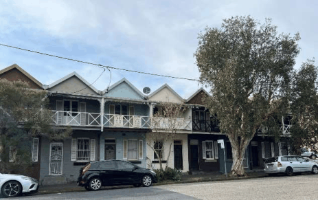
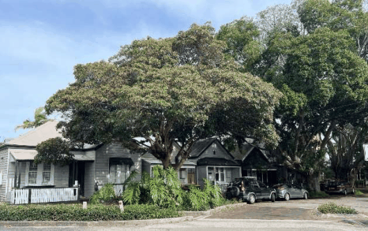
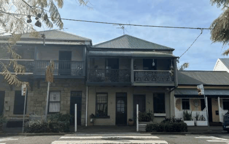
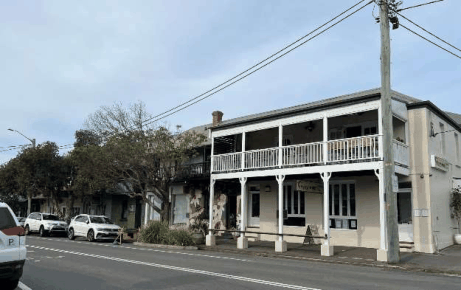
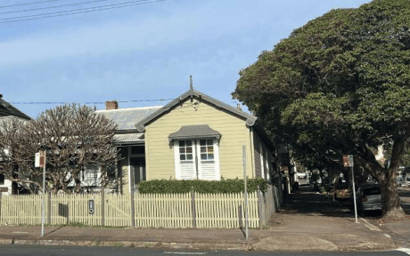
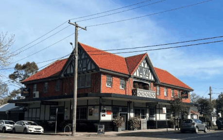

### 7.2 Desired future character statement

The character of the Cooks Hill Heritage Conservation Area is made up of a variety of building styles and settlement patterns dating from late 19th and early decades of the 20th century. The special character of Cooks Hill is to be preserved, celebrated and maintained through the retention of contributory buildings, street trees, existing subdivision pattern and elements of visual interest and heritage significance. The eclectic character of Cooks Hill is to provide residents with a unique and valued sense of place.

Elements to preserve and/or sensitively restore or reconstruct (based on evidence of original appearance) include:

Contributory buildings constructed prior to the Second World War. Mature trees in gardens and public domain. Former Burwood Coal and Copper Company rail line and bridge abutments at Laman Street. Heritage fences. Exposed face brick and stone of existing building facades and front fencing. Sandstone kerbing and guttering. Victorian era post box on Corlette Street and horse trough at corner of Young and Darby streets. Single or two storey scale of housing stock that is an original defining feature of the residential streets. Two-storey scale of buildings with parapets concealing roofs from the street and mansard roofs, and the mix of shop top housing and commercial premises that is an original defining feature of Darby Street and the street block addressing Union Street between Bull and Laman streets. Dense rhythmic arrangement of small bay widths along the building facades of Darby, Union, Bull, Laman, Gibbs, Queen, Corlette, Bruce, Young, Council, and Railway streets. Cantilevered awnings and balconies and single or two storey verandahs (often with cast iron columns, balustrades and decorative lacework) over the footpath of Darby, Union and Bull Streets, and where they occur on other streets in the heritage conservation area. Reinforce a consistent street edge alignment for properties along Darby Street. Pubs and shops on Darby, Union and Bull Streets. Public parks, including Centennial Park, Corlette Street and National Park. Items of heritage significance individually listed as heritage items in Schedule 5 of LEP 2012, including retention of the three-dimensional form and adaptive re-use of heritage item buildings. Rich record of relics and archaeological sites beneath the modern city.

The following images demonstrate the characteristic features of the Cooks Hill Heritage Conservation Area.

> [Picture on page 8: a picture, saved as a picture (images/section-e2-heritage-conservation-areas-page-8-2.gif, 150 dpi).]

> [Picture on page 8: a picture, saved as a picture (images/section-e2-heritage-conservation-areas-page-8-3.gif, 150 dpi).]

Figure E2.07: Street lined with mature trees alongside single-storey workers cottages contributing significantly to the streetscape.

> [Picture on page 8: a picture, saved as a picture (images/section-e2-heritage-conservation-areas-page-8-7.gif, 150 dpi).]

Figure E2.08: Typical group of buildings maintaining consistent urban form with design elements resulting in a harmonious streetscape.

> [Picture on page 8: a picture, saved as a picture (images/section-e2-heritage-conservation-areas-page-8-11.gif, 150 dpi).]

Figure E2.10: Cantilevered balconies with ornate elements over footpath in high

street/commercial premises.

> [Picture on page 8: a picture, saved as a picture (images/section-e2-heritage-conservation-areas-page-8-15.gif, 150 dpi).]

Figure E2.09: Mix of single and two-storey buildings with different architectural styles from mid-19th and early 20th centuries contributing to distinct visual character in Cooks Hill.

> [Picture on page 8: a picture, saved as a picture (images/section-e2-heritage-conservation-areas-page-8-20.gif, 150 dpi).]

#### Figure E2.11: Heritage building with commercial use.

Figure E2.12: Typical streetscape consisting of a single storey building built between mid-19th and early 20th century, sandstone kerb, mature trees in gardens within public domain.
