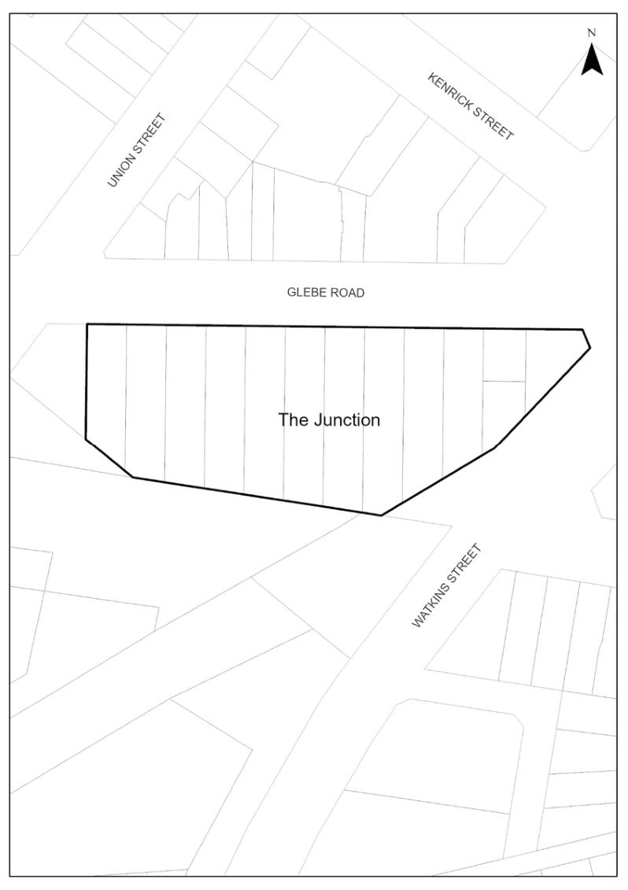

### 8.0 Glebe Road Federation Cottages Heritage Conservation Area

This section applies to land within Glebe Road Federation Cottages Heritage Conservation Area as listed in Schedule 5 and mapped in LEP 2012- Heritage Maps (HER_004G). The heritage conservation area is located on the southern side of Glebe Road, between the intersections of Watkins Street and Union Street, The Junction.

It maps the area for controls provided in Section E1 Built and landscape heritage, and is to be read with that section and the heritage significance and desired future character statements of this section, to understand the heritage requirements.

> [Picture on page 9: a picture, saved as a picture (images/section-e2-heritage-conservation-areas-page-9-8.gif, 150 dpi).]

Map E2.03: Land application – Glebe Road Federation Cottages Heritage Conservation Area

#### Key period of significance - circa 1909 – 1915

The Glebe Road Federation Cottages Heritage Conservation Area is important at the local level as it demonstrates the principal characteristics of the Federation period and nature of residential building construction between 1909 and 1915. The narrow window of time in which the precinct developed is significant in providing evidence of the key features of the federation period including construction and building technologies, fashion and key elements of style. Those being the single storey scale of these modest detached row of dwellings, symmetrical street frontage set close to Glebe Road and set off side boundaries, open verandah, pyramidal roof form, hip and gable roofs, bearer and joist construction with lightweight cladding material (weatherboard), and absence of garaging with parking occurring at the rear accessed via side driveways. The uniformity of the group in terms of architectural style, age, height, form, massing, setbacks, materials, and lack of obvious garaging contributes to defining the character.

The house at 55 Glebe Road has associative significance with a prominent individual, being the home of RJ Kilgour, a past Mayor of Merewether, and whose son was the first to enlist locally in 1915 for the First World War. The group of houses itself has associational significance with the Australian Agricultural Company (AACo), and the south east boundary line abuts the easement of the former Burwood coal and copper company railway line, which was the Merewether estate's coal haulage line.
