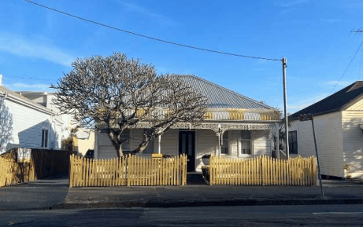
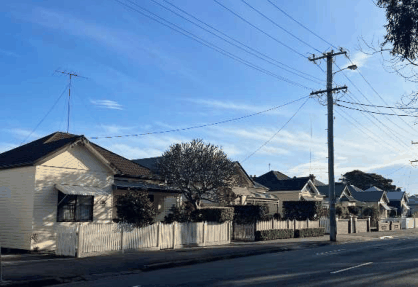
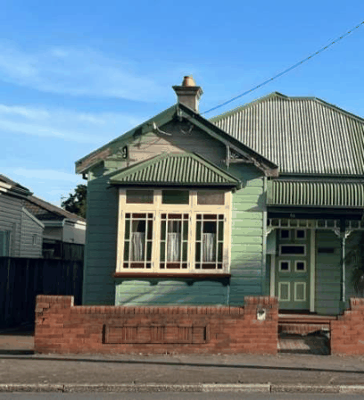

### 8.2 Desired future character statement

The character of the Glebe Road Federation Cottages Heritage Conservation Area is made up of single storey Federation cottages built between 1909 - 1915. The homogenous character of this precinct is to be preserved, celebrated and maintained through the retention of all contributory buildings, existing subdivision pattern and elements of visual interest and heritage significance.

Elements to preserve and/or sensitively restore or reconstruct (based on evidence of original appearance) include:

Building group at 55 to 75 Glebe Road, The Junction, is a fine representative of a group of intact Federation era cottages which have high contributory value to the streetscape. Single storey scale of housing stock that is an original defining feature of Federation cottages group. Exposed face brick of existing building facades and front fencing. Consistent height of front fencing, constructed of timber or brick. Consistent front and side setbacks including retaining the offsets to the eastern side boundaries and keeping front gardens as open space. Urban form reflects a regular pattern of subdivision and development dates from the 1900 - 1920. Main entry to houses in front verandah facing the street, with connection via front garden footpath. Mature trees in gardens and relationship of houses to their gardens and to each other. Side driveways with access to garages and on-site car parking accommodation at the rear of the house group. Items of heritage significance recommended for individual listing as heritage items in Schedule 5 of LEP 2012.

The following images demonstrate characteristic features of Glebe Road Federation Heritage Conservation Area.

> [Picture on page 11: a picture, saved as a picture (images/section-e2-heritage-conservation-areas-page-11-2.gif, 150 dpi).]

> [Picture on page 11: a picture, saved as a picture (images/section-e2-heritage-conservation-areas-page-11-3.gif, 150 dpi).]

Figure E2.13: Federation cottage exhibiting key characteristics of federation style.

> [Picture on page 11: a picture, saved as a picture (images/section-e2-heritage-conservation-areas-page-11-6.gif, 150 dpi).]

Figure E2.14: Array of federation cottages featuring the single-storey scale, uniform subdivision pattern, consistent street scape with front gardens, timber fence, and side driveways.

Figure E2.15: Federation cottage exhibits original design elements of federation style.
