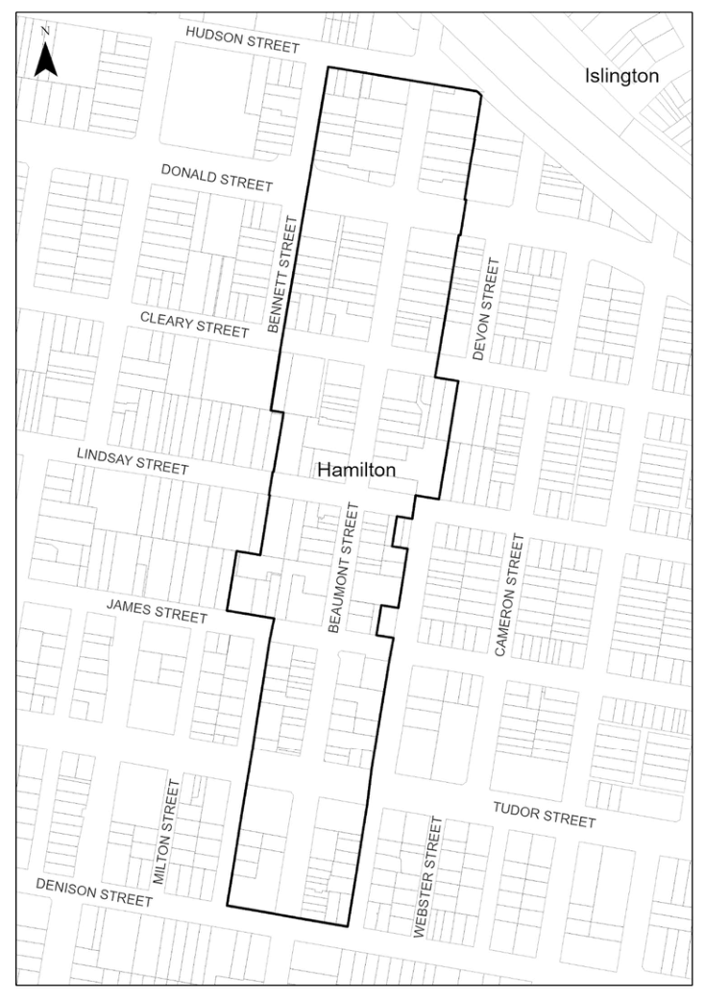

### 9.0 Hamilton Business Centre Heritage Conservation Area

This section applies to land within the Hamilton Business Centre Heritage Conservation Area as listed in Schedule 5 and mapped in LEP 2012- Heritage Maps (HER_004B, HER_004C, HER_004G, and HER_004FA). The heritage conservation area is in Hamilton located between Hudson Street to the north, Murray Street to the east, Denison Street to the south, and William Street and Bennett Street to the west.

It maps the area for controls provided in Section E1 Built and landscape heritage, and is to be read with that section and the heritage significance and desired future character statements of this section, to understand the heritage requirements.

> [Picture on page 12: a picture, saved as a picture (images/section-e2-heritage-conservation-areas-page-12-9.gif, 150 dpi).]

Map E2.04: Land application – Hamilton Business Centre Heritage Conservation Area

#### Key period of significance – circa 1870 to 1940

Hamilton Business Centre Heritage Conservation Area is of heritage significance for its role in economic and social life of the local Hamilton community. It contains many examples of two storey shops and commercial premises that reflect various periods of economic growth and social history.

The area represents waves of immigration during the 20th century and eastern European immigrants who established businesses in the street. The earliest examples of Italian and Greek eateries opened on Beaumont Street during the 1950s. The Newcastle Earthquake of 28 December 1989 dramatically changed Beaumont Street. There was widespread damage, loss of life and major social dislocation. The buildings that survived were revitalised and many of two storey shopfronts were saved by judicious planning and urban design.

Beaumont Street is a thriving urban centre with cosmopolitan character. Two storey scale defines the character of the street. Unfortunately, many buildings have been compromised by unsympathetic signage.
