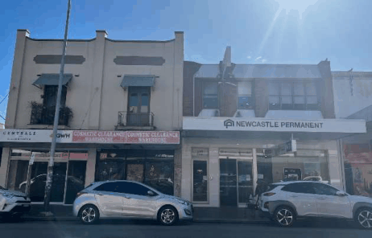
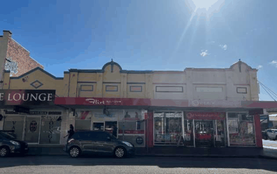
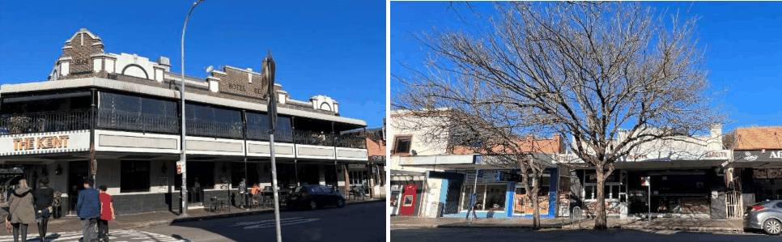

### 9.2 Desired future character statement

The character of Hamilton Business Centre Heritage Conservation Area is made up of a variety of building styles and settlement patterns that date from the late 19th and early decades of the 20th century. The special character of Hamilton business centre is to be preserved, celebrated and maintained through retention of contributory buildings, two storey scale commercial buildings, existing subdivision pattern and elements of visual interest and heritage significance.

The commercial and cosmopolitan character of Hamilton Business Centre is to continue to provide visitors, residents and commercial businesses with a unique and valued sense of place.

Elements to preserve and/or sensitively restore or reconstruct (based on evidence of original appearance) include:

Contributory buildings constructed prior to the Second World War. Two-storey scale of buildings with mix of shop top housing and commercial premises built to the

boundary alignment that is an original defining feature of Beaumont Street. Exposed face brick and stone of existing building facades and front fencing. Active street frontages in commercial buildings at the ground floor level. Dense rhythmic arrangement of common bay widths and first floor windows (often in the form of French

doors) of building facades with vertical proportions and glass-solid on facade of less than 1:1. Cantilevered awnings and single or two storey verandahs (often with cast iron columns, balustrades and

decorative lacework) over the footpath on Beaumont Street. Parapets concealing roofs from the street. Masonry buildings with face brick or rendered wall surfaces. Sandstone kerbing and guttering. Side streets off Beaumont Street being predominantly residential in character and of single storey scale,

typified by detached dwellings. Items of heritage significance individually listed as heritage items in Schedule 5 of LEP 2012, including

retention of the three-dimensional form and adaptive re-use of heritage item buildings.

The following images demonstrates the characteristic features of the Hamilton Business Centre Heritage

> [Picture on page 14: a picture, saved as a picture (images/section-e2-heritage-conservation-areas-page-14-2.gif, 150 dpi).]

Conservation Area.

> [Picture on page 14: a picture, saved as a picture (images/section-e2-heritage-conservation-areas-page-14-4.gif, 150 dpi).]

Figure E2.17: Two-storey buildings with mix of shop top housing and commercial premises built to boundary.

Figure E2.16: Commercial buildings with active frontages and parapet wall concealing the roofs.

> [Picture on page 14: a picture, saved as a picture (images/section-e2-heritage-conservation-areas-page-14-10.gif, 150 dpi).]

Figure E2.19: Mix of single and two-storey buildings consisting of uniform subdivision pattern, active frontages with sandstone kerbing and trees present in public domain.

Figure E2.18: Contributory building constructed prior to second world war with cantilevered cast iron balconies adorned with decorative lacework over the footpath on Beaumont Street.
