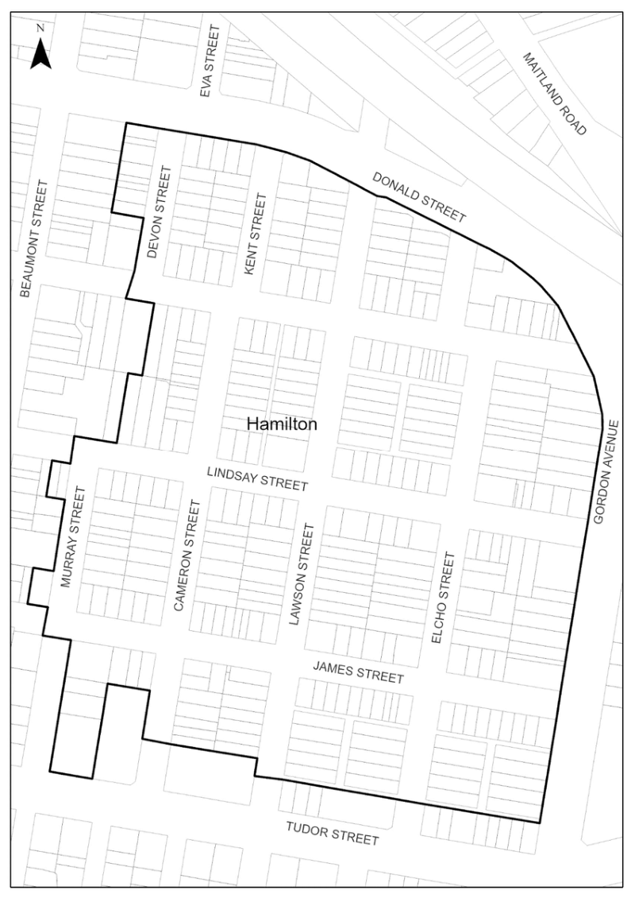

### 10.0 Hamilton Residential Precinct Heritage Conservation Area

This section applies to land within Hamilton Residential Precinct Heritage Conservation Area as listed in Schedule 5 and mapped in LEP 2012- Heritage Maps (HER_004FA and HER_004G). The heritage conservation area is in Hamilton located between Donald Street to the north, Gordon Avenue to the east, Tudor Street to the south, and Murray Street and Devon Street to the west.

It maps the area for controls provided in Section E1 Built and landscape heritage, and is to be read with that section and the heritage significance and desired future character statements of this section, to understand the heritage requirements.

> [Picture on page 15: a picture, saved as a picture (images/section-e2-heritage-conservation-areas-page-15-9.gif, 150 dpi).]

Map E2.05: Land application – Hamilton Residential Precinct Heritage Conservation Area

#### Key period of significance – circa 1870 to 1940

The Hamilton Residential Precinct Heritage Conservation Area is a low scale, residential area typified by small lot housing generally one or two storeys, built close to boundaries, and located towards the front of the block. The character of the area and its streetscapes is representative of late Victorian, Federation and inter-war periods of Australian urban development. The style of housing - late Victorian terraces and cottages, Federation cottages and bungalows in the popular styles of the time, Italianate, Queen Anne, Edwardian, and California and Spanish Mission influences. In particular, a large number of detached terrace houses comprising small lot housing, traditional street grid nestled adjacent to Hamilton railway station with general absence of space for vehicle accommodation. The Hamilton residential precinct represents a pattern of urban settlement that represents gradual urban infill of the Newcastle coal field as mining moved out to the Hunter valley from 1880s until the turn of the 20th century. Urban development in the suburb reflects the gradual release of land by the Australian Agricultural Company (AACo), with some houses built as early as 1870. Most of the suburb was released in 1885 -1886, and 1900 -

1920\. Hamilton’s development between 1880 and 1900 reflects a period of intensive infrastructure investment by the state government, comprising the opening of the railway and train station in 1887. This attracted people to the suburb from the city centre and the style and age of much of the housing stocks reflects this period. The Hamilton Residential Precinct Heritage Conservation Area has special associations with the AACo, being part of their 2000 acre grant of land in inner Newcastle. The township developed around the lucrative borehole pit, and was named 'Pit Town', with operations at the No 1 pit, No 2 pit, the Hamilton pit and the lucrative D pit on Cameron's Hill, all of which were opened up in the late 1840s and 1850s. The enduring legacy of the AACo is reflected in the contemporary names of streets, including Lindsay, Denison, Cleary, Everton and Skelton Streets. The smaller lot layout of the residential area of Hamilton can be attributed to the manner in which the AACo released land for sale, the main purchasers being miners and company employees, and also an era of urban development before the widespread use of the motor car, with little space made for car parking.
