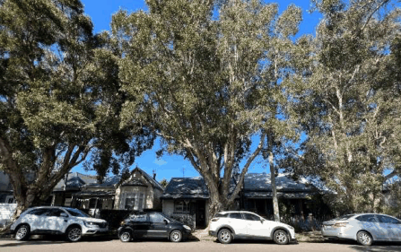
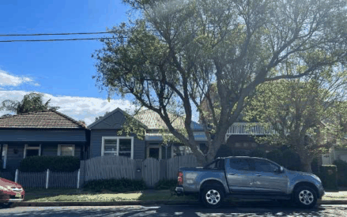
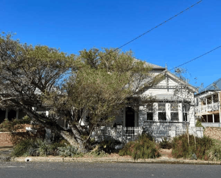
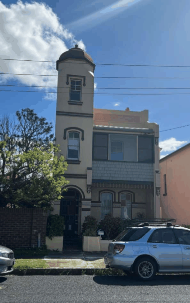

### 10.2 Desired future character statement

The character of the Hamilton Residential Precinct Heritage Conservation Area consists of a variety of building styles and settlement patterns that date from the late 19th and early decades of the 20th century. The special character of Hamilton residential precinct is to be preserved, celebrated and maintained through the retention of contributory buildings, street trees and elements of visual interest and heritage significance. Elements to preserve and/or sensitively restore or reconstruct (based on evidence of original appearance) include: Range of contributory and historic buildings, particularly intact or historically significant groupings, heritage items, iconic structures, and the appearance and layout of streets. Single or two storey scale of housing stock that is an original defining feature of the precinct. Exposed face brick and stone of existing building facades and front fencing. Many houses located towards the front of the block with small and low-fenced front yards, and some others built to the street without front yards. Traditional road layout and street furniture such as sandstone kerbing and guttering, and other features of historical interest. Urban form which reflects a regular pattern of subdivision and development that dates from the 1890s to the 1930s and building stock from this period. Mature trees in gardens and the public domain. Prevailing absence of garages and on-site car parking accommodation. Items of heritage significance individually listed as heritage items in Schedule 5 of LEP 2012, including retention of the three-dimensional form and adaptive re-use of heritage item buildings.

The following images demonstrates the characteristic features of the Hamilton Residential Precinct Heritage

> [Picture on page 17: a picture, saved as a picture (images/section-e2-heritage-conservation-areas-page-17-2.gif, 150 dpi).]

Conservation Area.

> [Picture on page 17: a picture, saved as a picture (images/section-e2-heritage-conservation-areas-page-17-4.gif, 150 dpi).]

#### Figure E2.20: Mix of single and two storey building stock present in the area.

> [Picture on page 17: a picture, saved as a picture (images/section-e2-heritage-conservation-areas-page-17-7.gif, 150 dpi).]

Figure E2.21: Streetscape with a variety of building styles, low scale, settlement pattern from the late 19th to the early 20th centuries with mature trees in public domain.

> [Picture on page 17: a picture, saved as a picture (images/section-e2-heritage-conservation-areas-page-17-12.gif, 150 dpi).]

Figure E2.22: Cottage with original ornate elements, mature trees in the public domain with sandstone kerbing contributing to historic character.

Figure E2.23: Detached two storey house with unusual tower feature contributing to character.
