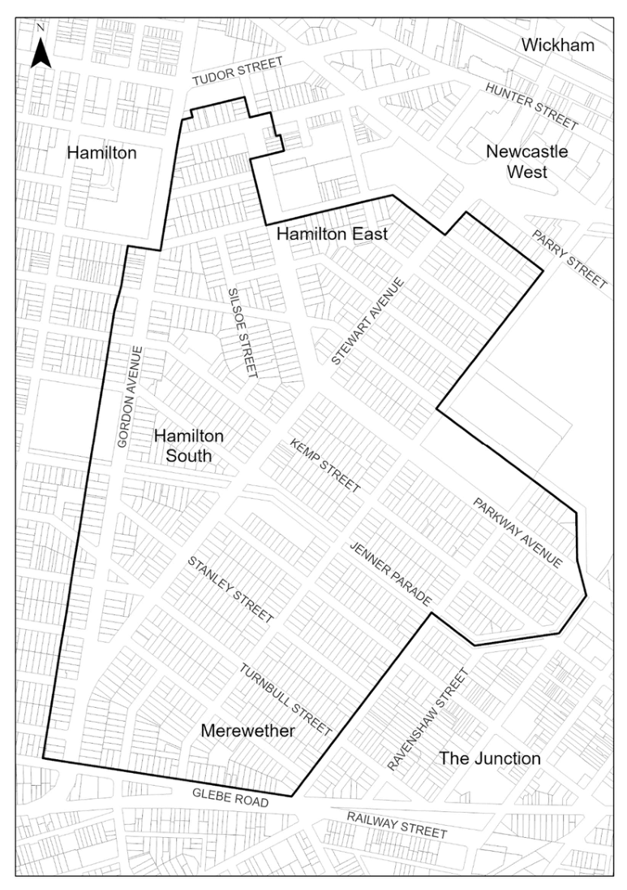

### 11.0 Hamilton South 'Garden Suburb' Heritage Conservation Area

This section applies to land within the Hamilton South 'Garden Suburb' Heritage Conservation Area as listed in Schedule 5 and mapped in LEP 2012- Heritage Maps (HER_004G). The heritage conservation area is in Hamilton East, Hamilton South and Merewether located between Denison Street, Everton Street and Warrah Street to the north, National Park Street, Jenner Parade and Smith Street to the east, Glebe Road to the south, and Gordon Avenue to the west.

It maps the area for controls provided in Section E1 Built and landscape heritage, and is to be read with that section and the heritage significance and desired future character statements of this section, to understand the heritage requirements.

> [Picture on page 18: a picture, saved as a picture (images/section-e2-heritage-conservation-areas-page-18-10.gif, 150 dpi).]

Map E2.06: Land application – Hamilton South 'Garden Suburb' Heritage Conservation Area

#### Key period of significance – circa 1913 to 1940

Hamilton South 'Garden Suburb' Heritage Conservation Area is significant to the local community with surviving evidence of an early 20th century subdivision pattern associated with the Australian Agricultural Company (AACo), and made up of single dwellings on large 'suburban' style allotments generally over 600 square metres. The character of the area and its streetscapes is representative of Federation and inter-war periods of Australian urban development. The style of housing - early 20th century Federation and Inter-war cottages and bungalows in the

popular styles of the time, Italianate, Queen Anne, Edwardian, and California and Spanish Mission influences. In particular, a large number of detached houses consistently and generously setback from the street in landscaped front gardens, with side driveways and vehicle accommodation located at the side or rear of the dwelling.

The precinct has associational significance with the eminent Australian architect and planner Sir John Sulman and as such its original form is important evidence of his work and ideas. The suburb is one of the earliest and largest examples of a planned garden suburb and as such is historically important. The evidence of Sulman’s original design is reflected in the road layout, allotment shape and pattern, and form of housing – single storey detached bungalow and cottage style houses, with a consistent palette of face brick and painted weatherboard houses.

The houses at 154 Gordon Street and 141 Gordan Avenue are significant to the suburb as they were used as "display" homes by the AACo to sell its Garden Suburb idea. Designed by notable architect F.G. Castleden, they were built to coincide with the release of the AACo's Hamilton estate, in 1914.
